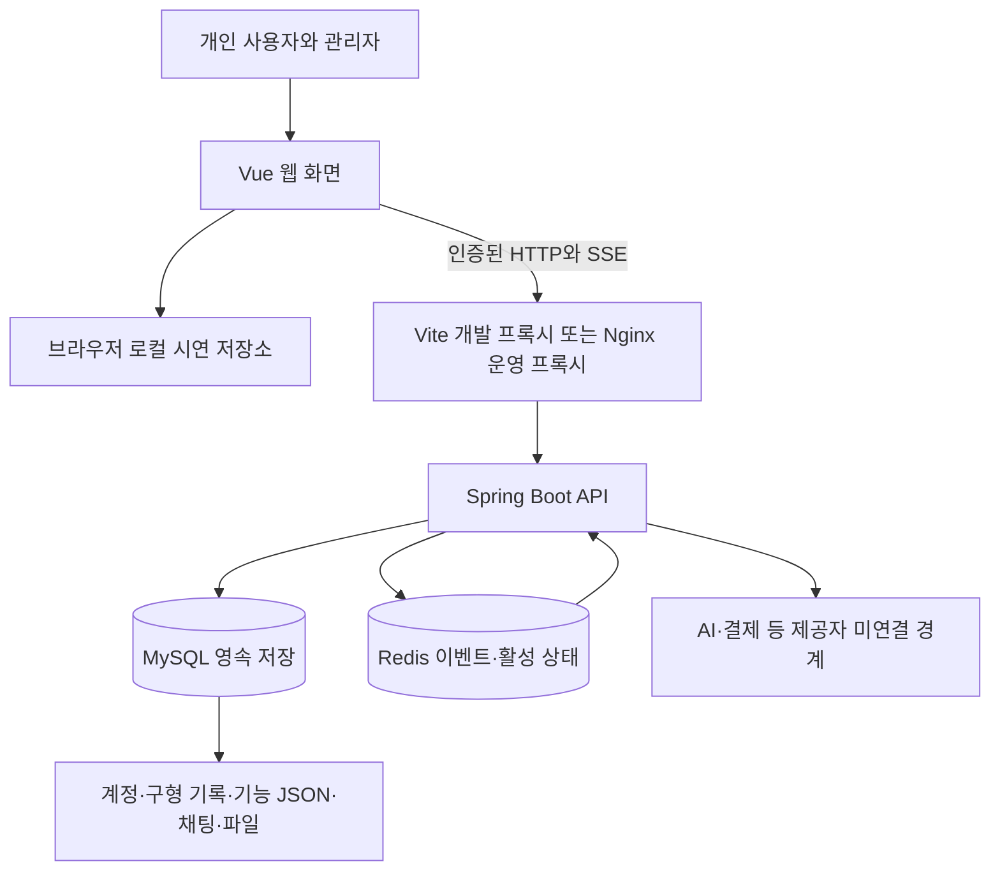
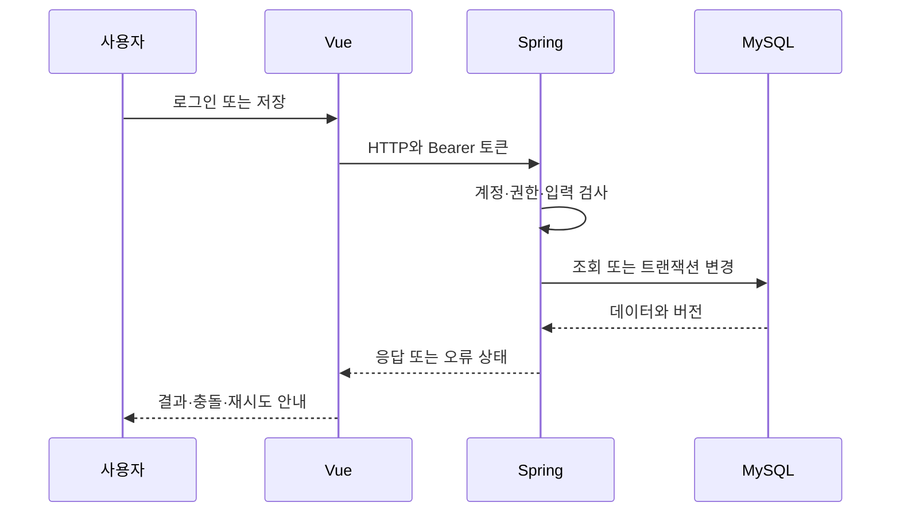

# 시스템 아키텍처와 기술 스택

작성일 2026-10-31. 수정일 2026-10-31. 시스템 구성도·시스템 아키텍처·기술 스택의 기준 문서는 이 파일 하나입니다. 현재 구현과 향후 AI 확장을 구분합니다.

## 목차

- [시스템 경계](#시스템-경계)
- [기술 스택](#기술-스택)
- [실제 요청과 데이터 흐름](#실제-요청과-데이터-흐름)
- [환경별 배치](#환경별-배치)
- [데이터와 보안 경계](#데이터와-보안-경계)
- [설계 결정과 확장](#설계-결정과-확장)

## 시스템 경계

로컬 저장과 서버 저장은 서로 다른 경로입니다. API가 구현되어 있어도 화면이 localStorage만 쓰면 계정·기기 간 데이터가 동기화되지 않습니다. 현재 구현을 완전한 서버 저장 서비스나 실결제 AI 서비스로 소개하지 않습니다.

## 기술 스택

| 영역 | 저장소 근거 | 역할·선택 이유와 한계 |
| --- | --- | --- |
| 웹 | Vue 3, Vue Router, Vite | 컴포넌트·라우팅·개발 프록시. JS 중심이며 TypeScript 전역 타입 검사 상태는 아님 |
| 모바일 | Capacitor 7 계열 | 웹 산출물 포장. 권한·알림·인증·결제·실기기 검수 별도 |
| 데스크톱 | Electron, electron-builder | 웹 UI 재사용. 설치·서명·OS별 검수 별도 |
| API | Java 17, Spring Boot 3.5.16 | HTTP·검증·보안·서비스·트랜잭션. Gradle Wrapper 사용 |
| 영속성 | JPA, Querydsl, JDBC | 엔티티·검색·신규 기능 저장. 모든 도메인이 같은 ORM 방식은 아님 |
| DB | MySQL 8.4, Flyway | 영속 저장·증분 migration. JPA는 validate |
| 실시간 | Redis 7.4, REST·SSE | 채팅 이벤트·입력 중·활성 상태. 장기 메시지는 MySQL |
| 인증 | Spring Security, JWT, 토큰 해시·auth_version | 사용자·역할·정지·무효화. sessionStorage는 XSS 비밀 저장소가 아님 |
| 관찰 | Log4j2, Actuator health | 기본 상태·오류 확인. 운영 지표·알림·SLO는 추가 실측 필요 |
| 배포 | Docker Compose, Nginx, Caddy, GitLab CI | 웹·API·DB·Redis와 선택 HTTPS. Pages는 정적 웹만 제공 |
| 문서 | Markdown, Mermaid, OpenAPI, Python | 수정 가능한 원문·계약 대조·DB 문서 생성 |

의존성 선언 범위와 실제 설치 버전을 구분합니다. 정확한 웹 의존성은 [잠금파일](../../frontend/package-lock.json), 서버 구성은 [build.gradle](../../backend/build.gradle), 도구 요구는 [로컬 실행 가이드](../handbook/source/01-로컬-실행-가이드.md)를 따릅니다.

## 실제 요청과 데이터 흐름

인증 클라이언트는 401에서 토큰 갱신 후 재시도합니다. 메뉴 숨김과 API 권한은 다르므로 서버에서도 검사합니다. SSE·파일·채팅 응답은 일반 JSON envelope와 다른 형식이 있을 수 있습니다.

채팅의 메시지·읽음·멘션·검색은 MySQL이 기준입니다. 순번·clientMessageId와 outbox를 사용하고 Redis 이벤트는 영속 메시지를 대체하지 않습니다. SSE 복귀 때 REST로 누락을 보정합니다. 상세는 [채팅 구조](../chat/architecture.md)에 있습니다.

구형 event·task·routine·planner와 신규 `feature_record`가 공존합니다. 신규 JSON은 FeatureType·서비스에서 소유자·필드·버전을 검사합니다. 대량 자료의 메모리 필터·집계와 DB 파일 저장은 측정·개선할 과제입니다. 물리 구조는 [현재 ERD·테이블 정의](../database/current-database.md)에 단일 관리합니다.

## 환경별 배치

| 환경 | 경로·포트 | 구분 |
| --- | --- | --- |
| 로컬 웹 | 127.0.0.1:5173 | 시연 데이터만으로 API 성공 판단 금지 |
| 격리 개발 | 웹 5173 → API 8080 → MySQL 13316·Redis 16389 | chat-local, 별도 개발 데이터 |
| 기본 API 개발 | API 8080 → 설정한 DB·Redis | DB 기본 예시는 localhost:3307/timeflow |
| Linux 개발·검증 | Nginx loopback 8088 → API·DB·Redis 내부망 | 운영과 다른 호스트·비밀값·볼륨 |
| Linux 운영 | Caddy 80/443 → Nginx → API → DB·Redis | DB·Redis·API 직접 공개 없음 |
| Pages | 정적 웹 → 별도 HTTPS API | Java·DB·Redis를 Pages가 실행하지 않음 |
| 설치형 앱 | Capacitor·Electron의 Vue → 별도 API | Vite 프록시가 없어 API 주소·CORS 검수 필요 |

명령은 [환경·서버 준비](../development/environments.md), [Linux 배포](../deployment/gitlab-cicd.md), [DB 환경](../database/environment.md)에 역할별로 둡니다. 구조 문서에 설치 절차 전체를 복제하지 않습니다.

## 데이터와 보안 경계

소유권은 인증된 계정을 기준으로 검사합니다. 업무·경력은 기본 개인 범위이며 공개 포트폴리오는 선택한 항목만 공유합니다. 파일의 소유자·그룹·만료를 검사하고 물리 FK와 서비스 권한의 책임을 구분합니다.

VITE_ 값은 브라우저 산출물에 공개되므로 DB·JWT·모델 비밀키를 넣지 않습니다. 운영 Nginx는 admin API·Actuator·Swagger를 외부 차단합니다. 운영자 접근은 별도 내부 경로와 서버 역할 검사를 모두 충족해야 합니다.

## 설계 결정과 확장

| 결정 | 현재 이유 | 재검토 조건 |
| --- | --- | --- |
| 단일 Spring·MySQL | 기존 인증·트랜잭션·운영 단순화 | 실제 병목·격리·팀 요구 확인 |
| 기능 JSON | 초기 기능별 계약과 허용 필드 검증 | 대량 집계·관계 무결성 요구 증가 |
| REST·SSE | 조회와 서버 이벤트 분리 | 연결 규모·양방향 요구 실측 |
| 전체 SHA 이미지 | 웹·API와 롤백 식별 | 독립 배포 단위·호환 매트릭스 필요 |
| AI 작업자 분리 제안 | 긴 작업·자료 처리·제공자 장애·비용 복구 | 실제 AI 개발 전 동의·원장·작업 검증 |

AI 서버·API·상태·비용·개인정보는 [AI 기술 설계](../product/ai-growth-2026-10-31/03-기술-설계와-구현-계획.md)에 단일 관리합니다. GPU·벡터 DB·모델 서버를 현재 운영 구성으로 표시하지 않습니다.

