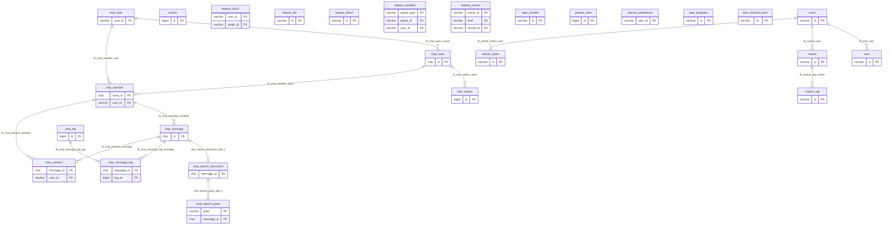

# 현재 데이터베이스 ERD와 테이블 정의서

작성일 2026-10-31. 수정일 2026-10-31. 상태는 현재 격리 개발 설치의 물리 스키마입니다.

MySQL 8.4.11의 `timeflow_chat_dev`에서 메타데이터만 읽었습니다. 사용자 데이터와 비밀값은 포함하지 않습니다. 총 28개 테이블 중 Flyway 이력 2개를 제외한 애플리케이션 테이블은 26개이며, 컬럼 205개와 물리 FK 15개를 확인했습니다.

운영 DB가 동일하다는 보장은 아닙니다. 기존 DB는 실제 Flyway 이력과 별도 비교합니다. 과거 V1의 37개 `tbl_*`와 40개 목표 설계는 이 문서의 현재 설치와 다릅니다. 현재 앱은 신규 기록 다수를 `feature_record`의 종류별 JSON으로 저장합니다.

## 목차

- [물리 ERD](#물리-erd)
- [논리 관계와 JSON 기록](#논리-관계와-json-기록)
- [테이블 목록](#테이블-목록)
- [테이블 정의](#테이블-정의)
- [마이그레이션과 재생성](#마이그레이션과-재생성)

## 물리 ERD

선은 실제 FK입니다. FK가 없는 사용자 참조는 서비스 권한 검사에 의존하며 아래 논리 관계와 구분합니다.



## 논리 관계와 JSON 기록

- `feature_record`의 PK는 `(owner_id, kind, record_id)`이며 `version`으로 충돌을 검사합니다. `payload`는 LONGTEXT이지만 서비스에서 JSON·종류·허용 필드·크기를 검증합니다. DB JSON 타입이나 FK가 자동으로 내용의 무결성을 보장하는 구조가 아닙니다.
- 신규 일정·다이어리·메모·업무·WBS·위키·경력·커뮤니티 등의 계약은 [최신 API 상세 명세](../api/frontend-backend-2026-10-10/specification.md)와 `FeatureType`을 따릅니다. 별도의 동명 물리 테이블이 있다고 가정하지 않습니다.
- `feature_member`의 공간과 `feature_record` 부모, 파일의 그룹, WBS·위키 부모와 공유는 서비스에서 같은 소유자·공간·활성 상태를 확인합니다.
- `users`와 `chat_user`는 인증 어댑터로 연결됩니다. Core 계정 ID의 UUID·ULID 호환과 채팅 V4의 폭 확장을 반영하며, 모든 ID가 무조건 26자리라고 가정하지 않습니다.
- `task.event_id` 문자열과 `events.id` BIGINT의 차이는 남아 있습니다. 연결 FK를 새로 그리거나 데이터를 강제 변환하지 않습니다.
- 구형 `events/routine/planner_item`과 신규 `SCHEDULE/ROUTINE_RECORD`를 동시에 쓰면 중복될 수 있습니다. 새 화면 연결은 사용할 계약을 먼저 선택합니다.

## 테이블 목록

| 테이블 | 역할 |
| --- | --- |
| [chat_member](#chat-member) | 대화방 참여·탈퇴와 읽음 위치 |
| [chat_mention](#chat-mention) | 메시지의 사용자 멘션과 읽음 상태 |
| [chat_message](#chat-message) | 영속 메시지와 재전송 중복 방지 |
| [chat_message_tag](#chat-message-tag) | 메시지와 태그의 연결 |
| [chat_outbox](#chat-outbox) | 커밋 후 실시간 이벤트 재전파 작업 |
| [chat_room](#chat-room) | DM·그룹 대화방과 방별 순번 |
| [chat_search_document](#chat-search-document) | 메시지 검색용 정규화 문서 |
| [chat_search_gram](#chat-search-gram) | 부분 검색용 검색 조각 색인 |
| [chat_tag](#chat-tag) | 채팅 해시태그 사전 |
| [chat_user](#chat-user) | 통합 계정과 연결되는 채팅 사용자 표시 정보 |
| [events](#events) | 구형 일정과 물리화한 반복 회차 |
| [feature_block](#feature-block) | 사용자별 차단 관계 |
| [feature_file](#feature-file) | 첨부 파일의 실제 바이트·소유권·보관 기한 |
| [feature_friend](#feature-friend) | 친구 요청과 정규화한 사용자 쌍 |
| [feature_member](#feature-member) | 공유 그룹·커뮤니티 참여자와 권한·상태 |
| [feature_record](#feature-record) | 허용된 종류별 개인·공용 기능 JSON 기록 |
| [flyway_chat_history](#flyway-chat-history) | 채팅 전용 마이그레이션 이력 |
| [flyway_schema_history](#flyway-schema-history) | Core·workspace 마이그레이션 이력 |
| [login_throttle](#login-throttle) | 로그인 시도 제한과 잠금 상태 |
| [planner_item](#planner-item) | 사용자 소유의 구형 수동 플래너 항목 |
| [planner_preference](#planner-preference) | 사용자별 기본 플래너 보기 |
| [refresh_token](#refresh-token) | 해시된 갱신 토큰과 폐기·만료 이력 |
| [routine](#routine) | 구형 루틴 정의 |
| [routine_log](#routine-log) | 루틴의 날짜별 수행 상태 |
| [task](#task) | 구형 할 일과 분류 스냅샷 |
| [task_assignee](#task-assignee) | 할 일별 담당자 후보 |
| [task_checklist_item](#task-checklist-item) | 할 일 체크리스트와 담당자·낙관적 버전 |
| [users](#users) | 통합 사용자 계정과 인증 무효화 버전 |

## 테이블 정의

NULL 허용은 DB 정의이며 API의 필수 입력과 다를 수 있습니다. 기본값 NULL과 값 없음의 차이는 `SHOW CREATE TABLE` 및 실제 마이그레이션으로 최종 확인합니다. 시각의 문자열 저장과 구형 축약 필드는 현재 구조를 그대로 기록한 것이며 신규 표준을 뜻하지 않습니다.

<a id="chat-member"></a>
### `chat_member`

대화방 참여·탈퇴와 읽음 위치.

엔진 `InnoDB`, 비교 규칙 `utf8mb4_unicode_ci`입니다.

| 컬럼 | DB 타입 | NULL 허용 | 기본값 | 키·추가 속성 | 의미 |
| --- | --- | --- | --- | --- | --- |
| `room_id` | char(26) | NO | NULL | PRI | 대화방 식별자 |
| `user_id` | varchar(36) | NO | NULL | PRI | 사용자 식별자 |
| `last_read_sequence` | bigint | NO | 0 | 없음 | 사용자가 읽은 마지막 방 순번 |
| `joined_at` | datetime(6) | NO | CURRENT_TIMESTAMP(6) | DEFAULT_GENERATED | 입장 시각 |
| `left_at` | datetime(6) | YES | NULL | 없음 | 탈퇴 시각 |

인덱스와 제약은 다음과 같습니다.

- `ix_chat_member_user`. 일반 인덱스 `(user_id, left_at, room_id)`.
- `PRIMARY`. 고유 인덱스 `(room_id, user_id)`.
- `fk_chat_member_room`. `(room_id)` → `chat_room(id)`. DELETE `NO ACTION`, UPDATE `NO ACTION`.
- `fk_chat_member_user`. `(user_id)` → `chat_user(user_id)`. DELETE `NO ACTION`, UPDATE `NO ACTION`.
- `ck_chat_member_read`. CHECK `(`last_read_sequence` >= 0)`.

<a id="chat-mention"></a>
### `chat_mention`

메시지의 사용자 멘션과 읽음 상태.

엔진 `InnoDB`, 비교 규칙 `utf8mb4_unicode_ci`입니다.

| 컬럼 | DB 타입 | NULL 허용 | 기본값 | 키·추가 속성 | 의미 |
| --- | --- | --- | --- | --- | --- |
| `room_id` | char(26) | NO | NULL | MUL | 대화방 식별자 |
| `message_id` | char(26) | NO | NULL | PRI | 메시지 식별자 |
| `user_id` | varchar(36) | NO | NULL | PRI | 사용자 식별자 |
| `read_at` | datetime(6) | YES | NULL | 없음 | 멘션 읽음 시각 |
| `created_at` | datetime(6) | NO | CURRENT_TIMESTAMP(6) | DEFAULT_GENERATED | 생성 시각. 실제 저장 타입·API 시간대 규칙 확인 |

인덱스와 제약은 다음과 같습니다.

- `ix_chat_mention_inbox`. 일반 인덱스 `(user_id, read_at, message_id)`.
- `ix_chat_mention_member`. 일반 인덱스 `(room_id, user_id)`.
- `ix_chat_mention_message`. 일반 인덱스 `(room_id, message_id)`.
- `PRIMARY`. 고유 인덱스 `(message_id, user_id)`.
- `fk_chat_mention_member`. `(room_id, user_id)` → `chat_member(room_id, user_id)`. DELETE `NO ACTION`, UPDATE `NO ACTION`.
- `fk_chat_mention_message`. `(room_id, message_id)` → `chat_message(room_id, id)`. DELETE `NO ACTION`, UPDATE `NO ACTION`.

<a id="chat-message"></a>
### `chat_message`

영속 메시지와 재전송 중복 방지.

엔진 `InnoDB`, 비교 규칙 `utf8mb4_unicode_ci`입니다.

| 컬럼 | DB 타입 | NULL 허용 | 기본값 | 키·추가 속성 | 의미 |
| --- | --- | --- | --- | --- | --- |
| `id` | char(26) | NO | NULL | PRI | 행 식별자 |
| `room_id` | char(26) | NO | NULL | MUL | 대화방 식별자 |
| `sequence_no` | bigint | NO | NULL | 없음 | 방 안의 메시지 순번 |
| `sender_id` | varchar(36) | NO | NULL | 없음 | 보낸 사용자 식별자 |
| `client_message_id` | char(36) | NO | NULL | 없음 | 클라이언트 재전송 멱등 식별자 |
| `body` | varchar(4000) | NO | NULL | 없음 | 본문 |
| `created_at` | datetime(6) | NO | CURRENT_TIMESTAMP(6) | DEFAULT_GENERATED | 생성 시각. 실제 저장 타입·API 시간대 규칙 확인 |

인덱스와 제약은 다음과 같습니다.

- `PRIMARY`. 고유 인덱스 `(id)`.
- `uk_chat_message_retry`. 고유 인덱스 `(room_id, sender_id, client_message_id)`.
- `uk_chat_message_room_id`. 고유 인덱스 `(room_id, id)`.
- `uk_chat_message_sequence`. 고유 인덱스 `(room_id, sequence_no)`.
- `fk_chat_message_member`. `(room_id, sender_id)` → `chat_member(room_id, user_id)`. DELETE `NO ACTION`, UPDATE `NO ACTION`.
- `ck_chat_message_body`. CHECK `(char_length(trim(`body`)) between 1 and 4000)`.
- `ck_chat_message_sequence`. CHECK `(`sequence_no` > 0)`.

<a id="chat-message-tag"></a>
### `chat_message_tag`

메시지와 태그의 연결.

엔진 `InnoDB`, 비교 규칙 `utf8mb4_unicode_ci`입니다.

| 컬럼 | DB 타입 | NULL 허용 | 기본값 | 키·추가 속성 | 의미 |
| --- | --- | --- | --- | --- | --- |
| `message_id` | char(26) | NO | NULL | PRI | 메시지 식별자 |
| `tag_id` | bigint | NO | NULL | PRI | 태그 식별자 |

인덱스와 제약은 다음과 같습니다.

- `ix_chat_message_tag_filter`. 일반 인덱스 `(tag_id, message_id)`.
- `PRIMARY`. 고유 인덱스 `(message_id, tag_id)`.
- `fk_chat_message_tag_message`. `(message_id)` → `chat_message(id)`. DELETE `NO ACTION`, UPDATE `NO ACTION`.
- `fk_chat_message_tag_tag`. `(tag_id)` → `chat_tag(id)`. DELETE `NO ACTION`, UPDATE `NO ACTION`.

<a id="chat-outbox"></a>
### `chat_outbox`

커밋 후 실시간 이벤트 재전파 작업.

엔진 `InnoDB`, 비교 규칙 `utf8mb4_unicode_ci`입니다.

| 컬럼 | DB 타입 | NULL 허용 | 기본값 | 키·추가 속성 | 의미 |
| --- | --- | --- | --- | --- | --- |
| `id` | bigint | NO | NULL | PRI auto_increment | 행 식별자 |
| `room_id` | char(26) | NO | NULL | MUL | 대화방 식별자 |
| `event_type` | varchar(16) | NO | NULL | 없음 | 전파 이벤트 종류 |
| `attempts` | int | NO | 0 | 없음 | 전파 시도 횟수 |
| `available_at` | datetime(6) | NO | CURRENT_TIMESTAMP(6) | DEFAULT_GENERATED | 다음 실행 가능 시각 |
| `published_at` | datetime(6) | YES | NULL | MUL | 전파 완료 시각 |
| `created_at` | datetime(6) | NO | CURRENT_TIMESTAMP(6) | DEFAULT_GENERATED | 생성 시각. 실제 저장 타입·API 시간대 규칙 확인 |

인덱스와 제약은 다음과 같습니다.

- `ix_chat_outbox_pending`. 일반 인덱스 `(published_at, available_at, id)`.
- `ix_chat_outbox_room`. 일반 인덱스 `(room_id)`.
- `PRIMARY`. 고유 인덱스 `(id)`.
- `fk_chat_outbox_room`. `(room_id)` → `chat_room(id)`. DELETE `NO ACTION`, UPDATE `NO ACTION`.
- `ck_chat_outbox_attempts`. CHECK `(`attempts` >= 0)`.

<a id="chat-room"></a>
### `chat_room`

DM·그룹 대화방과 방별 순번.

엔진 `InnoDB`, 비교 규칙 `utf8mb4_unicode_ci`입니다.

| 컬럼 | DB 타입 | NULL 허용 | 기본값 | 키·추가 속성 | 의미 |
| --- | --- | --- | --- | --- | --- |
| `id` | char(26) | NO | NULL | PRI | 행 식별자 |
| `kind` | varchar(8) | NO | NULL | 없음 | 기능 기록 또는 방 종류 |
| `name` | varchar(80) | YES | NULL | 없음 | 표시 이름 |
| `owner_id` | varchar(36) | NO | NULL | MUL | 소유자 식별자 |
| `direct_key` | varchar(73) | YES | NULL | UNI | DM 사용자 쌍의 중복 방지 키 |
| `last_sequence` | bigint | NO | 0 | 없음 | 방의 마지막 메시지 순번 |
| `created_at` | datetime(6) | NO | CURRENT_TIMESTAMP(6) | DEFAULT_GENERATED | 생성 시각. 실제 저장 타입·API 시간대 규칙 확인 |
| `updated_at` | datetime(6) | NO | CURRENT_TIMESTAMP(6) | DEFAULT_GENERATED | 수정 시각. 실제 저장 타입·API 시간대 규칙 확인 |

인덱스와 제약은 다음과 같습니다.

- `ix_chat_room_owner`. 일반 인덱스 `(owner_id)`.
- `PRIMARY`. 고유 인덱스 `(id)`.
- `uk_chat_direct`. 고유 인덱스 `(direct_key)`.
- `fk_chat_room_owner`. `(owner_id)` → `chat_user(user_id)`. DELETE `NO ACTION`, UPDATE `NO ACTION`.
- `ck_chat_room_kind`. CHECK `(((`kind` = _utf8mb4\'DM\') and (`direct_key` is not null)) or ((`kind` = _utf8mb4\'GROUP\') and (`direct_key` is null) and (`name` is not null)))`.
- `ck_chat_room_sequence`. CHECK `(`last_sequence` >= 0)`.

<a id="chat-search-document"></a>
### `chat_search_document`

메시지 검색용 정규화 문서.

엔진 `InnoDB`, 비교 규칙 `utf8mb4_0900_ai_ci`입니다.

| 컬럼 | DB 타입 | NULL 허용 | 기본값 | 키·추가 속성 | 의미 |
| --- | --- | --- | --- | --- | --- |
| `message_id` | char(26) | NO | NULL | PRI | 메시지 식별자 |
| `normalized_body` | mediumtext | NO | NULL | 없음 | 검색용 정규화 본문 |

인덱스와 제약은 다음과 같습니다.

- `PRIMARY`. 고유 인덱스 `(message_id)`.
- `chat_search_document_ibfk_1`. `(message_id)` → `chat_message(id)`. DELETE `CASCADE`, UPDATE `NO ACTION`.

<a id="chat-search-gram"></a>
### `chat_search_gram`

부분 검색용 검색 조각 색인.

엔진 `InnoDB`, 비교 규칙 `utf8mb4_0900_ai_ci`입니다.

| 컬럼 | DB 타입 | NULL 허용 | 기본값 | 키·추가 속성 | 의미 |
| --- | --- | --- | --- | --- | --- |
| `gram` | varchar(3) | NO | NULL | PRI | 부분 검색용 조각 |
| `message_id` | char(26) | NO | NULL | PRI | 메시지 식별자 |

인덱스와 제약은 다음과 같습니다.

- `idx_chat_search_message`. 일반 인덱스 `(message_id)`.
- `PRIMARY`. 고유 인덱스 `(gram, message_id)`.
- `chat_search_gram_ibfk_1`. `(message_id)` → `chat_search_document(message_id)`. DELETE `CASCADE`, UPDATE `NO ACTION`.

<a id="chat-tag"></a>
### `chat_tag`

채팅 해시태그 사전.

엔진 `InnoDB`, 비교 규칙 `utf8mb4_unicode_ci`입니다.

| 컬럼 | DB 타입 | NULL 허용 | 기본값 | 키·추가 속성 | 의미 |
| --- | --- | --- | --- | --- | --- |
| `id` | bigint | NO | NULL | PRI auto_increment | 행 식별자 |
| `name` | varchar(32) | NO | NULL | UNI | 표시 이름 |

인덱스와 제약은 다음과 같습니다.

- `PRIMARY`. 고유 인덱스 `(id)`.
- `uk_chat_tag_name`. 고유 인덱스 `(name)`.
- `ck_chat_tag_name`. CHECK `(char_length(`name`) between 1 and 32)`.

<a id="chat-user"></a>
### `chat_user`

통합 계정과 연결되는 채팅 사용자 표시 정보.

엔진 `InnoDB`, 비교 규칙 `utf8mb4_unicode_ci`입니다.

| 컬럼 | DB 타입 | NULL 허용 | 기본값 | 키·추가 속성 | 의미 |
| --- | --- | --- | --- | --- | --- |
| `user_id` | varchar(36) | NO | NULL | PRI | 사용자 식별자 |
| `nickname` | varchar(80) | NO | NULL | 없음 | 채팅 표시 닉네임 |
| `updated_at` | datetime(6) | NO | CURRENT_TIMESTAMP(6) | DEFAULT_GENERATED | 수정 시각. 실제 저장 타입·API 시간대 규칙 확인 |

인덱스와 제약은 다음과 같습니다.

- `PRIMARY`. 고유 인덱스 `(user_id)`.

<a id="events"></a>
### `events`

구형 일정과 물리화한 반복 회차.

엔진 `InnoDB`, 비교 규칙 `utf8mb4_unicode_ci`입니다.

| 컬럼 | DB 타입 | NULL 허용 | 기본값 | 키·추가 속성 | 의미 |
| --- | --- | --- | --- | --- | --- |
| `id` | bigint | NO | NULL | PRI auto_increment | 행 식별자 |
| `user_id` | varchar(36) | NO | NULL | MUL | 사용자 식별자 |
| `title` | varchar(255) | NO | NULL | 없음 | 제목 |
| `category` | varchar(255) | YES | NULL | 없음 | 분류 표시값 |
| `date` | date | NO | NULL | 없음 | 업무 기준 날짜 |
| `start_time` | time | YES | NULL | 없음 | 현지 시작 시각 |
| `end_time` | time | YES | NULL | 없음 | 현지 종료 시각 |
| `location` | varchar(255) | YES | NULL | 없음 | 장소 |
| `visibility` | varchar(20) | YES | NULL | 없음 | 공개 범위 |
| `note` | varchar(1000) | YES | NULL | 없음 | 비고·설명 |
| `series_id` | bigint | YES | NULL | MUL | 구형 반복 시리즈 식별자 |
| `created_at` | datetime(6) | NO | NULL | 없음 | 생성 시각. 실제 저장 타입·API 시간대 규칙 확인 |
| `updated_at` | datetime(6) | NO | NULL | 없음 | 수정 시각. 실제 저장 타입·API 시간대 규칙 확인 |

인덱스와 제약은 다음과 같습니다.

- `ix_events_series_date`. 일반 인덱스 `(series_id, date)`.
- `ix_events_user_date`. 일반 인덱스 `(user_id, date)`.
- `PRIMARY`. 고유 인덱스 `(id)`.

<a id="feature-block"></a>
### `feature_block`

사용자별 차단 관계.

엔진 `InnoDB`, 비교 규칙 `utf8mb4_0900_ai_ci`입니다.

| 컬럼 | DB 타입 | NULL 허용 | 기본값 | 키·추가 속성 | 의미 |
| --- | --- | --- | --- | --- | --- |
| `user_id` | varchar(36) | NO | NULL | PRI | 사용자 식별자 |
| `target_id` | varchar(36) | NO | NULL | PRI | 차단 대상 사용자 식별자 |

인덱스와 제약은 다음과 같습니다.

- `PRIMARY`. 고유 인덱스 `(user_id, target_id)`.

<a id="feature-file"></a>
### `feature_file`

첨부 파일의 실제 바이트·소유권·보관 기한.

엔진 `InnoDB`, 비교 규칙 `utf8mb4_0900_ai_ci`입니다.

| 컬럼 | DB 타입 | NULL 허용 | 기본값 | 키·추가 속성 | 의미 |
| --- | --- | --- | --- | --- | --- |
| `id` | varchar(26) | NO | NULL | PRI | 행 식별자 |
| `owner_id` | varchar(36) | NO | NULL | MUL | 소유자 식별자 |
| `group_id` | varchar(26) | YES | NULL | MUL | 공유 그룹 식별자 |
| `name` | varchar(200) | NO | NULL | 없음 | 표시 이름 |
| `size_bytes` | int | NO | NULL | 없음 | 파일 바이트 크기 |
| `content` | mediumblob | NO | NULL | 없음 | 첨부 파일 바이트 |
| `expires_at` | varchar(40) | YES | NULL | 없음 | 보관 만료 시각 |
| `created_at` | varchar(40) | NO | NULL | 없음 | 생성 시각. 실제 저장 타입·API 시간대 규칙 확인 |

인덱스와 제약은 다음과 같습니다.

- `ix_feature_file_group`. 일반 인덱스 `(group_id, created_at)`.
- `ix_feature_file_owner`. 일반 인덱스 `(owner_id, created_at)`.
- `PRIMARY`. 고유 인덱스 `(id)`.

<a id="feature-friend"></a>
### `feature_friend`

친구 요청과 정규화한 사용자 쌍.

엔진 `InnoDB`, 비교 규칙 `utf8mb4_0900_ai_ci`입니다.

| 컬럼 | DB 타입 | NULL 허용 | 기본값 | 키·추가 속성 | 의미 |
| --- | --- | --- | --- | --- | --- |
| `id` | varchar(26) | NO | NULL | PRI | 행 식별자 |
| `pair_key` | varchar(80) | NO | NULL | UNI | 중복 친구 쌍 방지 키 |
| `sender_id` | varchar(36) | NO | NULL | 없음 | 보낸 사용자 식별자 |
| `recipient_id` | varchar(36) | NO | NULL | 없음 | 받는 사용자 식별자 |
| `status` | varchar(20) | NO | NULL | 없음 | 처리·참여 상태 |
| `created_at` | varchar(40) | NO | NULL | 없음 | 생성 시각. 실제 저장 타입·API 시간대 규칙 확인 |

인덱스와 제약은 다음과 같습니다.

- `pair_key`. 고유 인덱스 `(pair_key)`.
- `PRIMARY`. 고유 인덱스 `(id)`.

<a id="feature-member"></a>
### `feature_member`

공유 그룹·커뮤니티 참여자와 권한·상태.

엔진 `InnoDB`, 비교 규칙 `utf8mb4_0900_ai_ci`입니다.

| 컬럼 | DB 타입 | NULL 허용 | 기본값 | 키·추가 속성 | 의미 |
| --- | --- | --- | --- | --- | --- |
| `space_type` | varchar(20) | NO | NULL | PRI | 그룹·커뮤니티 구분 |
| `space_id` | varchar(100) | NO | NULL | PRI | 참여 공간 식별자 |
| `user_id` | varchar(36) | NO | NULL | PRI | 사용자 식별자 |
| `role` | varchar(20) | NO | NULL | 없음 | 권한 또는 참여 역할 |
| `status` | varchar(20) | NO | NULL | 없음 | 처리·참여 상태 |
| `message` | varchar(2000) | NO |  | 없음 | 참여 요청 메시지 |
| `updated_at` | varchar(40) | NO | NULL | 없음 | 수정 시각. 실제 저장 타입·API 시간대 규칙 확인 |

인덱스와 제약은 다음과 같습니다.

- `ix_feature_member_user`. 일반 인덱스 `(user_id, status)`.
- `PRIMARY`. 고유 인덱스 `(space_type, space_id, user_id)`.

<a id="feature-record"></a>
### `feature_record`

허용된 종류별 개인·공용 기능 JSON 기록.

엔진 `InnoDB`, 비교 규칙 `utf8mb4_0900_ai_ci`입니다.

| 컬럼 | DB 타입 | NULL 허용 | 기본값 | 키·추가 속성 | 의미 |
| --- | --- | --- | --- | --- | --- |
| `owner_id` | varchar(36) | NO | NULL | PRI | 소유자 식별자 |
| `kind` | varchar(40) | NO | NULL | PRI | 기능 기록 또는 방 종류 |
| `record_id` | varchar(100) | NO | NULL | PRI | 기능 종류 안의 기록 식별자 |
| `payload` | longtext | NO | NULL | 없음 | FeatureType 허용 필드를 검증한 JSON 본문 |
| `version` | bigint | NO | 1 | 없음 | 수정 충돌 검사 버전 |
| `created_at` | varchar(40) | NO | NULL | 없음 | 생성 시각. 실제 저장 타입·API 시간대 규칙 확인 |
| `updated_at` | varchar(40) | NO | NULL | 없음 | 수정 시각. 실제 저장 타입·API 시간대 규칙 확인 |

인덱스와 제약은 다음과 같습니다.

- `ix_feature_kind`. 일반 인덱스 `(kind, created_at)`.
- `PRIMARY`. 고유 인덱스 `(owner_id, kind, record_id)`.

<a id="flyway-chat-history"></a>
### `flyway_chat_history`

채팅 전용 마이그레이션 이력.

엔진 `InnoDB`, 비교 규칙 `utf8mb4_0900_ai_ci`입니다.

| 컬럼 | DB 타입 | NULL 허용 | 기본값 | 키·추가 속성 | 의미 |
| --- | --- | --- | --- | --- | --- |
| `installed_rank` | int | NO | NULL | PRI | Flyway 적용 순번 |
| `version` | varchar(50) | YES | NULL | 없음 | 수정 충돌 검사 버전 |
| `description` | varchar(200) | NO | NULL | 없음 | 마이그레이션 설명 |
| `type` | varchar(20) | NO | NULL | 없음 | 항목 종류 |
| `script` | varchar(1000) | NO | NULL | 없음 | 마이그레이션 스크립트 이름 |
| `checksum` | int | YES | NULL | 없음 | Flyway 체크섬 |
| `installed_by` | varchar(100) | NO | NULL | 없음 | 적용 DB 계정 |
| `installed_on` | timestamp | NO | CURRENT_TIMESTAMP | DEFAULT_GENERATED | 적용 시각 |
| `execution_time` | int | NO | NULL | 없음 | 적용 소요 밀리초 |
| `success` | tinyint(1) | NO | NULL | MUL | 적용 성공 여부 |

인덱스와 제약은 다음과 같습니다.

- `flyway_chat_history_s_idx`. 일반 인덱스 `(success)`.
- `PRIMARY`. 고유 인덱스 `(installed_rank)`.

<a id="flyway-schema-history"></a>
### `flyway_schema_history`

Core·workspace 마이그레이션 이력.

엔진 `InnoDB`, 비교 규칙 `utf8mb4_0900_ai_ci`입니다.

| 컬럼 | DB 타입 | NULL 허용 | 기본값 | 키·추가 속성 | 의미 |
| --- | --- | --- | --- | --- | --- |
| `installed_rank` | int | NO | NULL | PRI | Flyway 적용 순번 |
| `version` | varchar(50) | YES | NULL | 없음 | 수정 충돌 검사 버전 |
| `description` | varchar(200) | NO | NULL | 없음 | 마이그레이션 설명 |
| `type` | varchar(20) | NO | NULL | 없음 | 항목 종류 |
| `script` | varchar(1000) | NO | NULL | 없음 | 마이그레이션 스크립트 이름 |
| `checksum` | int | YES | NULL | 없음 | Flyway 체크섬 |
| `installed_by` | varchar(100) | NO | NULL | 없음 | 적용 DB 계정 |
| `installed_on` | timestamp | NO | CURRENT_TIMESTAMP | DEFAULT_GENERATED | 적용 시각 |
| `execution_time` | int | NO | NULL | 없음 | 적용 소요 밀리초 |
| `success` | tinyint(1) | NO | NULL | MUL | 적용 성공 여부 |

인덱스와 제약은 다음과 같습니다.

- `flyway_schema_history_s_idx`. 일반 인덱스 `(success)`.
- `PRIMARY`. 고유 인덱스 `(installed_rank)`.

<a id="login-throttle"></a>
### `login_throttle`

로그인 시도 제한과 잠금 상태.

엔진 `InnoDB`, 비교 규칙 `utf8mb4_unicode_ci`입니다.

| 컬럼 | DB 타입 | NULL 허용 | 기본값 | 키·추가 속성 | 의미 |
| --- | --- | --- | --- | --- | --- |
| `id` | varchar(26) | NO | NULL | PRI | 행 식별자 |
| `key_type` | varchar(10) | NO | NULL | MUL | 로그인 제한 키의 종류 |
| `key_val` | varchar(255) | NO | NULL | 없음 | 로그인 제한 키 값 |
| `fail_cnt` | int | NO | 0 | 없음 | 실패 횟수 |
| `lock_utc` | datetime(6) | YES | NULL | 없음 | 잠금 종료 UTC 시각 |
| `last_fail_utc` | datetime(6) | YES | NULL | 없음 | 마지막 실패 UTC 시각 |
| `u_at` | datetime(6) | NO | NULL | 없음 | 수정 UTC 시각 |

인덱스와 제약은 다음과 같습니다.

- `PRIMARY`. 고유 인덱스 `(id)`.
- `uk_login_throttle_key`. 고유 인덱스 `(key_type, key_val)`.

<a id="planner-item"></a>
### `planner_item`

사용자 소유의 구형 수동 플래너 항목.

엔진 `InnoDB`, 비교 규칙 `utf8mb4_unicode_ci`입니다.

| 컬럼 | DB 타입 | NULL 허용 | 기본값 | 키·추가 속성 | 의미 |
| --- | --- | --- | --- | --- | --- |
| `id` | bigint | NO | NULL | PRI auto_increment | 행 식별자 |
| `type` | varchar(20) | NO | NULL | 없음 | 항목 종류 |
| `title` | varchar(255) | NO | NULL | 없음 | 제목 |
| `category` | varchar(255) | YES | NULL | 없음 | 분류 표시값 |
| `date` | date | YES | NULL | MUL | 업무 기준 날짜 |
| `start_time` | time | YES | NULL | 없음 | 현지 시작 시각 |
| `end_time` | time | YES | NULL | 없음 | 현지 종료 시각 |
| `status` | varchar(20) | YES | NULL | 없음 | 처리·참여 상태 |
| `dday` | tinyint(1) | NO | 0 | 없음 | D-Day 표시 여부 |
| `note` | varchar(255) | YES | NULL | 없음 | 비고·설명 |
| `created_at` | datetime(6) | NO | NULL | 없음 | 생성 시각. 실제 저장 타입·API 시간대 규칙 확인 |
| `updated_at` | datetime(6) | NO | NULL | 없음 | 수정 시각. 실제 저장 타입·API 시간대 규칙 확인 |
| `user_id` | varchar(36) | YES | NULL | MUL | 사용자 식별자 |

인덱스와 제약은 다음과 같습니다.

- `ix_planner_item_date_type`. 일반 인덱스 `(date, type)`.
- `ix_planner_item_user_date`. 일반 인덱스 `(user_id, date)`.
- `PRIMARY`. 고유 인덱스 `(id)`.

<a id="planner-preference"></a>
### `planner_preference`

사용자별 기본 플래너 보기.

엔진 `InnoDB`, 비교 규칙 `utf8mb4_unicode_ci`입니다.

| 컬럼 | DB 타입 | NULL 허용 | 기본값 | 키·추가 속성 | 의미 |
| --- | --- | --- | --- | --- | --- |
| `user_id` | varchar(36) | NO | NULL | PRI | 사용자 식별자 |
| `default_view` | varchar(10) | NO | NULL | 없음 | 기본 플래너 보기 |
| `version` | bigint | NO | 0 | 없음 | 수정 충돌 검사 버전 |
| `created_at` | datetime(6) | NO | NULL | 없음 | 생성 시각. 실제 저장 타입·API 시간대 규칙 확인 |
| `updated_at` | datetime(6) | NO | NULL | 없음 | 수정 시각. 실제 저장 타입·API 시간대 규칙 확인 |

인덱스와 제약은 다음과 같습니다.

- `PRIMARY`. 고유 인덱스 `(user_id)`.

<a id="refresh-token"></a>
### `refresh_token`

해시된 갱신 토큰과 폐기·만료 이력.

엔진 `InnoDB`, 비교 규칙 `utf8mb4_unicode_ci`입니다.

| 컬럼 | DB 타입 | NULL 허용 | 기본값 | 키·추가 속성 | 의미 |
| --- | --- | --- | --- | --- | --- |
| `id` | varchar(26) | NO | NULL | PRI | 행 식별자 |
| `user_id` | varchar(36) | NO | NULL | MUL | 사용자 식별자 |
| `device_id` | varchar(128) | YES | NULL | 없음 | 기기 식별자 |
| `tok_hash` | varchar(255) | NO | NULL | UNI | 갱신 토큰 해시 |
| `jti` | varchar(36) | YES | NULL | 없음 | 토큰 고유 식별자 |
| `exp_utc` | datetime(6) | NO | NULL | 없음 | 만료 UTC 시각 |
| `rev_utc` | datetime(6) | YES | NULL | 없음 | 폐기 UTC 시각 |
| `last_used_utc` | datetime(6) | YES | NULL | 없음 | 마지막 사용 UTC 시각 |
| `c_at` | datetime(6) | NO | NULL | 없음 | 생성 UTC 시각 |

인덱스와 제약은 다음과 같습니다.

- `ix_refresh_token_user`. 일반 인덱스 `(user_id, rev_utc, exp_utc)`.
- `PRIMARY`. 고유 인덱스 `(id)`.
- `uk_refresh_token_hash`. 고유 인덱스 `(tok_hash)`.
- `fk_refresh_token_user`. `(user_id)` → `users(id)`. DELETE `NO ACTION`, UPDATE `NO ACTION`.

<a id="routine"></a>
### `routine`

구형 루틴 정의.

엔진 `InnoDB`, 비교 규칙 `utf8mb4_unicode_ci`입니다.

| 컬럼 | DB 타입 | NULL 허용 | 기본값 | 키·추가 속성 | 의미 |
| --- | --- | --- | --- | --- | --- |
| `id` | varchar(26) | NO | NULL | PRI | 행 식별자 |
| `user_id` | varchar(36) | NO | NULL | MUL | 사용자 식별자 |
| `name` | varchar(200) | NO | NULL | 없음 | 표시 이름 |
| `icon` | varchar(16) | YES | NULL | 없음 | 아이콘 표시값 |
| `cat_id` | varchar(26) | YES | NULL | 없음 | 분류 식별자 |
| `cat_name` | varchar(60) | YES | NULL | 없음 | 분류 이름 스냅샷 |
| `cat_color` | varchar(7) | YES | NULL | 없음 | 분류 색상 스냅샷 |
| `cat_icon` | varchar(16) | YES | NULL | 없음 | 분류 아이콘 스냅샷 |
| `at_time` | varchar(5) | NO | NULL | 없음 | 루틴 시각 문자열 |
| `days` | varchar(32) | NO | NULL | 없음 | 수행 요일 문자열 |
| `onoff` | tinyint(1) | NO | 1 | 없음 | 활성 여부 |
| `notify` | tinyint(1) | NO | 0 | 없음 | 알림 설정 여부. 실제 외부 발송과 구분 |
| `n_min` | int | YES | NULL | 없음 | 알림 선행 분 |
| `c_at` | datetime(6) | NO | NULL | 없음 | 생성 UTC 시각 |
| `u_at` | datetime(6) | NO | NULL | 없음 | 수정 UTC 시각 |
| `d_at` | datetime(6) | YES | NULL | 없음 | 소프트 삭제 UTC 시각 |

인덱스와 제약은 다음과 같습니다.

- `ix_routine_user_time`. 일반 인덱스 `(user_id, onoff, at_time)`.
- `PRIMARY`. 고유 인덱스 `(id)`.
- `fk_routine_user`. `(user_id)` → `users(id)`. DELETE `NO ACTION`, UPDATE `NO ACTION`.

<a id="routine-log"></a>
### `routine_log`

루틴의 날짜별 수행 상태.

엔진 `InnoDB`, 비교 규칙 `utf8mb4_unicode_ci`입니다.

| 컬럼 | DB 타입 | NULL 허용 | 기본값 | 키·추가 속성 | 의미 |
| --- | --- | --- | --- | --- | --- |
| `id` | varchar(26) | NO | NULL | PRI | 행 식별자 |
| `routine_id` | varchar(26) | NO | NULL | MUL | 루틴 식별자 |
| `dt` | date | NO | NULL | 없음 | 수행 날짜 |
| `st` | varchar(10) | NO | NULL | 없음 | 도메인 상태 |
| `u_at` | datetime(6) | NO | NULL | 없음 | 수정 UTC 시각 |

인덱스와 제약은 다음과 같습니다.

- `PRIMARY`. 고유 인덱스 `(id)`.
- `uk_routine_log_date`. 고유 인덱스 `(routine_id, dt)`.
- `fk_routine_log_routine`. `(routine_id)` → `routine(id)`. DELETE `NO ACTION`, UPDATE `NO ACTION`.

<a id="task"></a>
### `task`

구형 할 일과 분류 스냅샷.

엔진 `InnoDB`, 비교 규칙 `utf8mb4_unicode_ci`입니다.

| 컬럼 | DB 타입 | NULL 허용 | 기본값 | 키·추가 속성 | 의미 |
| --- | --- | --- | --- | --- | --- |
| `id` | varchar(26) | NO | NULL | PRI | 행 식별자 |
| `user_id` | varchar(36) | NO | NULL | MUL | 사용자 식별자 |
| `title` | varchar(200) | NO | NULL | 없음 | 제목 |
| `note` | text | YES | NULL | 없음 | 비고·설명 |
| `st` | varchar(20) | NO | NULL | 없음 | 도메인 상태 |
| `pri` | varchar(20) | NO | NULL | 없음 | 할 일 우선순위 |
| `energy_lvl` | varchar(20) | NO | NULL | 없음 | 필요 에너지 수준 |
| `duration_min` | int | NO | 30 | 없음 | 예상 소요 분 |
| `due` | date | YES | NULL | 없음 | 마감 날짜 |
| `cat_id` | varchar(26) | YES | NULL | 없음 | 분류 식별자 |
| `cat_name` | varchar(60) | YES | NULL | 없음 | 분류 이름 스냅샷 |
| `cat_color` | varchar(7) | YES | NULL | 없음 | 분류 색상 스냅샷 |
| `cat_icon` | varchar(16) | YES | NULL | 없음 | 분류 아이콘 스냅샷 |
| `event_id` | varchar(26) | YES | NULL | 없음 | 연결 일정 식별자. 구형 타입 불일치 주의 |
| `is_repeat` | tinyint(1) | NO | 0 | 없음 | 반복 여부 |
| `c_at` | datetime(6) | NO | NULL | 없음 | 생성 UTC 시각 |
| `u_at` | datetime(6) | NO | NULL | 없음 | 수정 UTC 시각 |
| `d_at` | datetime(6) | YES | NULL | 없음 | 소프트 삭제 UTC 시각 |

인덱스와 제약은 다음과 같습니다.

- `ix_task_user_due`. 일반 인덱스 `(user_id, due, c_at)`.
- `ix_task_user_status`. 일반 인덱스 `(user_id, st, d_at)`.
- `PRIMARY`. 고유 인덱스 `(id)`.
- `fk_task_user`. `(user_id)` → `users(id)`. DELETE `NO ACTION`, UPDATE `NO ACTION`.

<a id="task-assignee"></a>
### `task_assignee`

할 일별 담당자 후보.

엔진 `InnoDB`, 비교 규칙 `utf8mb4_unicode_ci`입니다.

| 컬럼 | DB 타입 | NULL 허용 | 기본값 | 키·추가 속성 | 의미 |
| --- | --- | --- | --- | --- | --- |
| `id` | varchar(26) | NO | NULL | PRI | 행 식별자 |
| `task_id` | varchar(26) | NO | NULL | MUL | 할 일 식별자 |
| `user_id` | varchar(36) | NO | NULL | 없음 | 사용자 식별자 |

인덱스와 제약은 다음과 같습니다.

- `PRIMARY`. 고유 인덱스 `(id)`.
- `uk_task_assignee`. 고유 인덱스 `(task_id, user_id)`.

<a id="task-checklist-item"></a>
### `task_checklist_item`

할 일 체크리스트와 담당자·낙관적 버전.

엔진 `InnoDB`, 비교 규칙 `utf8mb4_unicode_ci`입니다.

| 컬럼 | DB 타입 | NULL 허용 | 기본값 | 키·추가 속성 | 의미 |
| --- | --- | --- | --- | --- | --- |
| `id` | varchar(26) | NO | NULL | PRI | 행 식별자 |
| `task_id` | varchar(26) | NO | NULL | MUL | 할 일 식별자 |
| `title` | varchar(200) | NO | NULL | 없음 | 제목 |
| `completed` | tinyint(1) | NO | 0 | 없음 | 완료 여부 |
| `assignee_id` | varchar(36) | YES | NULL | 없음 | 해당 할 일의 담당자 후보 식별자 |
| `version` | bigint | NO | 0 | 없음 | 수정 충돌 검사 버전 |
| `created_at` | datetime(6) | NO | NULL | 없음 | 생성 시각. 실제 저장 타입·API 시간대 규칙 확인 |
| `updated_at` | datetime(6) | NO | NULL | 없음 | 수정 시각. 실제 저장 타입·API 시간대 규칙 확인 |

인덱스와 제약은 다음과 같습니다.

- `ix_checklist_task_assignee`. 일반 인덱스 `(task_id, assignee_id)`.
- `ix_checklist_task_created`. 일반 인덱스 `(task_id, created_at, id)`.
- `PRIMARY`. 고유 인덱스 `(id)`.

<a id="users"></a>
### `users`

통합 사용자 계정과 인증 무효화 버전.

엔진 `InnoDB`, 비교 규칙 `utf8mb4_unicode_ci`입니다.

| 컬럼 | DB 타입 | NULL 허용 | 기본값 | 키·추가 속성 | 의미 |
| --- | --- | --- | --- | --- | --- |
| `id` | varchar(36) | NO | NULL | PRI | 행 식별자 |
| `email` | varchar(255) | NO | NULL | UNI | 로그인 이메일 |
| `pw_hash` | varchar(255) | NO | NULL | 없음 | 비밀번호 해시 |
| `nick` | varchar(80) | NO | NULL | 없음 | 닉네임 |
| `role` | varchar(20) | NO | NULL | 없음 | 권한 또는 참여 역할 |
| `st` | varchar(20) | NO | NULL | 없음 | 도메인 상태 |
| `tz` | varchar(64) | NO | Asia/Seoul | 없음 | 사용자 시간대 |
| `email_vfy` | tinyint(1) | NO | 0 | 없음 | 이메일 확인 상태 |
| `last_login_utc` | datetime(6) | YES | NULL | 없음 | 마지막 로그인 UTC 시각 |
| `pw_chg_utc` | datetime(6) | YES | NULL | 없음 | 비밀번호 변경 UTC 시각 |
| `c_at` | datetime(6) | NO | NULL | 없음 | 생성 UTC 시각 |
| `u_at` | datetime(6) | NO | NULL | 없음 | 수정 UTC 시각 |
| `d_at` | datetime(6) | YES | NULL | 없음 | 소프트 삭제 UTC 시각 |
| `is_enabled` | int | YES | 1 | 없음 | 계정 사용 여부 |
| `auth_version` | bigint | NO | 0 | 없음 | 계정 전체 인증 무효화 버전 |

인덱스와 제약은 다음과 같습니다.

- `PRIMARY`. 고유 인덱스 `(id)`.
- `uk_users_email`. 고유 인덱스 `(email)`.

## 마이그레이션과 재생성

| 이력 | 버전 | 설명 | 성공 |
| --- | --- | --- | --- |
| core | 2 | << Flyway Baseline >> | 1 |
| core | 3 | safe core schema | 1 |
| core | 4 | task checklist and planner preferences | 1 |
| core | 5 | account identifier width | 1 |
| core | 6 | frontend feature records | 1 |
| chat | 0 | << Flyway Baseline >> | 1 |
| chat | 1 | chat schema | 1 |
| chat | 2 | mentions and tags | 1 |
| chat | 3 | message search | 1 |
| chat | 4 | legacy account ids | 1 |

기준은 Core V3, workspace V4·V6, Java Core V5, Chat V1~V4입니다. V2 baseline은 과거 V1을 재실행하지 않기 위한 이력이며 마이그레이션 SQL을 수동 실행하라는 뜻이 아닙니다.

[스키마 메타데이터](current-schema.json)에 수집일·마이그레이션 소스의 UTF-8·LF 정규화 SHA-256을 함께 보관합니다. 운영체제 개행 차이는 해시 차이로 취급하지 않습니다. 생성기는 DB 사용자 행을 조회하거나 DDL을 실행하지 않습니다.

```powershell
python scripts/docs/build_current_database.py --check
# 격리 MySQL이 실행 중일 때만 메타데이터를 다시 캡처합니다.
python scripts/docs/build_current_database.py --capture-container timeflow-chat-mysql-1 --as-of 2026-10-31
```

기존 DB의 변경·복구는 [DB 환경과 마이그레이션 안내](environment.md)를 따릅니다. 운영 스키마와 자동 동기화하거나 과거 검토용 DDL을 적용하지 않습니다.
