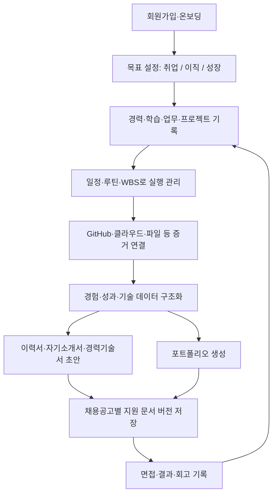

# 서비스 개요 및 제품 정의

- 문서 버전: v2.1
- 기준일: 2026-11-20
- 서비스명: Timebar Diary (제품 방향: Career OS)

## 1. 서비스 정의

Timebar Diary는 사용자의 계획(Plan)과 실제 기록(Actual)을 같은 시간축에서 관리하는 기존 기반을 유지하면서, 직장·아르바이트·인턴·프리랜서·개인 프로젝트·커뮤니티 활동에서 얻은 경험을 지속적으로 축적하고 취업·이직 문서와 포트폴리오로 전환하는 **통합 커리어 관리 플랫폼**으로 확장한다.

서비스는 취업 공고만 제공하거나 이력서 파일만 저장하는 앱이 아니다. 사용자의 활동을 원천 기록으로 보존하고, 그 기록을 경력·프로젝트·성과·역량·문서와 연결하는 개인 커리어 데이터 플랫폼을 지향한다.

## 2. 타깃 사용자

| 사용자 유형 | 주요 문제 | 핵심 사용 기능 |
|---|---|---|
| 취업준비생 | 프로젝트·교육·자격·대외활동이 흩어져 있고 자기소개서 소재를 찾기 어렵다 | 루틴, 학습·프로젝트 기록, 포트폴리오, 이력서, 지원 관리, 면접 기록 |
| 이직 준비 직장인 | 회사별 업무 성과와 기술·역할을 시간이 지난 후 기억하기 어렵다 | 업무 기록, 경력 타임라인, WBS, 성과 근거, 경력기술서, JD 분석 |
| 재직자·커리어 성장 사용자 | 직무 역량과 업무 성과를 장기적으로 관리하기 어렵다 | 업무 히스토리, 프로젝트, 루틴, 커리어 갭 분석 |
| 프리랜서·인턴·아르바이트 경험자 | 고용 형태가 달라 경력이 단절되거나 누락된다 | 경험 유형별 이력, 계약·업무·산출물 기록 |
| 공동 프로젝트 참여자 | 팀 결과와 본인 역할·기여도를 나누어 설명하기 어렵다 | 직무 커뮤니티, 팀 구성, WBS, 기여 기록, 공동 포트폴리오 |
| 관리자·운영자 | 사용자·콘텐츠·신고·외부 연동의 안전한 운영이 필요하다 | 관리자 콘솔, 연동 허용 목록, 감사 로그, 운영 정책 |

주 타깃은 취업준비생과 이직 준비 직장인이다. 재직자·프리랜서·학생·프로젝트 참여자는 확장 타깃으로 둔다. 기관·코치·기업용 기능은 개인의 명시적 공유와 별도 권한 설계를 전제로 후속 범위로 둔다.

## 3. 제품 목표

### 3.1 핵심 목표

1. 사용자가 수행한 모든 의미 있는 활동을 시간순으로 축적한다.
2. 업무·학습·프로젝트 기록에 역할, 기술, 문제 해결, 성과, 증거 자료를 연결한다.
3. 누적 기록을 이력서·자기소개서·경력기술서·포트폴리오로 재사용한다.
4. 취업·이직 지원 과정의 공고, 제출 문서, 면접, 결과를 한곳에서 관리한다.
5. 루틴·일정·WBS·실제 작업 시간을 연결해 목표와 실행을 함께 관리한다.
6. 같은 직무의 사용자들이 프로젝트를 만들고 협업한 결과를 개인별 기여도와 함께 기록한다.
7. AI는 승인된 자료를 근거로 분석·초안을 제안하며, 사용자가 검토·수정·승인한다.
8. 웹과 모바일에서 같은 계정·데이터·권한으로 연속 사용한다.

### 3.2 제품이 제공하지 않을 것

- 근거 없는 AI 경력·성과·수치 자동 생성
- 사용자의 동의 없는 경력·일정·업무 기록 공개
- GitHub Commit 수만으로 개인의 역량이나 팀 기여도를 단정하는 평가
- 관리자 승인 없이 임의의 웹사이트에 로그인하거나 데이터를 게시하는 자동화
- 취업 성공률·연봉 상승률을 보장하는 문구나 점수
- 실제 제공자 연결 전 “연동 완료”라고 표시하는 기능

## 4. 핵심 가치 제안

| 가치 | 사용자의 변화 | 제품 기능 |
|---|---|---|
| 기록 | 경험을 잊기 전에 남긴다 | 빠른 업무 기록, 활동 타임라인, 파일·링크 첨부 |
| 구조화 | 경험을 경력 자산으로 분류한다 | 회사·직무·역할·기술·성과·기간·근거 데이터 |
| 관리 | 목표와 실행을 함께 관리한다 | Plan/Actual, 루틴, 일정, WBS, 집중 타이머 |
| 협업 | 함께 만든 결과와 개인 기여를 분리한다 | 커뮤니티, 프로젝트 팀, WBS, 리뷰·기여 기록 |
| 증명 | 산출물과 근거로 경험을 설명한다 | GitHub·클라우드·문서·이미지·검증 상태 |
| 전환 | 기록을 지원 문서로 재사용한다 | AI 문서 초안, 템플릿, 버전 관리, 내보내기 |
| 성장 | 목표 직무와 현재 경험의 차이를 파악한다 | JD 분석, 역량 매핑, 학습 루틴 추천 |

## 5. 핵심 사용자 흐름

## 6. 기존 Timebar Diary 핵심 개념 보존

| 개념 | 유지 및 확장 방향 |
|---|---|
| Plan | 일정·할 일·WBS·목표 시간 등 사전 계획을 뜻한다. 커리어 프로젝트의 작업 계획에도 활용한다. |
| Actual | 실제 수행 시간·업무 기록이다. 경력 원장에 원본 근거로 연결할 수 있다. |
| 기록 연결 | 일정·할 일·실제 기록의 연결을 유지한다. 경력 활동과 프로젝트 원천 기록 연결을 추가한다. |
| J/P/B 하루 모드 | 기존 제품의 하루 모드(J형·P형·밸런스형)를 보존한다. 이는 취업/이직 사용자 유형이나 별도의 P/B 기능과 혼동하지 않는다. |
| 하루의 기준 | 계정 시간대·하루 시작 시각을 유지하고 통계·루틴 계산에 적용한다. |
| 커뮤니티·챌린지 | 소통 및 인증 구조를 보존하고, 직무별 프로젝트 모집과 공동 작업 기능을 추가한다. |
| WBS·위키 | 기존 업무 분해·업무 지식 문서 기능을 프로젝트·성과 기록과 연결한다. |

## 7. 성공 지표 후보

초기에는 매출이나 취업 성공률보다 사용자가 실제로 기록을 축적하고 다시 사용하는지 측정한다.

| 지표 | 정의 후보 | 주의사항 |
|---|---|---|
| 주간 유효 기록 사용자 | 주간에 업무·학습·프로젝트 등 유효 기록을 1건 이상 만든 사용자 | 민감 본문을 분석하지 않고 이벤트 수만 집계 |
| 활동→경력 연결률 | 커리어 활동 중 경험/프로젝트/문서와 연결된 비율 | 연결 강요로 이어지지 않도록 선택형 |
| 문서 재사용률 | 원천 기록을 참조한 문서 생성·수정 비율 | AI 생성 수 자체를 성과로 과대평가하지 않음 |
| 포트폴리오 완성률 | 필수 섹션과 공개 승인 상태를 충족한 항목 비율 | 공개하지 않는 개인 보관도 완성으로 취급 가능 |
| 지원 관리 지속률 | 공고 저장 후 지원 결과 또는 다음 행동이 기록된 비율 | 지원하지 않음도 유효한 결과 상태 |
| 동기화 신뢰도 | 외부 연동 성공·실패·충돌 비율 | 연결 제공자와 기간별로 분리 |

## 8. 제품 원칙

1. 한 번 입력한 기록을 여러 기능에서 재사용한다.
2. 모든 결과물은 원천 기록과 연결 가능해야 한다.
3. 비공개가 기본이며 공개는 항목별 사용자 승인으로 처리한다.
4. 기존 기능은 목적이 겹친다는 이유만으로 제거하지 않는다.
5. 시연 데이터와 실제 데이터, 로컬 저장과 서버 저장을 구분한다.
6. AI 출력은 초안이며 사용자가 확인하기 전 제출·전송하지 않는다.
7. 모바일은 웹의 축소판이 아니라 빠른 기록·알림·조회에 최적화한다.
