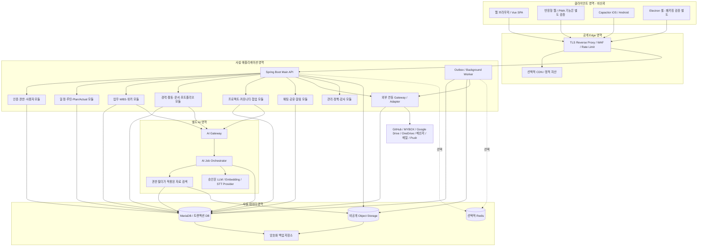
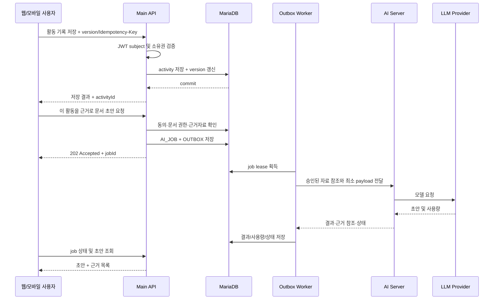

# 시스템 구성도 및 아키텍처 설계서

- 문서 버전: v2.1
- 기준일: 2026-11-20
- 목적: 기존 Vue/Spring Boot 기반을 유지하면서 웹·모바일, 경력·프로젝트, 클라우드, 별도 AI 서버를 확장하는 목표 구조를 정의한다.

> 현재 구성의 근거는 제공된 2026-11-20 기능개발·메뉴 문서와 2026-09-26 아키텍처 스냅샷이 서로 다르다. 아래 “현재 기준”은 11월 20일 기능 원장에 기록된 기능 상태를 기준으로 요약하고, 9월 스냅샷의 초기 구성은 과거 구조로 별도 보존한다. 실제 현재 배포 환경은 저장소와 인프라에서 재확인해야 한다.

## 1. 아키텍처 목표

- 기존 애플리케이션은 모듈형 모놀리스로 유지한다. 기능 확장 때문에 초기부터 모든 도메인을 마이크로서비스로 분리하지 않는다.
- 웹과 모바일은 동일한 Spring Boot API와 사용자 데이터 모델을 사용한다.
- AI는 별도 서버/서비스로 분리하고 메인 API가 인증·권한·동의·비용·작업 상태를 통제한다.
- 외부 서비스 연동은 provider adapter를 통해 격리한다.
- DB와 객체 파일 저장소는 사설 네트워크에 둔다.
- 오래 걸리는 AI·파일·동기화·알림 작업은 비동기 worker로 처리한다.

## 2. 현재 개발 구성 요약

11월 20일 제공된 기능개발 목록은 다음 기능이 서버와 화면에 연결된 것으로 기록한다(모든 배포 환경에서 운영 검증 완료라는 의미는 아님).

- 회원 인증, refresh token, 사용자 권한
- 일정·할 일·루틴·일부 개인 기록의 서버/로컬 저장 흐름
- Plan/Actual, 기록 연결, 타이머·집중 모드
- WBS·업무 위키·업무 기록의 서버 연결
- 경력·이력서·포트폴리오 기본 저장
- 친구·공유 그룹·커뮤니티·챌린지·채팅·첨부
- 백업·내보내기 일부, 오프라인 대기열 일부
- AI·외부 캘린더·결제·소셜 로그인 일부는 제공자 미연결 또는 설계 단계

9월 26일 아키텍처 스냅샷은 `CONTRACT_READY` stub, 공용 메모리 PlannerService, 로컬 시연 중심 상태를 기록한다. 이 설명을 11월 20일 현재 상태로 그대로 사용하면 기능 원장과 충돌하므로 과거 스냅샷으로 표시한다.

## 3. 목표 시스템 구성도

## 4. 컴포넌트 책임

| 구성 요소 | 책임 | 금지/경계 |
|---|---|---|
| Vue Web | 화면, 입력 검증 보조, 상태 표시, API 호출 | 비밀키 보관·권한의 최종 판단 금지 |
| Capacitor | 카메라·파일·푸시 등 모바일 기능 연결 | API 권한을 우회하지 않음 |
| Electron | 데스크톱 셸이 필요할 때 배포 | 현재 패키징/서명 완료로 간주하지 않음 |
| Reverse Proxy | TLS, 라우팅, 요청 제한, 보안 헤더 | 관리자 API·DB 직접 공개 금지 |
| Main API | 인증, 소유권, 업무 규칙, 트랜잭션, 정책 집행 | AI 모델 실행을 직접 수행하지 않음 |
| Domain modules | 일정·업무·커리어·프로젝트 등 비즈니스 규칙 | 다른 모듈 DB 테이블 직접 수정 최소화 |
| Integration Gateway | provider별 인증·API adapter·연결 상태 | 사용자가 입력한 임의 URL을 서버가 fetch하지 않음 |
| Outbox Worker | 알림·동기화·AI 요청·파일 작업을 비동기 처리 | 열린 DB 트랜잭션 안에서 외부 네트워크 대기 금지 |
| AI Server | 데이터 분석·문서 초안·번역·STT 등 모델 작업 | Main API의 인증·동의 없이 자체적으로 데이터 조회 금지 |
| MariaDB | 트랜잭션·관계·소유권·버전·상태 저장 | 인터넷 공개 금지 |
| Object Storage | 첨부·내보내기 파일·검사 결과 저장 | 공개 버킷 기본 금지, storage key 직접 노출 금지 |
| Admin | 사이트 allowlist, provider 정책, 신고·감사 | 사용자 데이터 무단 조회 금지 |

## 5. 배포 토폴로지 제안

| 영역 | 초기 배포 | 확장 조건 |
|---|---|---|
| Reverse proxy | 1개 공개 진입점 | WAF/CDN·다중 인스턴스 필요 시 |
| Vue 정적 파일 | proxy 또는 정적 서버 | CDN은 트래픽/캐시 요구 확인 후 |
| Spring Boot API | 컨테이너/VM 1개 이상 | 부하·가용성 목표 검증 후 수평 확장 |
| Worker | API와 별도 프로세스 권장 | 대량 작업 시 작업 유형별 consumer 분리 |
| AI Server | 별도 컨테이너/VM/관리형 endpoint | GPU·모델·비용 측정 후 분리 확장 |
| MariaDB | 사설 단일 DB부터 | RPO/RTO와 트래픽을 기준으로 replica/HA |
| Redis/Queue | MVP 필수 아님 | 다중 인스턴스 rate limit·job queue 필요 시 도입 |
| Object Storage | 비공개 저장소 | 업로드·다운로드량 증가 시 별도 확장 |
| Monitoring | 내부 접근만 허용 | metrics/log/tracing 도입 시 |

CPU·RAM·인스턴스 개수는 동시접속·데이터량·SLO가 정해지지 않아 확정하지 않는다. 운영 목표와 부하 테스트로 산정한다.

## 6. 네트워크 및 보안 경계

| 출발 → 목적 | 통신 | 기본 정책 |
|---|---|---|
| 사용자 → Proxy | HTTPS 443 | 공개, TLS·rate limit 적용 |
| Proxy → Main API | 사설 TCP 또는 내부 TLS | proxy의 사설 주소만 허용 |
| API/Worker → MariaDB | DB 전용 포트 | 사설 네트워크·앱 계정 분리 |
| API/Worker → Object Storage | HTTPS/S3 API | 필요한 bucket/prefix만 허용 |
| Main API → AI Server | 내부 HTTPS/mTLS 권장 | 인증된 service identity 및 요청 ID |
| Worker → 외부 Provider | HTTPS 443 | provider host allowlist, timeout, 최소 scope |
| 운영자 → Admin | VPN/bastion/접근 제어 | MFA, 감사 로그 |

운영에서 Swagger, 상세 Actuator, 로그 파일, 관리자 API를 인터넷에 공개하지 않는다. 관리자 화면의 메뉴 숨김은 보안 통제가 아니며 서버에서 매 요청을 검사한다.

## 7. 요청 흐름 예시: 활동 기록과 AI 문서 초안

AI 결과는 초안으로 저장하고 사용자가 확정하기 전에는 이력서 원본이나 공개 포트폴리오를 자동 덮어쓰지 않는다.

## 8. 장애·관찰성·복구

- 모든 요청에 requestId/operationId를 부여한다.
- 로그에는 경로, 지연, 상태 코드, provider 코드 등을 남기되 비밀번호·토큰·업무 본문·일기 본문·개인 인사 사유는 기록하지 않는다.
- DB 장애 시 저장 성공을 가장하지 않고 명확한 오류를 반환한다.
- 비동기 작업은 접수와 완료를 구분하고 조회 API를 제공한다.
- 재시도는 멱등 키·lease·attempt 수·backoff를 사용한다. “정확히 한 번 전송”을 보장한다고 표현하지 않는다.
- 백업·복원은 DB와 객체 파일의 참조 일관성을 확인한다.
- RPO 24시간/RTO 4시간은 과거 문서의 제안값일 뿐 확정된 서비스 약속이 아니다. 운영 승인과 복원 리허설 후 결정한다.

## 9. 기존 2026-09-26 구성도에 대한 정리

9월 문서의 다음 사항은 당시 스냅샷으로 보존하고 최신 구조와 분리한다.

- Vite 개발 서버 5173, Spring Boot 8080, Vue Router, Capacitor/Electron 셸
- `/api/v1`은 당시 설계 경로이며 현재 매핑이 아니라고 명시
- 공용 메모리 PlannerService, CONTRACT_READY stub, 일부 localStorage 시연
- MariaDB/JPA/Flyway의 baseline과 Entity 이름 불일치

11월 20일 기능 원장에서는 더 많은 API/화면 연결이 기록되어 있으므로, 실제 현재 구조도를 확정하기 전에 최신 소스의 Controller·Service·Store·Router·Flyway·실행 결과를 다시 추출한다.
