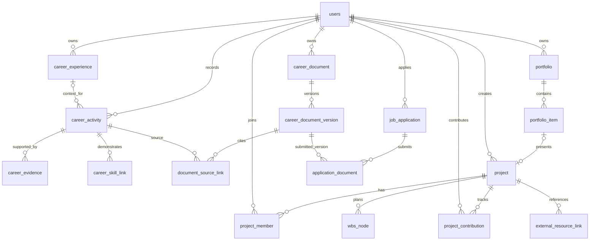
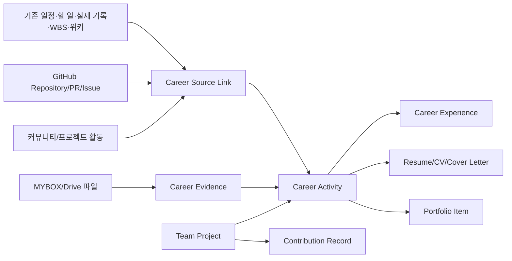

# 데이터 모델 및 ERD 설계서

- 문서 버전: v2.1
- 기준일: 2026-11-20
- 성격: 기존 DDL 위험을 보존하면서 커리어·프로젝트 도메인을 추가하기 위한 논리 설계
- **실행 가능한 SQL migration이 아니다.**

## 1. 데이터 설계 원칙

1. 신규 PK는 기존 프로젝트 정책과 일치하는 CHAR(26) ULID를 우선 검토한다. 기존 BIGINT ID는 호환성 확인 전 변경하지 않는다.
2. 사용자 소유 데이터는 `user_id`와 인증 subject를 기준으로 격리한다.
3. 수정 가능한 레코드는 version 기반 낙관적 잠금 또는 이에 준하는 충돌 제어를 갖는다.
4. 신규 시각은 UTC로 저장하고 지역 날짜/시간대는 별도 필드로 표현한다.
5. 파일 내용은 DB에 무조건 넣지 않고 비공개 객체 저장소에 두며, DB에는 metadata와 storage reference를 둔다.
6. 개인 기록의 기본 공개 범위는 PRIVATE다.
7. 회사·프로젝트·커뮤니티의 자료 소유권, 공동 작업물 권한을 명시한다.
8. 신규 스키마는 현재 Entity·API·기존 feature_record 저장 방식을 대조한 후 결정한다.

## 2. 현재 DDL·ERD의 알려진 위험

제공된 2026-09-26 `02-current-database.md`, `03-target-database.md`, `04-schema-gaps.md`에서 다음을 확인할 수 있다. 이것은 현재 운영 DB를 조회한 결과가 아니라 문서의 정적 분석이다.

- V1은 `tbl_` 접두어가 있는 37개 테이블을 선언하지만 FK는 `users`, `events`, `task`, `routine`, `cal_group`, `sticker_pack` 등 접두어 없는 이름을 참조한다.
- JPA의 `@Table` 이름도 `users`, `events`, `task`, `routine` 등 접두어 없는 이름이다.
- 첫 ERD 조각은 `tbl_users`를 선언하고 관계에서는 `users`를 사용하며, `tbl_routine` 선언 뒤에 `routine`을 관계 대상으로 사용한다. 엔티티 식별자가 일치하지 않는다.
- 39개 FK 선언의 대상이 같은 파일의 CREATE 목록에 없다는 정합성 보고가 있다.
- `CREATE OR REPLACE TABLE`은 기존 테이블을 대체할 위험이 있어 데이터가 있는 DB에서 재실행하면 안 된다.
- `tbl_task.event_id`는 CHAR(26), `tbl_events.id`는 BIGINT라 직접 FK를 구성할 수 없다.
- `tbl_planner_item`은 user_id가 없는 레거시 구조로 보고되어 개인 계정 데이터에 바로 사용하면 안 된다.
- `tbl_diary`는 사용자/날짜 당 하나의 레코드 유일성을 전제로 하지만 UI 데이터 모형과 차이가 있을 수 있다.
- `category` 및 `dash_layout`의 nullable UNIQUE 컬럼은 NULL 중복을 막지 못할 수 있다.
- 제공된 11월 20일 기능 원장은 `feature_record`, `record_link`, `idempotency_key` 등 9월 DDL 요약에 포함되지 않은 후속 구조를 기록한다.

**결론:** 9월 DDL 목록을 11월 현행 스키마로 단정하지 않는다. 신규 커리어 테이블 생성 전 `flyway_schema_history`, 실제 DB `information_schema`, JPA Entity, 최신 Flyway 파일을 읽기 전용으로 대조한다.

## 3. 기존 도메인과 커리어 도메인 연결 개념

- 기존 일정·할 일·실제 기록은 “활동이 언제 계획되고 실제로 수행되었는가”를 보여준다.
- 기존 WBS·업무 기록은 “어떤 업무를 어떤 순서와 역할로 수행했는가”를 보여준다.
- 커리어 활동 원장은 기존 기록을 복제하기보다 원천 기록을 참조하고, 문서용 요약·역량·성과·증거를 추가한다.
- 프로젝트는 WBS·채팅·파일·GitHub resource와 연결하되 프로젝트 DB에 동일한 파일/메시지를 복제하지 않는다.

## 4. 목표 커리어 ERD — 논리 모델

아래는 관계를 설명하기 위한 논리 ERD다. 실제 테이블명·키·FK·cardinality는 Entity 및 DB 대조 후 확정한다.

## 5. 신규/확장 엔티티 후보

| 엔티티 후보 | 핵심 속성 | 주요 관계 | 비고 |
|---|---|---|---|
| career_experience | id, user_id, experience_type, organization, role, start_date, end_date?, status, description, visibility, version | users | 회사·인턴·알바·프리랜서·교육 등 |
| career_activity | id, user_id, experience_id?, source_type?, source_id?, activity_type, title, body, occurred_at, tags, version | users, experience | 기존 record와 중복 저장하지 않도록 source reference 설계 |
| career_evidence | id, activity_id, evidence_type, object_id?/external_url?, label, checksum?, visibility | activity, file metadata | 원본 파일·외부 링크 권한 확인 |
| career_skill | id, canonical_name, category, locale | taxonomy | 표준 기술명과 사용자 표기 분리 |
| career_skill_link | activity_id, skill_id, proficiency_claim?, verified_status | activity, skill | 숙련도는 사용자 주장/검증 상태 구분 |
| career_document | id, user_id, document_type, title, locale, current_version, visibility | users | 이력서·자소서·경력기술서 등 |
| career_document_version | id, document_id, version, content_ref/content_json, change_summary, created_by, created_at | document | 장기적으로 대용량 파일과 구조화 콘텐츠 저장 위치 결정 |
| document_source_link | document_version_id, source_type, source_id, excerpt_ref? | document version | 원천 활동/프로젝트와 생성 문장 근거 연결 |
| portfolio | id, user_id, title, slug, visibility, password_hash?, expires_at?, revoked_at? | users | 비공개 기본, public token 별도 관리 |
| portfolio_item | id, portfolio_id, item_type, source_type?, source_id?, display_order, snapshot_ref? | portfolio | 공개 시점의 표시 데이터 snapshot 정책 필요 |
| job_application | id, user_id, company, position, posting_url?, status, applied_at?, deadline?, notes, version | users | 공고 수집 자동화는 별도 승인 |
| application_document | application_id, document_version_id, document_role | application/document | 제출 시점 버전 불변 참조 |
| project | id, owner_id, title, description, project_type, status, start_date?, end_date?, visibility, version | users | 개인·팀·커뮤니티 프로젝트 |
| project_member | project_id, user_id, role, permission, status, joined_at, left_at? | project/users | composite unique/active membership 규칙 필요 |
| project_contribution | id, project_id, user_id, contribution_type, description, source_type?, source_id?, review_status | project/users | 코드 외 기여도도 기록 |
| external_account | id, user_id, provider, provider_subject, scopes, status, connected_at, revoked_at? | users | OAuth 연결 메타데이터 |
| external_resource_link | id, user_id, provider, external_id, resource_type, project_id?, activity_id?, last_synced_at? | external account | 실제 외부 자료는 provider에서 읽고 선택 참조 |
| ai_job | id, user_id, job_type, status, consent_id, source_manifest_ref, result_ref?, usage_json?, error_code? | users | AI 작업 상태·비용 추적 |

이 표는 물리 컬럼 전체 사전이 아니다. 인덱스·FK·unique·삭제 정책은 현재 저장 모델과 트래픽 요구를 확인한 뒤 별도 DB 설계서에 등록한다.

## 6. 핵심 관계도 — 기존 업무 기록 연결

## 7. 권한·삭제·보존 정책

- 사용자 소유 활동은 `(id, user_id)` 기준으로 조회·수정한다.
- 공동 프로젝트 데이터는 개인 소유 데이터와 별도 ACL을 적용한다.
- 커뮤니티 회원이라고 해서 개인 경력이나 첨부 파일에 접근할 수 없다.
- 공개 포트폴리오는 공개 승인된 snapshot/항목만 노출한다.
- 원천 기록이 삭제되면 연결된 문서에는 “원본 기록 삭제/접근 불가”를 표시한다. 과거 제출 문서를 어떻게 보존할지는 법률·사용자 요구 확인 후 결정한다.
- 휴지통 30일 등 보존 기간은 제안값이다. 회사 기밀·인사정보·공동 저작물은 별도 삭제·보존 정책이 필요하다.

## 8. 마이그레이션 원칙

1. 운영·개발 DB에서 실제 테이블과 Flyway 이력을 읽는다.
2. `tbl_`와 non-prefix 이름의 공존 여부를 확인한다.
3. 이미 배포한 V1을 수정하거나 무조건 `repair`하지 않는다.
4. 빈 DB baseline과 기존 DB 증분 migration 경로를 구분한다.
5. 새로운 경력 도메인 도입 시 기존 `/api/work/career/projects`, `/api/work/resume`, `/api/work/portfolio` 및 `feature_record`와 중복 여부를 먼저 분석한다.
6. 데이터 복사·정규화는 shadow table, 행 수, checksum, FK orphan, version, UTC 변환을 검증한다.
7. 백업·복원 리허설 후 승인받아 점진 전환한다.
8. 기존 데이터 삭제·rename은 별도 승인과 보관 정책 없이는 수행하지 않는다.

## 9. ERD 표기 관련 정정

첫 번째로 제공된 ERD의 `tbl_users`와 `users`, `tbl_routine`과 `routine`, `tbl_events`와 `events`처럼 실제 CREATE명과 관계 대상명이 일치하지 않는 부분은 의도적으로 목표 ERD에 그대로 복제하지 않았다. 실제 테이블명을 확인한 뒤 ERD의 entity identifier와 FK target을 하나로 통일해야 한다.
