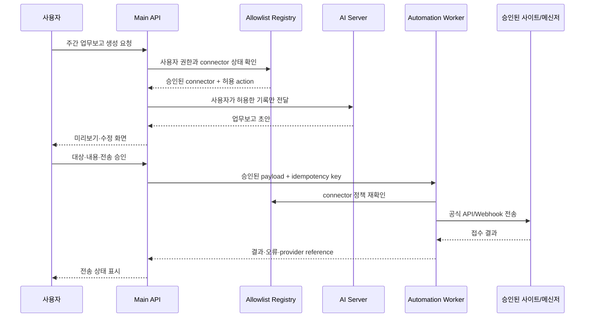

# 외부 서비스 연동 설계서

- 문서 버전: v2.1
- 기준일: 2026-11-20
- 범위: GitHub, 네이버 MYBOX, Google Drive, OneDrive, 외부 메신저·업무 사이트, 외부 캘린더

## 1. 연동 설계 원칙

1. 외부 서비스 연결은 사용자가 명시적으로 승인한 계정과 범위만 사용한다.
2. 소셜 로그인(인증)과 자료 연동(Repository/파일 접근)은 별도 연결로 취급한다.
3. 공식 API, OAuth, Webhook, 제공자가 허용한 API를 우선한다.
4. 임의 URL을 받아 백엔드가 호출하는 구조를 만들지 않는다.
5. 연결 정보는 provider별 adapter로 격리하고 token은 브라우저 localStorage에 평문 저장하지 않는다.
6. 사용자가 연결 해제하면 새로운 동기화·게시 작업을 중단하고 토큰 폐기/삭제 정책을 적용한다.
7. 연동 상태는 연결됨·권한 부족·만료·동기화 중·실패·철회·미지원으로 구분한다.

## 2. GitHub 연동

### 2.1 두 가지 기능을 분리

| 기능 | 목적 | 필요한 동작 |
|---|---|---|
| GitHub SSO 로그인 | 회원가입/로그인 편의 | OAuth 인증, provider subject 검증, 기존 사용자 계정 연결 정책 |
| GitHub 자료 연동 | 프로젝트·활동 근거 수집 | Repository 선택, Commit/PR/Issue 읽기, 동기화, 연결 해제 |

GitHub로 로그인했다고 Repository 데이터 접근 권한까지 자동 획득했다고 간주하면 안 된다. 별도 자료 접근 승인과 최소 scope를 요구한다.

### 2.2 수집 후보 데이터

- Repository 이름, 설명, 언어, 기본 브랜치, 공개 여부
- Commit 메타데이터(sha, author identity, committed date, message는 민감정보 필터 적용)
- Pull Request 제목·상태·리뷰·변경 요약
- Issue 번호·제목·상태
- Repository URL 및 release/tag

기본적으로 비공개 Repository의 코드 본문 전체를 자동으로 복사하지 않는다. 개인별 기여 증거를 만들 때도 Commit 수·코드 줄 수를 역량 점수로 직접 사용하지 않는다.

### 2.3 기여도 판단 원칙

| 활동 | 증거로 활용 | 자동 기여도 점수 |
|---|---|---|
| Commit | 구현 작업의 일부 근거 | 자동 점수화 금지 |
| Pull Request | 변경·리뷰 흐름 근거 | 승인/병합 상태만 참고 |
| Issue | 문제 정의·조치 근거 | 자동 점수화 금지 |
| Code Review | 리뷰 기여 근거 | 리뷰 수만으로 순위화 금지 |
| 문서·기획·테스트 | 비코드 기여 | 사용자/팀 확인형 기록 |

## 3. 네이버 MYBOX 및 클라우드

### 3.1 구분해야 하는 서비스

- 네이버 MYBOX: 사용자의 개인 파일 보관 서비스. 공식 Open API의 실제 scope·지원 기능·토큰 정책을 도입 시점에 다시 검증한다.
- NAVER Cloud Object Storage: 서비스 운영 인프라용 객체 저장소로 MYBOX와 다른 서비스다.
- Google Drive/OneDrive/Dropbox: 각각 별도의 OAuth consent, API scope, rate limit, 파일 권한 모델을 갖는다.

MYBOX 연동을 네이버 블로그 자동 게시와 같은 기능으로 취급하지 않는다. 블로그 게시가 필요하면 블로그 서비스의 별도 공식 API와 게시 정책을 확인해야 한다.

### 3.2 기본 기능

- 사용자 클라우드 계정 연결·철회
- 파일/폴더 목록 중 사용자가 선택한 자료 조회
- 앱으로 가져오기(복사) 또는 외부 링크 참조를 구분
- 프로젝트·경력 활동·포트폴리오 항목에 연결
- 동기화 상태·마지막 확인 시각·오류 사유 표시
- 외부에서 파일이 삭제/이동/권한 회수된 경우 링크 상태 표시

### 3.3 클라우드 파일 처리 모델

| 방식 | 설명 | 고려사항 |
|---|---|---|
| 외부 링크 참조 | 외부 파일 ID/URL만 보관 | 사용자 권한 철회·링크 만료·외부 삭제에 취약 |
| 앱으로 복사 | 사용자가 선택한 파일을 앱의 비공개 저장소로 복사 | 스토리지 비용·저작권·회사 기밀·복사 동의 |
| 선택적 동기화 | metadata만 동기화하고 파일은 요청 시 조회 | provider 권한·API 제한·다운로드 URL 유효기간 |

기본은 파일 참조와 명시적 가져오기를 제공하고, 모든 클라우드 파일을 자동 복사하지 않는다.

## 4. 외부 업무 사이트·메신저 자동 업로드

### 4.1 허용 목록 구조

관리자는 사이트/메신저를 사전에 등록하고, connector 단위로 지원 작업을 정의한다.

| 필드 | 설명 |
|---|---|
| connectorId | 내부 고유 ID |
| displayName | 관리자·사용자에게 보이는 이름 |
| providerType | 메신저·업무시스템·문서시스템 등 |
| allowedHosts | 사전 검증된 host 목록 |
| allowedPaths/API | connector가 호출할 수 있는 API 경로 |
| authType | OAuth, service credential, webhook secret 등 |
| scopes | 허용 권한 범위 |
| allowedActions | 보고서 작성·전송·상태 조회 등 |
| dataClassification | 공개/내부/민감 데이터 허용 범위 |
| status | 검토 중·승인·중지·폐기 |
| approvedBy/approvedAt | 관리자 승인 이력 |

관리자가 host를 등록했다고 해서 모든 경로·데이터를 허용하는 것은 아니다. connector별로 메서드, path, payload schema, 파일 유형, 최대 크기, 대상 채널을 제한한다.

### 4.2 사용자 실행 흐름

### 4.3 반드시 적용할 제한

- connector는 서버에 사전 등록된 host와 API 경로만 사용한다.
- 사용자가 자유 입력한 webhook URL을 즉시 실행하지 않는다.
- DNS rebinding, private IP, loopback, link-local, metadata endpoint를 차단한다.
- redirect는 기본 금지하거나 승인된 host 범위 안에서만 허용한다.
- GET/POST 등 HTTP method와 JSON schema를 connector별로 제한한다.
- 사용자의 미리보기·최종 승인 없이 외부 게시/전송하지 않는다.
- 실행 작업은 idempotency key로 중복 전송을 줄이고 provider message ID와 결과를 기록한다.
- 사이트의 공식 API가 없거나 자동화가 약관을 위반할 수 있으면 연동하지 않는다.
- 브라우저 자동화/RPA는 API가 없는 경우의 기본 대체 수단으로 두지 않는다.

## 5. 외부 캘린더

기존 FD-83/MN-72 외부 캘린더 연동은 미연결 상태로 구분한다. 새 커리어 일정/지원 마감 연동은 기존 캘린더 adapter를 재사용할지 검토한다.

- 최초 동기화 및 증분 동기화
- provider sync token 만료 시 전체 재동기화
- 외부 일정 삭제와 내부 사용자의 독립 수정 충돌 처리
- 타임존·종일 일정·DST 처리
- 연결 해제 후 외부 데이터 삭제 여부를 사용자에게 선택하게 함

## 6. OAuth와 credential 저장

- OAuth state는 단회·만료·client/provider/redirect URI에 묶는다.
- PKCE를 지원 provider에서 적용하고 code/refresh token을 로그에 남기지 않는다.
- provider subject로 계정을 식별하고 이메일이 같다는 이유만으로 자동 병합하지 않는다.
- refresh/access token은 서버 secret store 또는 암호화된 credential 저장소를 사용한다.
- 암호화 키는 DB에 평문으로 같이 저장하지 않고 별도 KMS/Secret Manager를 검토한다.
- 현재 BYOK는 브라우저 평문 저장 제거 정책을 유지한다. 안전한 서버 측 secret 관리가 준비되기 전 활성화하지 않는다.

## 7. provider 상태 표시

| 상태 | 사용자 문구 예시 | 허용 동작 |
|---|---|---|
| NOT_CONFIGURED | 아직 연결을 지원하지 않아요 | 연결 불가, 안내 |
| NOT_CONNECTED | 연결되지 않았어요 | 연결 시작 |
| CONNECTED | 연결됨 | 승인 scope 내 작업 |
| NEEDS_REAUTH | 다시 연결이 필요해요 | 재인증 |
| LIMITED_SCOPE | 필요한 권한이 부족해요 | 권한 설명·재승인 |
| SYNCING | 동기화 중이에요 | 상태 조회 |
| ERROR | 연결 상태를 확인하지 못했어요 | 재시도·진단 |
| REVOKED | 연결이 해제되었어요 | 재연결 |

“연결됨”은 계정 인증이 성공했다는 뜻이지 모든 자료·동작이 가능한 상태라는 뜻이 아니다. 기능 capability를 별도로 확인한다.

## 8. 공식 문서 확인 기준

실제 개발 착수 시 각 제공자의 최신 공식 문서에서 OAuth, scope, rate limit, webhook, 데이터 보관·삭제, 앱 심사, 상용 사용 제한을 확인한다. 이 문서에는 검증되지 않은 endpoint URL·scope·응답 필드를 확정값으로 기재하지 않는다.
