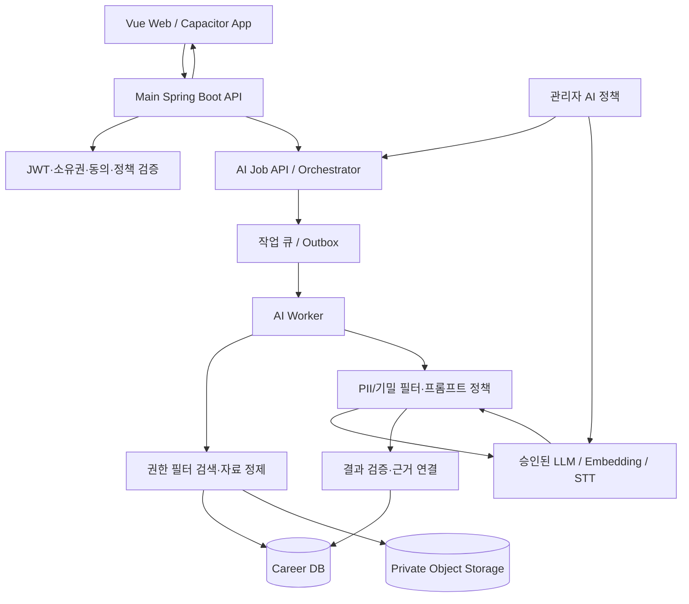

# AI 서버 및 AI 기능 아키텍처

- 문서 버전: v2.1
- 기준일: 2026-11-20
- 전제: AI 실행 서버는 메인 애플리케이션 서버와 별도 구축한다.

## 1. 설계 목표

AI 기능은 사용자의 실제 기록을 근거로 업무·경력·프로젝트를 요약하고, 이력서·자기소개서·경력기술서·포트폴리오·업무보고서 초안을 만든다. AI 서버는 별도 배포 단위로 두되 사용자의 데이터 권한과 동의는 Main API가 통제한다.

## 2. AI 서버 분리 구성도

## 3. 서버별 책임

| 영역 | 책임 |
|---|---|
| Main API | 사용자 인증, 리소스 소유권, 동의·범위 확인, AI job 생성, 결과 접근 권한 |
| AI Job API | 작업 유형, 입력 자료 참조, 상태, 비용 상한, 재시도·취소 |
| Retrieval | 권한이 확인된 활동·경력·문서만 검색, 최소 데이터만 구성 |
| AI Worker | 모델 호출, 응답 검증, 구조화, 근거 연결, 사용량 산출 |
| Provider Adapter | 승인된 AI provider별 endpoint·인증·오류 형식 격리 |
| Guard | 프롬프트 인젝션·민감정보·길이·출력 스키마 검사 |
| Admin AI Policy | 활성 provider·모델·허용 업무·사용량 상한·보존 정책 |

AI 서버가 사용자의 DB에 직접 임의 접속하는 구조는 피한다. Main API가 승인한 resource manifest 또는 짧은 수명의 내부 요청으로 필요한 자료를 전달한다.

## 4. AI 기능 분류

| 기능 | 입력 | 결과 | 승인 지점 |
|---|---|---|---|
| 업무 기록 요약 | 사용자가 선택한 기간·업무 기록 | 일간/주간/월간 보고 초안 | 저장 전 확인 |
| 경력 분석 | 경력·활동·프로젝트·성과 | 직무·기술·역할 요약 | 사용자가 근거 확인 |
| 이력서 생성 | 목표 직무·선택 경력 | 이력서 초안 | 문서 확정 전 |
| 자기소개서 생성 | 질문·지원 기업·경험 근거 | 문항별 초안 | 사실·문체·기업명 확인 |
| 경력기술서 | 회사·프로젝트·역할·성과 | 프로젝트/업무 중심 문서 | 성과 수치 확인 |
| 포트폴리오 구성 | 프로젝트·산출물·기여 | 케이스 스터디 구성 | 개인 기여·공개 범위 확인 |
| JD 분석 | 사용자가 저장한 채용공고 | 요구 역량·보유 근거·부족 정보 | 분석 범위 확인 |
| 스킬 갭 | 목표 직무·현재 경험 | 부족 경험·학습 제안 | 목표 수정 가능 |
| 면접 연습 | 직무·지원 문서·경험 | 예상 질문·답변 피드백 | 답변 저장 선택 |
| 다국어 변환 | 확정 문서·목표 언어 | 번역 초안 | 고유명사·전문용어 검수 |
| 빠른 입력 분류 | 사용자가 작성한 문장/음성 텍스트 | 활동 유형·날짜·태그 후보 | 저장 전 확인 |

## 5. AI job 처리 모델

권장 상태:

`CREATED → QUEUED → RUNNING → REVIEW_REQUIRED → APPROVED/SAVED`

실패·중단 상태:

`FAILED`, `CANCELLED`, `EXPIRED`, `REJECTED`

- 요청 생성은 202 Accepted와 jobId를 반환한다.
- 작업 상태 조회·취소 API를 별도로 제공한다.
- 재시도는 동일 job의 입력·정책 버전을 기록한다.
- 사용자가 자료 범위나 동의를 바꾸면 실행 중 job을 취소하거나 최신 승인 상태를 다시 검사한다.
- 결과는 초안으로 저장하며 사용자가 승인하기 전 원본 문서를 덮어쓰지 않는다.

## 6. AI 생성 문서의 근거 추적

각 문장 또는 문단에 근거 활동·프로젝트·파일 참조를 연결할 수 있도록 한다.

| 출력 요소 | 저장할 정보 |
|---|---|
| 생성 문장 | 문장/블록 ID, 텍스트, 생성 시각, 모델·prompt version |
| 원천 근거 | activityId, experienceId, projectId, evidenceId 등 |
| 사용자 수정 | 수정 전후 버전, 수정자, 수정 시각 |
| 검증 상태 | 사용자 확인, 수치 근거 확인, 공개 승인 여부 |
| 미확인 주장 | 근거 없는 성과·수치·역할을 별도 표시 |

AI가 응답 속도 개선률·비용 절감액·참여 인원·매출 수치를 입력 자료 없이 만들어서는 안 된다. 근거가 없으면 “수치 입력 필요” 또는 “정량 성과 미기록”으로 남긴다.

## 7. 경력 분석 및 JD 매칭 원칙

- 채용공고의 필수/우대 요건을 구분한다.
- 사용자의 기록에서 직접 확인되는 기술·업무 경험과 자기 진술을 구분한다.
- 경험이 없거나 증거가 부족한 항목은 “부족”이 아니라 “기록에서 확인되지 않음”으로 표시한다.
- 적합도 숫자를 제공하더라도 산정 기준·데이터 범위·불확실성을 설명한다.
- 나이·성별·출신·건강 등 직무와 무관한 민감 특성을 추론하거나 추천 점수에 반영하지 않는다.

## 8. AI provider·사용자 AI 프로그램 연결

사용자가 구독 중인 소비자용 AI 웹앱과 API 사용 권한은 동일하지 않다. 특정 AI 웹사이트의 세션 쿠키를 저장하거나 화면을 스크래핑해 자동 조작하는 방식은 기본 연동 방법으로 사용하지 않는다.

- 공식 API를 제공하는 provider부터 connector로 지원한다.
- 사용자의 별도 API key 입력(BYOK)을 허용하려면 서버 측 암호화 보관, key rotation, 권한·철회·감사, 비용 상한을 구현한 후 검토한다.
- 기존 `localStorage`에 API key를 저장하지 않는다. 기존 BYOK 평문 제거 정책과 충돌하지 않게 한다.
- 사용자 지정 base URL을 허용할 경우 관리자 허용 목록과 SSRF 방어를 적용한다.
- AI가 외부 사이트에 행동을 실행하는 것은 문서 생성과 분리하고 사용자 승인형 자동화 경로로 보낸다.

## 9. 프롬프트·검색 보안

- 사용자 입력, 커뮤니티 글, 외부 문서, Repository README는 신뢰할 수 없는 데이터다. 그 안의 지시문을 시스템 지시로 승격하지 않는다.
- retrieval은 현재 사용자의 권한 범위 내 자료만 검색한다.
- 공유된 자료도 공유 범위와 철회 시점을 다시 검사한다.
- 검색 인덱스에는 삭제·권한 변경 tombstone을 반영한다.
- 외부 도구 실행은 별도 allowlist, schema validation, 승인 단계를 거친다.
- 결과의 HTML/Markdown 렌더링은 sanitize한다.

## 10. 비용·사용량 통제

- 사용자·일일·월간별 요청 횟수와 토큰/분량 상한을 설정한다.
- 파일 OCR, 음성 변환, 장문 문서 분석은 별도 과금/사용량으로 계산한다.
- 모델별 latency·실패·token usage를 기록하되 입력 본문은 기본 로그에서 제외한다.
- 제공자 장애 시 다른 모델로 자동 전환하는 기능은 품질·개인정보 전송 범위가 같다고 확인되기 전에는 사용하지 않는다.

## 11. 단계별 도입

1. AI 서버 없이 규칙 기반 기록·템플릿을 먼저 완성한다.
2. 별도 AI job API와 단일 승인 provider를 연결한다.
3. 경력 분석·문서 초안을 추가하고 근거 추적을 검증한다.
4. JD 분석·스킬 갭·다국어 변환을 추가한다.
5. 외부 사이트 전송은 AI 작성과 분리된 사용자 승인형 자동화로 도입한다.
