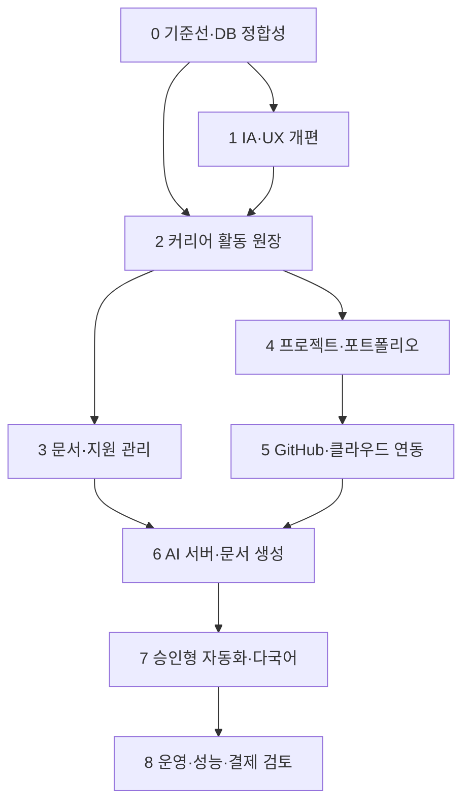

# 개발 로드맵 및 우선순위 제안

- 문서 버전: v2.1
- 기준일: 2026-11-20
- 원칙: 실제 담당 인력·예산·목표 출시일이 제공되지 않았으므로 기간·공수는 확정하지 않는다.

## 1. 로드맵 기본 방향

전체 기능을 한 번에 개발하지 않는다. 먼저 기존 앱의 현재 상태와 데이터 모델을 정합화하고, 커리어 활동 원장을 중심으로 핵심 사용자 가치를 완성한다. AI 서버·외부 자동화는 데이터·동의·권한·근거 구조가 완성된 뒤 도입한다.

## 2. 단계별 범위

| 단계 | 목표 | 주요 기능 | 완료 판단 |
|---|---|---|---|
| 0. 기준선 정리 | 문서·코드·DB·테스트 정합성 | 최신 HEAD 확인, 9월/11월 문서 충돌 정리, DB schema·Flyway 조사, 기존 API/메뉴 inventory | 기준 문서와 테스트 실행 증거가 일치 |
| 1. UX·서비스 기반 | 커리어 플랫폼으로 정보구조 개편 | 사용자 유형 온보딩, 홈 위젯, 커리어 메뉴, 기존 경로 보존, 반응형 UX | 핵심 사용자 흐름에서 기존 기능 회귀 없음 |
| 2. 커리어 기록 | 원천 활동을 축적 | 경험/경력, 활동 타임라인, 성과·기술·근거 자료, 기존 WBS·Actual 연결 | 한 활동을 경력/프로젝트/문서에서 재사용 |
| 3. 문서·지원 관리 | 경험을 취업·이직 자료로 전환 | 이력서, 자기소개서, 경력기술서 템플릿·버전, 지원 내역·면접·제출 문서 | 지원 시점 문서 버전을 재조회 가능 |
| 4. 포트폴리오·프로젝트 | 개인/팀 결과물을 증명 | 포트폴리오 공개, 프로젝트 허브, 팀 구성, WBS·기여 기록 | 공개 항목과 개인 기여를 검증·구분 |
| 5. 외부 연동 | 기록 수집의 수고 감소 | GitHub SSO/Repo 분리, MYBOX·Drive·OneDrive, provider 상태·철회 | sandbox OAuth/API 테스트·권한 회수 통과 |
| 6. AI 서버 | 안전한 AI 문서·분석 | 별도 AI server, job queue, 근거 추적, 비용 상한, 문서 생성·JD 분석 | 동의·권한·근거·출력검증 통과 |
| 7. 업무 자동화·다국어 | 결과를 승인된 외부 시스템으로 전달 | 관리자 connector catalog, 사용자 승인형 보고서 전송, i18n | allowlist·SSRF·멱등·감사 테스트 통과 |
| 8. 운영 고도화 | 안정성·규모·수익 모델 | 모니터링, 부하, 백업 복원, 결제 검토, 모바일 패키징 | 운영 배포·복구 리허설 증거 |

## 3. 선행 의존성

## 4. 첫 번째 개발 묶음 권장 범위

실제 코드 작업을 시작할 때 다음 묶음부터 착수하는 것이 좋다.

1. 기존 메뉴·기능·저장 상태를 최신 소스와 대조한다.
2. 경력·이력서·포트폴리오의 기존 API/DB 구조를 확인해 재사용 범위를 확정한다.
3. 커리어 활동 원장의 논리 모델과 API 계약을 작성한다.
4. 신규 활동을 기존 WBS·실제 기록·프로젝트와 연결한다.
5. 커리어 타임라인 화면과 빠른 입력을 구현한다.
6. 근거 파일/링크를 연결하고 공개는 비공개로 시작한다.
7. 테스트·문서·화면 경로 목록·DB migration을 같은 PR에서 갱신한다.

## 5. 개발 우선순위 판단 기준

| 기준 | 가중 검토 |
|---|---|
| 사용자 핵심 가치 | 사용자가 경험을 기록하고 문서로 재사용하는가 |
| 재사용성 | 기존 기능·API·테이블·공통 저장소를 활용할 수 있는가 |
| 데이터 위험 | 개인정보·회사 기밀·외부 token 위험을 통제할 수 있는가 |
| 기술 의존성 | 외부 provider 심사·계정·API가 필요한가 |
| 검증 가능성 | 자동 테스트·브라우저·sandbox에서 수용 기준을 검증할 수 있는가 |
| 운영 비용 | 파일·AI·동기화·worker 비용을 제한할 수 있는가 |

## 6. 기존 PR과 신규 작업의 관계

기존 PR-01~PR-22 및 IM-01~IM-14 상태를 이 문서가 덮어쓰지 않는다. 신규 개발 묶음은 기존 우선순위 문서의 마지막 ID 다음으로 등록한다. 아래 번호는 제안용이다.

| 신규 PR 후보 | 작업 | 선행 |
|---|---|---|
| PR-23 | 현행 코드·DB·문서 정합성 재확인 | 기존 PR 상태 확인 |
| PR-24 | 커리어 원장 데이터/API 설계 | PR-23 |
| PR-25 | 커리어 타임라인·경험 화면 | PR-24 |
| PR-26 | 문서 템플릿·버전·지원 관리 | PR-24, PR-25 |
| PR-27 | 포트폴리오 공개 정책·공유 | PR-26, 보안 검토 |
| PR-28 | 팀 프로젝트·기여도 | PR-24, 기존 커뮤니티/WBS 재사용 검토 |
| PR-29 | GitHub connector | PR-23, OAuth 보안 검토 |
| PR-30 | 클라우드 connector | PR-23, 파일 저장 정책 |
| PR-31 | AI server MVP | PR-24~30 중 필요한 부분, REQ-F19~21 정책 확정 |
| PR-32 | 관리자 allowlist·업무 자동화 | PR-31, 보안·운영 승인 |
| PR-33 | 다국어/i18n | UX 기준 및 문서 locale 정책 |

실제 PR 번호는 우선순위 원장에서 정식 발급한다.

## 7. MVP에서 제외하거나 보류할 기능

- 자동 입사지원 및 계정 비밀번호를 이용한 외부 사이트 로그인
- 승인되지 않은 메신저·업무 사이트로 자동 게시
- 모든 클라우드 파일의 무차별 백업/동기화
- AI가 경력과 성과를 자동 확정하는 기능
- 대규모 실시간 랭킹/직무별 역량 점수
- 기업용 조직·인사관리 기능
- 결제·구독 시스템의 선행 구축

## 8. 릴리스 수용 조건

- 기존 로그인·계정 전환·사용자 소유권·관리자 권한 회귀 테스트 통과
- 기존 일정·루틴·Plan/Actual·WBS·커뮤니티 주요 흐름 회귀 테스트 통과
- 신규 기능의 서버·화면·테스트·문서·API 계약이 함께 갱신됨
- 저장 방식(서버/로컬/시연/미연결)이 정확하게 표시됨
- 320px, 390px, 768px, 1024px, 1440px 반응형 검증
- 접근성 및 개인정보/보안 검토 결과 기록
- Flyway 검증과 DB 복원 테스트는 실제 DB 환경에서 별도 증빙
- 외부 connector와 AI provider는 sandbox/테스트 계정으로 연결·철회·장애 시나리오 검증
