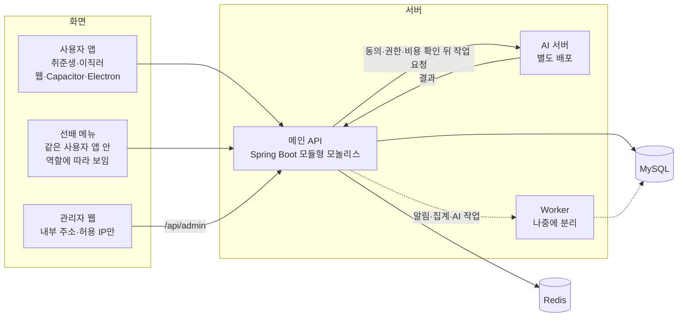

# 서비스·서버 구성: 선배 플랫폼, AI 서버, 관리자 통계

- 문서 버전: v1.0
- 작성일: 2026-11-27
- 상태: 구성 방향 승인(DEC-15). 세부 항목은 결정 대기(DEC-16~DEC-23). **설계안이며 아직 구현하지 않았다.**
- 관련 문서: [05 시스템 아키텍처](05-system-architecture.md), [08 AI 아키텍처](08-ai-architecture.md), [09 보안·개인정보](09-security-and-privacy.md), [12 결정 기록](12-decisions-and-open-issues.md)

## 1. 배경

사용자 요청(2026-11-27): 지금의 취준생·이직러 서비스에 더해, (1) AI 연동 서버, (2) 현업 경험자가 인증 후 가입해 팁을 나누고 스카우트·공고를 올리는 웹·앱, (3) 이 모든 것을 보는 관리·통계 화면을 만들고 싶다. 처음 제안은 서버 4개였다.

검토 결과, **화면은 4가지로 나누되 백엔드 서버는 2개(메인 API, AI 서버)로 시작**하는 안을 사용자가 승인했다(DEC-15). 05 문서의 "모듈형 모놀리스 유지, AI만 별도 서버" 원칙과 같다.

## 2. 이름

- 현업 경험을 나누는 사람: **선배**(영어 화면 "Mentor"). 인증을 마친 선배는 "인증 선배" 배지를 단다.
- 공고·스카우트를 올리는 사람을 선배와 다른 역할(예: 채용 파트너)로 둘지는 DEC-16에서 정한다.

## 3. 한눈에 보는 구성

| 구분 | 무엇 | 지금 상태(2026-11-27 소스 기준) | 이번 결정 |
|---|---|---|---|
| 화면 ① | 사용자 앱(취준생·이직러) | 있음. Vue 웹, Capacitor·Electron 구성 | 그대로 |
| 화면 ② | 선배 화면 | 없음 | 처음에는 사용자 앱 안 "선배 메뉴"로 만든다. 선배 기능이 커지거나 브랜드를 나눌 필요가 생기면 별도 웹·앱으로 뗀다(백엔드가 같아 떼기 쉽다) |
| 화면 ③ | 관리자·통계 웹 | 있음. 관리자 창(`AdminApp`)이 사용자 화면과 따로 렌더된다 | 지금 관리자 창을 키우고, 운영에서는 내부 주소·허용 IP로만 연다 |
| 서버 ① | 메인 API | 있음. 계정·기록·커리어·커뮤니티·채팅·관리자 API | 선배·공고·스카우트·통계 API를 **모듈로 더한다**. 서버를 따로 만들지 않는다 |
| 서버 ② | AI 서버 | 없음. 메인 API의 AI 요청은 미연결(503) 경계 | **별도 서버**로 만든다. 사용자 DB에 직접 접속하지 않고 메인 API가 넘긴 자료만 쓴다(08 문서) |
| 서버 ③ | Worker | 없음 | 알림·통계 집계·AI 작업이 늘면 API와 다른 프로세스로 뗀다(05 문서) |

## 4. 서버를 4개로 나누지 않는 이유

1. **취준생과 선배는 같은 데이터를 함께 쓴다.** 한 사람이 두 역할을 가질 수 있고(현직 이직러가 선배 활동), 스카우트는 취준생 프로필의 공개 범위를 봐야 하며(09 문서의 `SELECTED_USERS` 공유 범위), 팁·질문은 지금의 커뮤니티·채팅과 이어진다. 서버를 나누면 계정·권한·공개 범위·차단 목록을 두 곳에서 맞춰야 한다.
2. **관리자 기능은 이미 메인 API에 있다.** 관리자 창과 `/api/admin`이 있고, 운영 프록시가 바깥의 `/api/admin` 요청을 막는다. 통계 서버를 따로 두어도 결국 메인 DB를 읽어야 한다.
3. **AI만 성격이 다르다.** 실행 환경(Python·GPU·외부 AI 키), 비용, 처리 시간, 확장 방식이 달라서 분리하는 편이 낫다.

## 5. 메인 API에 더할 모듈(제안)

| 모듈 | 내용 | 기존 기능 재사용 |
|---|---|---|
| 역할 | 사용자·선배·(채용 파트너)·관리자. 지금은 `USER`·`ADMIN` 한 가지 값만 저장한다(`UserRole`). 한 계정이 여러 역할을 가지려면 역할 저장 구조를 바꿔야 한다 | 관리자 사용자 관리 화면 |
| 선배 인증 | 신청, 증빙, 관리자 심사, 배지, 증빙 보관·파기 | 첨부 파일 저장, 감사 로그 |
| 선배 활동 | 팁 글, 질문·답변, 신고 | 커뮤니티 글·댓글, 신고·심사 |
| 공고·스카우트 | 공고 등록·심사·만료, 스카우트 제안(받기를 켠 사용자에게만) | 채팅, 알림 |
| 통계 | 가입·인증 대기·활동·공고·스카우트·신고 지표. 처음에는 관리자 API 집계, 커지면 야간 집계 표 → 읽기 전용 복제 DB | 관리자 통계 화면 |
| AI 작업 | 동의·범위 확인, 작업 생성·상태·취소, 결과 권한 | 08 문서의 AI job 모델 |

## 6. 진행 단계(제안)

| 단계 | 내용 | 먼저 끝나야 하는 것 |
|---|---|---|
| S0 | 구성 결정과 이 문서(완료) | - |
| S1 | 역할 구조 확장: 선배(·채용 파트너) 역할, 한 계정 여러 역할 | DEC-16 |
| S2 | 선배 인증: 신청·증빙·관리자 심사·배지 | S1, DEC-17 |
| S3 | 선배 활동: 팁·질문 답변·신고 | S2 |
| S4 | 관리자 통계 1차: 운영 지표 | S1, DEC-22 |
| S5 | 공고·스카우트: 공고 심사, 받기를 켠 사용자에게만 제안 | S2, DEC-18·DEC-19 |
| S6 | AI 서버: 작업 API·큐, 첫 기능, 제공자 연결 | DEC-20·DEC-21, 기존 DEC-08 |
| S7 | Worker 분리, 통계 집계 배치 | 사용량이 늘 때 |

S6(AI)은 S1 이후 다른 단계와 나란히 진행할 수 있다. 실제 순서는 DEC-23에서 정한다.

## 7. 결정 대기

| ID | 항목 | 결정 전 영향 |
|---|---|---|
| DEC-16 | 선배와 채용 파트너를 다른 역할로 둘지 | 역할 저장 구조, 인증 방법 |
| DEC-17 | 선배 인증 방법(회사 이메일, 재직 증빙과 관리자 심사 등) | 증빙 저장·보관 기간, 관리자 심사 화면 |
| DEC-18 | 공고·스카우트의 법적 확인 시점과 무료·유료 여부 | S5 착수 시점. 채용 정보 제공·직업 소개는 직업안정법상 신고·등록 대상이 될 수 있어 전문가 확인이 필요하다(판단 아님) |
| DEC-19 | 스카우트 제안을 받는 방식(직접 켜야 받기 등) | 프로필 공개 범위, 동의 기록 |
| DEC-20 | 첫 AI 기능 | AI 서버 첫 범위 |
| DEC-21 | AI 서버 기술 스택 | 배포·운영 방식 |
| DEC-22 | 관리자 통계 첫 범위 | 집계 쿼리·지표 정의 |
| DEC-23 | 진행 순서 | 일정·WBS |

결정되면 [12 결정 기록](12-decisions-and-open-issues.md) 7절에 남기고 이 표의 상태를 바꾼다.
