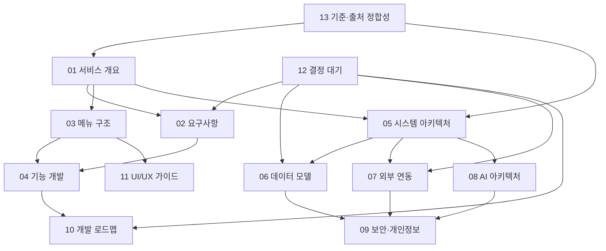

# Career OS 설계 문서 묶음

- 문서 묶음 버전: v2.1
- 기준일: 2026-11-20
- 적용 위치 제안: `docs/design/`
- 목적: 기존 Timebar Diary의 시간관리·기록·업무·협업 기능을 보존하면서 취업·이직·경력·포트폴리오 중심의 통합 커리어 플랫폼으로 확장하기 위한 설계 기준을 제공한다.

> **주의:** 이 문서 묶음은 사용자가 제공한 Markdown 발췌문을 통합·재구성한 설계 초안이다. 저장소 파일 전체, 실제 브랜치, 운영 DB, 외부 서비스 계정에 접근해 검증한 결과가 아니다. 구현 상태는 제공된 2026-11-20 기능개발·메뉴 문서의 기록을 기준으로 인용하며, 실제 적용 전 현재 HEAD와 최신 테스트 결과를 대조해야 한다.

## 문서 목록

| 파일 | 목적 | 먼저 읽을 때 |
|---|---|---|
| [01-service-overview.md](01-service-overview.md) | 서비스 목표, 타깃, 핵심 가치, 사용자 시나리오 | 기획·디자인·개발 공통 |
| [02-requirements-addendum.md](02-requirements-addendum.md) | 기존 요구 보존 정책과 신규 요구 후보 | 요구사항·수용 기준 작성 |
| [03-menu-structure.md](03-menu-structure.md) | 기존 메뉴를 보존한 통합 메뉴 제안 | IA·라우팅·화면 설계 |
| [04-feature-development.md](04-feature-development.md) | 기존 FD와 신규 기능의 구현 경계 | 개발 작업 분해 |
| [05-system-architecture.md](05-system-architecture.md) | 현재/목표 시스템 구성도와 배포 경계 | 시스템 설계·인프라 |
| [06-data-model-and-erd.md](06-data-model-and-erd.md) | 현재 DB 위험, 목표 논리 ERD, 신규 도메인 | DB 설계·마이그레이션 |
| [07-external-integrations.md](07-external-integrations.md) | GitHub·클라우드·메신저·허용 사이트 연동 | OAuth·API 연동 |
| [08-ai-architecture.md](08-ai-architecture.md) | 별도 AI 서버, 비동기 작업, AI 문서 생성 | AI 백엔드 설계 |
| [09-security-and-privacy.md](09-security-and-privacy.md) | 사용자 데이터, 경력 증거, 공유, 토큰, AI 보호 | 보안 검토 |
| [10-roadmap-and-priorities.md](10-roadmap-and-priorities.md) | 단계별 개발 순서와 의존성 | 일정·WBS·릴리스 |
| [11-ui-ux-guidelines.md](11-ui-ux-guidelines.md) | 웹·모바일 UX 및 DESIGN.md 적용 | UI/UX 리뉴얼 |
| [12-decisions-and-open-issues.md](12-decisions-and-open-issues.md) | 충돌·결정 대기·추가 확인사항 | 착수 전 검토 |
| [13-source-reconciliation.md](13-source-reconciliation.md) | 제공 문서 간 기준일·상태 충돌 정리 | 문서 통합·정합성 점검 |
| [14-baseline-reconciliation.md](14-baseline-reconciliation.md) | 현재 소스와의 대조 결과, 1단계(IA·커리어 원장) 적용 범위 | 구현 상태 확인 |

## 적용 원칙

1. 기존 `REQ-F01~F23`, `REQ-N01~N10`, `MN-01~MN-127`, `FD-01~FD-84`는 이 문서 묶음에서 삭제·재사용·재번호화하지 않는다.
2. 신규 ID는 후보 번호로만 제안한다. 실제 ID 발급과 수용 기준의 원문 등록은 기존 변경 절차대로 `../planning/requirements.md` 등 원본 문서에서 수행한다.
3. 기존 메뉴 경로와 API 계약은 실제 코드 확인 없이 변경하지 않는다. 새 메뉴는 기존 화면을 대체하기보다 연결하거나 확장하는 방향을 우선한다.
4. 문서의 Mermaid ERD는 논리 설계도다. 실제 DB DDL 또는 Flyway migration으로 바로 실행하지 않는다.
5. “서버 구현”, “화면 연결”, “검증 통과”, “외부 제공자 연결”은 서로 다른 상태다. 하나의 상태로 합쳐 표시하지 않는다.
6. 외부 제공자 미연결 기능은 화면에 준비 중/미연결 상태를 사실대로 표시한다.
7. 신규 개발 전 최신 `master`/실제 작업 브랜치, 최신 테스트 결과서, Flyway 이력, DB 스키마, API 계약을 재확인한다.

## 문서 관계

## 추천 적용 순서

1. `13-source-reconciliation.md`와 `12-decisions-and-open-issues.md`에서 기존 문서 충돌 및 결정 대기 사항을 닫는다.
2. `01-service-overview.md`를 서비스 정의의 기준으로 합의한다.
3. `02-requirements-addendum.md`의 신규 요구 후보를 원본 요구사항 문서에 정식 등록한다.
4. `03-menu-structure.md`와 `11-ui-ux-guidelines.md`로 IA·화면을 설계한다.
5. `05-system-architecture.md`, `06-data-model-and-erd.md`, `07-external-integrations.md`, `08-ai-architecture.md`를 상세 설계 및 검토한다.
6. `04-feature-development.md`와 `10-roadmap-and-priorities.md`를 실제 PR·테스트 ID에 연결한다.

## 변경 이력

| 버전 | 날짜 | 내용 |
|---|---|---|
| v2.1 | 2026-11-20 | 제공된 설계·메뉴·요구·기능개발·DB·외부 인터페이스 자료를 커리어 플랫폼 확장 기준으로 분리 정리 |
| v2.1 보완 | 2026-11-21 | 14번 문서 추가: 소스 대조 결과와 커리어 메뉴·활동 원장·지원 관리·커리어 목표 1차 반영 범위 기록 |
| v2.1 보완 | 2026-11-26 | 12번 DEC-12(다국어 지원 범위) 승인 기록 추가(dev-docs 09 Q-38) |
