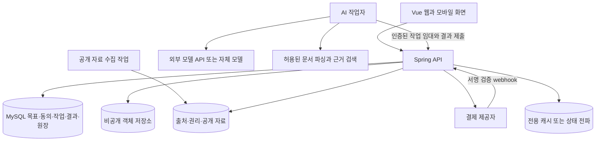
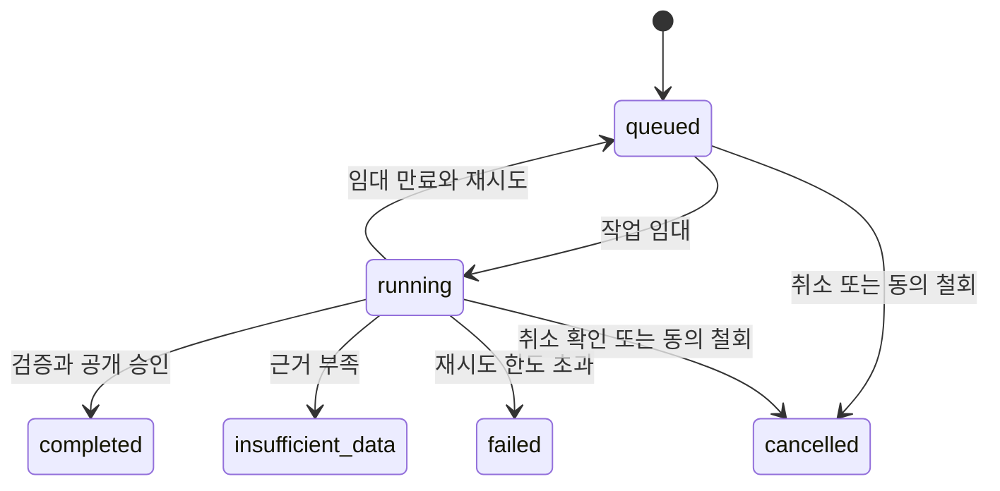

# 기술 설계와 단계별 구현 계획

작성일 2026년 10월 31일. 수정일 2026년 10월 31일. 현재 저장소를 확인해 작성한 설계 제안입니다. 이 문서의 신규 API·테이블·AI 서버·결제 기능은 아직 구현하지 않았습니다.

## 목차

- [현재 구현과 먼저 해결할 간극](#현재-구현과-먼저-해결할-간극)
- [권장 서버 구성](#권장-서버-구성)
- [데이터를 확보하고 분석하는 과정](#데이터를-확보하고-분석하는-과정)
- [새 데이터 모델](#새-데이터-모델)
- [제안 API와 기존 계약의 연결](#제안-api와-기존-계약의-연결)
- [작업 상태와 비용 정산](#작업-상태와-비용-정산)
- [개인정보와 권한](#개인정보와-권한)
- [평가와 운영 검증](#평가와-운영-검증)
- [단계별 구현과 출시 순서](#단계별-구현과-출시-순서)
- [구현 전에 확정할 결정](#구현-전에-확정할-결정)

## 현재 구현과 먼저 해결할 간극

현재 프로젝트는 Vue 프론트엔드, Spring Boot API, MySQL과 Redis를 사용합니다. 인증·채팅의 실제 연동과, 프론트엔드 일부 화면의 로컬 시연 상태를 구분해야 합니다. 최신 API 계약은 [2026년 10월 10일 계약 문서](../../api/frontend-backend-2026-10-10/README.md)를 기준으로 합니다.

| 확인한 파일 | 현재 확인된 동작 | 이번 기능에 필요한 변경 |
| --- | --- | --- |
| [AiInsightView.vue](../../../frontend/src/views/insight/AiInsightView.vue) | 모드별 고정 문구로 보고서를 표시 | 서버 작업 상태·검증된 결과·출처 화면으로 교체 |
| [CareerDocsView.vue](../../../frontend/src/views/work/CareerDocsView.vue) | 컴포넌트의 예시 데이터와 규칙 기반 문장 생성 포함 | 계정별 경력·문서 API 연결, 버전 충돌과 저장 실패 처리 |
| [aiSettings.js](../../../frontend/src/store/aiSettings.js) | 로컬 설정과 BYOK 키 저장, builtin 선택만으로 준비 상태가 참이 될 수 있음 | 서버 capability 확인, 브라우저 장기 비밀키 저장 제거 |
| [workPrivacy.js](../../../frontend/src/store/workPrivacy.js) | 업무·경력 영역을 기본 AI 제외로 설정 | 서버에서도 동일한 제외·선택·공유 범위 강제 |
| [SettingsBillingView.vue](../../../frontend/src/views/settings/SettingsBillingView.vue) | 가격·카드·변경 동작에 로컬 시연 상태 포함 | 실제 결제·이용권·사용량 API 연결 |
| [IntegrationController.java](../../../backend/src/main/java/kr/timebar/diary/integration/IntegrationController.java) | AI·결제 등 외부 제공자 미연결 경계는 503, capability는 사용 불가 | 신규 분석 작업과 실결제 연결 전까지 현재 의미 유지 |
| [SettingsService.java](../../../backend/src/main/java/kr/timebar/diary/operations/SettingsService.java) | 설정 JSON의 비밀값 저장을 제한 | 기존 aiSettings 객체를 그대로 서버로 전송하지 않음 |
| [FeatureType.java](../../../backend/src/main/java/kr/timebar/diary/feature/FeatureType.java) | 경력·위키 등 허용 필드가 정해진 JSON 계약 | 연구 DOI·분석 근거를 임의 필드로 끼우지 않고 명시적 모델 추가 |

backend에 관련 저장 API가 있다고 해서 해당 화면이 이미 이를 사용한다고 볼 수는 없습니다. 먼저 목표에 필요한 경력·문서·작업을 API에 연결하고 계정 간 분리, 새로고침, 재로그인, 다른 기기와 버전 충돌을 확인합니다. 유료 분석이 사라질 수 있는 로컬 시연 데이터에 의존하게 만들지 않습니다.

기존 API에는 교체형 `PUT`과 버전 조건을 사용하는 신규 기록 모델, 마지막 저장을 우선하는 과거 planner 모델이 함께 있습니다. 일정·루틴의 구형과 신형 자원을 동시에 쓰면 중복 생성·집계가 발생할 수 있습니다. 신규 목표의 행동은 사용할 자원을 하나로 정하고, 실제 controller·DTO·버전 계약을 확인한 뒤 연결합니다.

## 권장 서버 구성

**Spring을 권한과 데이터의 기준으로 유지하고, AI 분석을 비동기 작업자로 분리하는 구성을 권장합니다.** 처음부터 GPU 서버나 자체 학습 모델이 필요한 것은 아닙니다. 외부 모델 API로 품질·비용을 확인하면서 Python 문서 처리와 검색이 필요해지면 별도 컨테이너를 둡니다.



### 책임의 분리

| 구성 요소 | 담당할 책임 |
| --- | --- |
| Vue | 목표·자료 선택, 예상 사용량 확인, 상태 조회, 근거 확인, 수정안과 행동 승인 |
| Spring | 사용자 인증, 소유권·동의·이용권·예산 확인, 작업 저장, 결과 검증, 문서·계획 반영, 결제와 원장 |
| AI 작업자 | 허용된 입력의 파싱·검색·구조화·초안 생성, 모델 사용량 보고 |
| 수집 작업 | 계약상 허용된 공개 자료 수집, 중복 제거, 출처·변경·철회 관리 |
| 모델 제공자 | 최소화한 입력에 대한 모델 추론. 사용자 권한이나 결제 여부를 결정하지 않음 |

작업자는 전체 사용자 DB를 직접 읽거나 브라우저의 로그인 토큰을 전달받지 않습니다. 서비스 인증과 짧은 유효기간의 작업별 권한으로 필요한 입력만 받습니다. 업로드 자료는 소유권을 확인한 비공개 객체 참조로 전달하고 만료되는 다운로드 권한을 사용합니다.

### AI 서버 선택지

| 선택 | 적합한 단계 | 판단할 조건 |
| --- | --- | --- |
| Spring과 외부 모델 API | 적은 종류의 입력으로 빠르게 검증 | 파싱·검색 의존성이 단순하고 Java에서 관리 가능 |
| Spring과 별도 Python 작업자, 외부 모델 | 권장하는 첫 운영 구성 | 문서 처리·평가·검색 패키지를 독립 배포하고 작업 수를 늘려야 함 |
| 검색·임베딩을 자체 운영 | 공개·비공개 자료량과 검색 요구가 커진 이후 | 권리·격리·삭제 요구, 검색 평가 결과와 실제 비용이 뒷받침됨 |
| GPU 모델 서버 | 외부 전송 제한이나 충분한 고정 사용량이 확인된 이후 | 모델 품질, 라이선스, GPU 가동률, 장애 대응 인력과 총비용 비교 |

처음부터 벡터 DB, 여러 에이전트 프레임워크, Kubernetes를 필수로 만들지 않습니다. 작은 자료 집합은 관계형 메타데이터 필터와 일반 검색으로 시작하고 검색 누락·자료량을 측정한 뒤 임베딩을 추가합니다. 모델 이름과 가격을 문서에 고정하기보다 제공자별 어댑터와 실제 평가 결과로 선택합니다.

### 작업 실행 방식

첫 버전은 MySQL 작업 테이블의 임대·재시도 방식으로 구현할 수 있습니다. 작업자가 Spring의 내부 API로 처리할 작업을 원자적으로 임대하고, heartbeat와 임대 만료로 장애를 복구합니다. FastAPI를 사용하더라도 웹 프로세스의 `BackgroundTasks`에 유료 장기 작업의 영속성과 복구를 맡기지 않습니다. 공식 문서도 무거운 작업에서 별도 작업 도구·프로세스를 고려하도록 설명합니다. [S14](sources.md#s14).

처리량이 커지면 DB outbox와 전용 Redis Streams 등으로 전달할 수 있습니다. 이때도 MySQL의 작업·정산 기록을 기준으로 하고 중복 전달을 전제로 설계합니다. 현재 Redis 7.4 채팅 Pub/Sub은 유실 복구가 필요한 분석 작업의 큐로 쓰지 않습니다. 기존 128/256MB 메모리와 `noeviction` 설정도 공유 부하를 감당하는지 따로 확인합니다.

Redis Streams를 선택할 때는 현재 버전에서 지원하는 `XADD`, `XREADGROUP`, `XACK`, `XAUTOCLAIM` 등을 사용하고, 최신 문서의 8.2 이상 전용 기능을 그대로 적용하지 않습니다. 확인 응답·미처리 항목·재처리 정책, AOF 등 내구성 설정을 검증해야 하며 이것만으로 정확히 한 번의 실행이 보장되지는 않습니다. [S15](sources.md#s15).

### 웹·모바일·데스크톱의 구현 순서

현재 [package.json](../../../frontend/package.json)에는 웹 빌드, Capacitor 모바일 동기화, Electron 개발·패키징 경로가 있습니다. 포장 구성이 있다는 것과 모든 플랫폼의 설치·결제·권한 동작을 검증했다는 것은 다릅니다.

| 플랫폼 | 권장 구현 |
| --- | --- |
| 반응형 웹 | 첫 출시 대상. 같은 Vue 화면과 Spring API로 자료 선택·분석·검토·계획을 완성 |
| 모바일 웹 | 짧은 결과 확인·행동 선택·결과 기록을 우선. 큰 문헌 표와 수정안은 접기·단계 구분으로 제공 |
| Capacitor 앱 | 웹 흐름이 검증된 뒤 파일 선택·보관 권한·알림·복귀 시 작업 상태 동기화를 별도 검증 |
| Electron 앱 | 같은 API·작업 ID 사용. 파일 접근 권한과 보안 경계를 지키고 모델 키를 앱에 포함하지 않음 |

장기 분석은 클라이언트가 닫혀도 서버에서 처리하고, 다시 열면 계정별 작업 상태를 복원합니다. 모바일의 백그라운드 실행에 분석 완료를 의존하지 않습니다. 개인 문서의 기기 캐시는 선택적으로 두고 계정 전환·로그아웃·삭제 시 분리·정리합니다. 오프라인에서도 새 AI 결과가 생성되는 것처럼 표시하지 않습니다.

앱스토어 배포·디지털 이용권 결제는 실제 배포 플랫폼의 당시 공식 정책과 계약을 확인해 결제 경로·권한 동기화를 확정합니다. 웹 결제 화면을 그대로 넣는 것만으로 네이티브 유료 출시가 준비되었다고 보지 않습니다.

## 데이터를 확보하고 분석하는 과정

### 수집 가능한 데이터와 조건

| 데이터 | 초기 활용 | 먼저 확인할 조건 |
| --- | --- | --- |
| 사용자 선택 공고와 경험 | 공고 요구와 경험 근거 비교 | 입력·처리 권한, 타인 정보 가림, 시장 전체 통계와 구분 |
| 고용24 | 승인된 채용·훈련·직무 정보 | 기업회원 신청, API별 승인·필드·이용 제한과 재사용 계약 [S10](sources.md#s10). |
| 한국산업인력공단 공개 API | 자격·직무 데이터 연결 후보 | 실제 제공 API의 갱신 주기·이용 조건·코드 연결 검토 [S11](sources.md#s11). |
| Crossref | DOI, 서지정보, 갱신·정정 정보 | 메타데이터와 초록·전문의 이용권 구분 [S12](sources.md#s12). |
| OpenAlex | 문헌·주제 관계와 탐색 후보 | 현재 인증·사용량·비용과 각 원문의 이용권 확인 [S13](sources.md#s13). |
| 사용자 연구 문서 | 문헌 비교와 연구 메모 연결 | 미공개·공동 연구·소속기관 정책과 외부 처리 동의 |

검색 결과에 접근할 수 있다는 이유만으로 본문을 무제한 수집·학습·재배포하지 않습니다. 자료마다 출처, 원문 URL, 발행일, 수집일, 허용 목적, 보관 가능 기간, 인용·재배포 조건, 수정·철회 상태를 기록합니다. 공급자 약관과 계약이 불확실하면 자동 수집을 끄고 허용된 입력만 사용합니다.

### 처리 단계

1. **수집과 검역을 수행합니다.** 허용된 도메인·API와 파일만 받아 파일 형식·크기·악성 내용·파서 제한을 확인합니다. 외부 URL은 내부 IP·클라우드 메타데이터·위험한 리다이렉트를 차단해 서버 내부 접근을 방지합니다.
2. **정규화합니다.** 채용은 원 출처·기업·직무·지역·게시 식별자를, 연구는 DOI·버전·문헌 유형을 기준으로 중복을 줄입니다. 원본과 정규화 결과를 연결해 수정 가능하게 합니다.
3. **통계와 검색을 분리합니다.** 표본 수, 기간별 비중과 중복 제거는 검증 가능한 코드로 계산합니다. AI가 계산값을 지어내지 않습니다. 검색은 목표와 자료 범위로 제한합니다.
4. **개인 입력을 구성합니다.** 분석 시작 시 선택한 자료의 버전과 동의 버전을 스냅샷으로 남깁니다. 기본 AI 제외 자료를 자동 포함하지 않습니다.
5. **구조화된 결과를 생성합니다.** 모델은 제공한 근거 ID 안에서 해석·질문·초안을 제안합니다. 외부 문서의 지시문은 자료로 취급하며 작업 권한을 바꾸지 못하게 합니다.
6. **결과를 검증합니다.** 스키마, 출처 ID, 인용 범위, 사용자 경력·문헌과의 연결, 허용 표현을 검사합니다. DOI 존재 확인은 서지정보 API로 검증하고, 문헌의 실제 주장을 뒷받침하는지는 별도로 평가합니다.
7. **사용자가 검토합니다.** 문서 변경과 행동은 제안 상태로 저장합니다. 승인된 부분만 해당 버전과 소유권을 다시 확인해 적용합니다.

공개 분야 요약은 허용 범위 안에서 공유 캐시를 사용할 수 있습니다. 개인 경험·원고가 들어간 입력·임베딩·결과 캐시는 소유자와 목표별로 격리합니다. 사용자 이름만 캐시 키에서 빼는 방식은 충분하지 않습니다.

### 결과 형식의 예시

아래 JSON은 제안 스키마의 예시이며 현재 API 응답이 아닙니다. 수요가 늘었다는 수치 대신 필요한 근거와 사용자 확인 상태를 표현합니다.

```json
{
  "schemaVersion": "growth-report.v1",
  "goalId": "goal-123",
  "analysisKind": "career",
  "scope": {
    "mode": "selected_sources",
    "sourceCount": 3,
    "region": "사용자 선택 지역",
    "collectedAt": "2026-10-31"
  },
  "findings": [{
    "id": "finding-1",
    "statement": "선택한 공고에서 데이터 검증 업무가 확인됩니다.",
    "sourceRefs": ["source-1", "source-2"],
    "evidenceRefs": ["experience-7@v2"],
    "limitations": ["선택한 공고에 한정한 비교입니다."]
  }],
  "gaps": [{
    "kind": "evidence_missing",
    "question": "프로젝트에서 실제로 확인한 검증 결과가 있나요?"
  }],
  "proposals": [{
    "id": "proposal-1",
    "kind": "action",
    "title": "데이터 검증 결과 정리",
    "estimatedMinutes": 120,
    "completionCriterion": "검증 방법과 관찰한 결과를 기록",
    "status": "pending_approval"
  }]
}
```

각 `sourceRef`에는 사용한 문서 버전·위치·이용 범위가 연결됩니다. 출처가 존재하는지와 그 출처가 주장을 지지하는지는 별도 검사입니다. `estimatedMinutes`는 제안값이며 사용자가 조정할 수 있습니다. 연구 보고서는 별도 스키마로 문헌별 방법·한계·심사 상태·미확인 질문을 표현합니다.

## 새 데이터 모델

`growth` 도메인을 추가하고 계정 소유권, 동의, 과금과 작업 상태는 명시적인 관계형 테이블로 관리하는 방안을 권장합니다. 버전이 있는 보고서 본문은 제한된 JSON 스키마로 저장할 수 있습니다. 기존 범용 기능 JSON의 허용 필드 제한을 우회하지 않습니다.

| 제안 테이블 묶음 | 핵심 정보와 제약 |
| --- | --- |
| `growth_goals`, `growth_goal_profiles` | 소유자, 유형, 목표, 상태, 기한, 선택 조건, 버전 |
| `growth_consents` | 목적, 자료 범위, 제공자·정책 버전, 동의·철회 시각 |
| `growth_evidence`, `growth_evidence_links` | 경험·문헌·결과물 참조, 원본 버전, 사용자 확인, 소유자·공유 권한 |
| `growth_sources`, `growth_source_versions` | 출처와 권리 조건, 수집 시각, 본문 참조, 수정·철회 상태 |
| `growth_artifacts`, `growth_artifact_versions` | 문서 원본·수정안·확정본, 근거 연결, 사용자 승인과 버전 |
| `ai_jobs`, `ai_job_attempts`, `ai_input_snapshots` | 요청 해시, 멱등키, 입력·동의 버전, 상태·임대·시도·취소·모델 버전 |
| `growth_reports`, `growth_claim_refs` | 검증된 결과, 핵심 주장과 근거 위치, 한계, 스키마 버전 |
| `growth_action_proposals` | 제안·수정·승인·보류, 적용 대상 버전, 생성한 작업·일정 ID |
| `subscriptions`, `entitlements` | 결제 제공자 식별자, 실제 이용 기간·상품·상태 |
| `usage_ledger`, `billing_events`, `outbox_events` | 예약·확정·복원, 중복 방지 키, 제공자 이벤트, 재처리 상태 |

사용자 소유 자원은 조회·변경·다운로드마다 소유권을 확인합니다. 목표 ID만 알면 접근할 수 있는 구조를 만들지 않습니다. 개인 근거를 공개 출처로 승격할 때는 자동 추론이 아니라 별도 권한과 확인이 필요합니다.

현재 업로드 한도는 파일 10MB·요청 11MB, 범용 기능 payload는 128KiB입니다. 큰 원고나 문헌을 기존 JSON에 넣기 위해 이 한도를 일괄 확장하지 않습니다. 비공개 객체 저장소와 메타데이터 참조를 사용하고 문서별 용량·페이지·압축 해제·파싱 시간·모델 입력 한도를 별도로 정합니다.

## 제안 API와 기존 계약의 연결

아래는 신규 계약 초안입니다. 확정 시 기존 API 목록·스키마·계약 테스트를 함께 갱신합니다.

| 메서드와 경로 예시 | 책임 |
| --- | --- |
| `GET/POST /api/growth/goals` | 내 목표 조회·생성 |
| `GET/PUT /api/growth/goals/{id}` | 소유권과 버전 조건을 확인한 목표 조회·교체 |
| `POST /api/growth/goals/{id}/evidence` | 사용할 기존 자료나 업로드 참조 선택 |
| `POST /api/growth/goals/{id}/consents` | 분석 목적과 범위 동의 |
| `DELETE /api/growth/consents/{id}` | 동의 철회와 연관 작업 취소·결과 접근 처리 |
| `GET /api/growth/trends` | 권리·범위가 확인된 공개 분야 변화 조회 |
| `POST /api/growth/analysis-estimates` | 예상 사용 단위와 입력 한도 확인, 최종 예약은 아님 |
| `POST /api/growth/analysis-jobs` | 서버 권한 검증 후 작업·사용량 예약, `202`와 상태 URL 반환 |
| `GET /api/growth/analysis-jobs/{id}` | 내 작업 상태와 실패 사유 조회 |
| `POST /api/growth/analysis-jobs/{id}/cancel` | 멱등적인 취소 요청 |
| `GET /api/growth/reports/{id}` | 현재 권한이 유효한 결과·출처 조회 |
| `POST /api/growth/artifacts/{id}/revisions` | 문서 수정안 생성 작업 요청 |
| `POST /api/growth/action-proposals/{id}/accept` | 검토한 제안을 기존 할 일·일정에 한 번 적용 |
| `GET /api/billing/entitlements` | 실제 이용권과 남은 사용량 조회 |
| `POST /api/billing/checkout-sessions` | 서버 상품·가격 ID로 결제 시작 |
| `POST /api/billing/webhooks/{provider}` | 서명·이벤트 중복 검증 후 결제 상태 반영 |

기존 `/api/insight/generate`의 요청은 `from`, `to`, `features`이며 현재 미연결 경계입니다. 이를 예고 없이 비동기 `202` 응답으로 바꾸지 않습니다. 신규 growth 계약을 먼저 도입하고 구형 화면의 전환·호환 종료를 별도로 정합니다. capability는 실제 모델·동의·계약·운영 준비를 확인한 서버 값을 사용합니다.

현재 [SecurityConfig.java](../../../backend/src/main/java/kr/timebar/diary/security/SecurityConfig.java)는 공개 허용 경로 외에 사용자 JWT를 요구합니다. 결제 webhook은 정확히 해당 경로만 사용자 JWT 예외로 둔 뒤 제공자 서명을 검증합니다. 내부 작업자 API는 별도 서비스 인증과 작업별 범위 권한을 적용하고 일반 사용자 API와 인증 주체를 구분합니다. 내부 경로 전체를 무인증으로 열지 않습니다.

분석 결과 확인은 초기에는 제한된 polling으로 시작해도 됩니다. 필요할 때 기존 인증 방식을 따르는 별도 상태 스트림을 추가합니다. 채팅 이벤트와 섞거나 URL에 장기 인증 토큰을 넣지 않습니다.

### 승인한 제안의 적용

`accept`는 소유권, 제안 상태, 대상 문서 버전과 멱등키를 검사합니다. 이미 적용된 제안을 다시 요청하면 기존에 만든 ID를 반환합니다. 수정한 문서와 버전이 맞지 않으면 `409`로 충돌을 알리고 현재 내용과 다시 비교하게 합니다.

할 일과 일정은 기존 서비스 계층을 사용해 연결합니다. 선택한 새 일정 자원만 사용하고 구형 events·planner와 중복으로 쓰지 않습니다. 기존 저장 방식이 버전 충돌을 검사하지 않는 자원에는 AI가 기존 내용을 덮어쓰지 않도록 신규 생성·미리보기 범위를 우선 적용합니다.

문서·할 일·일정을 하나의 트랜잭션으로 처리할 수 있으면 원자적으로 저장합니다. 서로 다른 서비스로 분리된다면 outbox와 재처리 키로 부분 성공을 복구하고, 사용자에게 적용 결과를 정확하게 보여줍니다. LLM이 직접 DB나 외부 캘린더에 쓰는 권한은 갖지 않습니다.

## 작업 상태와 비용 정산



처리 단계는 자료 확인, 검색, 분석, 검증 등으로 별도 기록합니다. `insufficient_data`는 모델 호출 장애와 구분하는 정상 종료 상태이며, 결과를 유효하게 제공하지 못한 경우 예약 사용량을 복원하는 정책을 권장합니다. 제한된 진단 설명만 보여주고 이를 심층 분석 성공으로 차감하지 않습니다.

### 한 작업의 처리 순서

1. Spring이 사용자·자료 소유권·동의·제공 가능 상태·이용권·예산을 확인합니다.
2. 짧은 DB 트랜잭션 안에서 작업·입력 스냅샷·사용량 예약을 함께 저장합니다. 사용자와 멱등키에 고유 제약을 둡니다. 같은 키의 다른 입력은 충돌로 처리합니다. 서로 다른 요청의 동시 한도 초과는 계정·과금기간별 예산 행 잠금 또는 조건부 원자 예약으로 막습니다.
3. 작업자가 유효한 임대 토큰으로 입력을 받고 실행합니다. 외부 모델·처리자에 새로 전송하기 직전마다 현재 동의·취소·계정 상태를 다시 검사합니다. 이미 전송한 요청과 이후 신규 전송을 구분해, 철회 후 후속 호출을 막습니다. **모델 네트워크 호출 동안 DB 트랜잭션을 열어두지 않습니다.**
4. 작업자는 사용량·모델 버전·결과를 보고합니다. 오래된 시도의 결과가 새 작업을 덮어쓰지 못하도록 임대 세대와 상태를 확인합니다.
5. Spring은 결과 검증과 함께 현재 동의·삭제 상태를 다시 확인합니다. 결제 상태 변경 시 진행 중 작업을 제공할지 취소할지도 명시된 정책으로 검사합니다.
6. 결과 공개와 사용량 확정은 한 번만 수행합니다. 재시도 이벤트는 이미 확정한 결과와 원장 ID를 반환합니다.
7. 실패·자료 부족·취소는 정책에 맞게 예약을 해제합니다. 이미 발생한 외부 모델 비용은 운영 원가로 남기고 사용자 차감과 구분합니다.

예약 재분석도 매번 같은 검증을 거칩니다. 기본 비활성으로 두고, 사용자가 승인한 주기·회당 단위·월 상한을 서버에 저장합니다. 잔량 부족·이용권 만료·동의 철회 시 건너뛰며 자동으로 추가 과금하지 않습니다.

취소가 모델 호출을 즉시 중단하지 못해도 이후 결과 공개·적용은 막을 수 있어야 합니다. 재시도 횟수·전체 시간·최대 입력·출력·제공자 비용 한도를 작업별로 둡니다. 예약량을 넘을 수 있는 호출은 새로 시작하지 않고 중단·축소·재승인 중 정책에 따라 처리합니다.

임대가 만료됐다고 이전 외부 호출까지 끝난 것은 아닙니다. 시도별 제공자 요청 ID와 응답 수신 상태를 기록하고, 결과가 불명확한 timeout은 제공자 조회·멱등 지원 여부에 따라 대사 후 제한적으로 재시도합니다. 중복 결과 공개·사용량 차감을 막는 것과 외부 원가의 중복을 막는 것은 별도 문제이므로 모두 관찰합니다.

### 과금에서 지켜야 할 일관성

사용량 원장의 상태는 `reserved → committed` 또는 `reserved → released`로 정의합니다. 이미 확정한 항목을 환불할 때는 원본을 지우지 않고 별도 조정 기록을 남깁니다. 작업 ID와 원장 처리 종류에 고유 제약을 두고, 실제 모델 사용 비용과 사용자 상품 단위를 별도로 집계합니다.

결제 webhook은 서명·시각·환경·상품·계정 매핑을 검증하고 제공자 이벤트 ID로 중복을 제거합니다. 순서가 뒤바뀐 이벤트는 제공자 상태 조회와 버전·시각 정책으로 조정합니다. 브라우저가 보내는 가격·결제 성공·유료 여부를 신뢰하지 않습니다. 만료·해지·실패·환불·분쟁 정책과 정기 대사 작업이 필요합니다.

## 개인정보와 권한

### 동의와 최소 입력

업무·경력 자료의 기본 AI 제외 원칙을 유지합니다. 목표별 선택 자료, 분석 목적, 외부 처리자, 보관 정책과 공유 범위를 설명하고 동의 버전을 남깁니다. 회사명·인명 가림은 서버 처리에도 적용하고 사용자가 보낸 실제 입력 범위를 확인할 수 있게 합니다.

브라우저 localStorage의 BYOK 키를 기본 상용 경로로 유지하지 않습니다. 최초 유료 제품은 서버의 제공자 키를 비밀 저장소에서 관리하는 방식이 단순합니다. BYOK가 꼭 필요하면 별도 위협 검토와 암호화·단기 사용·삭제 설계를 하고 기존 로컬 설정 객체를 일반 settings API에 업로드하지 않습니다.

입력·원고·결과를 모델 학습에 재사용하는 기능은 기본으로 켜지 않습니다. 제공자의 보관·학습·지역 처리 정책을 확인하고 상품 동의와 별도 목적을 혼합하지 않습니다. 민감한 연구 자료는 외부 처리 없이도 기록·계획 기능을 사용할 수 있어야 합니다.

### 제안하는 보관 정책의 초안

아래는 구현 전 정책 초안입니다. 법정 보존 기간이나 현재 운영 정책이 아니며, 실제 계약·개인정보 정책과 운영 요구를 검토해 확정해야 합니다.

| 데이터 | 제안 기본값 |
| --- | --- |
| 사용자가 저장한 문서·결과물 | 사용자 삭제 또는 계정 정책까지 보관, 개별 삭제·내보내기 제공 |
| 일시 분석용 업로드 | 분석 후 30일 내 삭제를 기본 제안, 근거 보관함 저장은 별도 선택 |
| 최소화한 AI 입력 스냅샷 | 장애 확인용 최대 7일 후 내용 삭제, 버전·해시·동의 이력은 목적에 맞춰 최소 보관 |
| 운영 로그 | 본문·비밀키·원고 제외, 예시 30일 보관 후 집계·삭제 |
| 공개 출처 사본 | 공급자 이용 조건·수정·철회 정책을 우선 적용 |
| 결제·회계 기록 | 적용 법령·계약의 보존 의무를 별도 검토, 개인 원고와 분리 |

철회·삭제 시 진행 작업, 입력 스냅샷, 파생 결과와 임베딩·검색 인덱스·캐시를 추적해 무효화·삭제합니다. 공유 링크도 함께 해제합니다. 백업 복원 시 삭제된 자료를 다시 활성화하지 않는 절차와 완료 상태가 필요합니다. 회계 보존이 필요한 거래 기록을 원고와 같은 삭제 규칙으로 일괄 지우지는 않습니다.

### 서비스 경계와 표시

생성형 AI 기반 서비스의 사전 고지와 생성 결과 표시를 설계에 포함합니다. 현재 인공지능기본법 제31조의 관련 의무를 기준으로 실제 표시 방식과 적용 범위를 출시 시 확인합니다. 채용 판단·평가 등 고영향 영역으로 기능이 확대될 때는 해당 여부를 다시 검토합니다. 개인의 작성 지원이라고 해서 어떤 설계든 자동으로 제외된다고 단정하지 않습니다. [S16](sources.md#s16).

코치·교수·기관 관리자는 사용자가 공유한 목표·문서에만 접근합니다. 기관이 비용을 지불해도 개인 일기·원고·작업 시간 전체를 볼 권한이 생기지 않습니다. 사용자별 조회·수정·공유·삭제 권한을 API에서 검사하고 필요한 감사 기록을 남깁니다.

## 평가와 운영 검증

### 모델 평가

첫 평가 자료로 경력 50건, 연구 30건, 공격·오류 사례 20건 등 100건을 구성할 수 있습니다. 이는 표본 구성의 제안입니다. 사용 동의를 확보한 자료나 합성 자료를 사용하고 초기 실험 분야의 검토자가 정답·허용 범위·부족한 근거를 표시합니다.

| 평가 항목 | 확인할 내용 |
| --- | --- |
| 근거 일치 | 핵심 주장에 출처가 연결되고 해당 문장이 실제로 주장을 뒷받침하는가 |
| 수치 정확성 | 기간·지역·표본·증감률이 계산 결과와 같은가 |
| 개인 사실 보존 | 역할·성과·경험·실험 결과를 임의로 추가하지 않는가 |
| 불확실성 | 자료 부족, 미열람 전문, 오래된 자료와 상충하는 근거를 표시하는가 |
| 실행 가능성 | 사용자의 시간·조건 안에서 결과물과 완료 기준이 명확한가 |
| 검색 성능 | 필요한 문헌·공고를 찾는지, 중복·철회 자료를 처리하는가 |
| 공격 대응 | 문서 속 지시문, 비밀 노출 요구와 허용하지 않은 도구 호출을 차단하는가 |

자동 스키마·출처 ID 검사는 매번 실행하고, 근거가 주장을 지지하는지와 작성 방향의 적합성은 사람의 표본 검토를 병행합니다. 모델이나 프롬프트를 바꾸면 같은 평가 자료로 회귀를 확인합니다. 가짜 인용·경력, 다른 계정 자료 노출은 즉시 출시 중단 항목으로 둡니다.

### 필수 통합 시나리오

- 계정 A의 목표·자료·다운로드·작업·보고서를 계정 B가 읽거나 바꾸지 못합니다.
- 미동의·철회·삭제 후 작업 시작과 결과 공개가 차단됩니다.
- 중복 요청·webhook·임대 만료·작업자 재시작에도 문서·할 일·차감이 중복되지 않습니다.
- 완료 직전 취소, 만료된 작업자의 결과 제출, 삭제 후 캐시 조회를 검증합니다.
- 제공자 timeout·429·5xx·부분 응답·틀린 JSON·허위 DOI·빈 검색 결과를 재현합니다.
- 실제 결제 sandbox에서 성공·실패·해지·만료·환불과 순서가 바뀐 이벤트를 검증합니다.
- 업로드 한도, 파서 시간 제한, 외부 URL 내부 접근 차단과 문서 내 악성 지시문을 검증합니다.
- 기존 문서 버전 충돌은 `409`로 처리하고 사용자가 변경한 글을 보존합니다.
- 웹·모바일에서 상태·출처·수정안·승인·실패 복구를 키보드와 320px 화면으로 확인합니다.

응답 시간은 첫 요청의 빠른 접수와 전체 작업 완료 시간을 구분해 측정합니다. 제공자와 문서량을 확인하기 전에 고정 초 단위 완료를 약속하지 않습니다. 작업 대기 시간, 단계별 소요 시간, 성공·자료 부족·실패율, 출처 검증률, 작업당 비용과 원장 불일치를 관찰합니다. 로그에는 개인 원문을 기본으로 남기지 않습니다.

### 배포와 운영

기존 Docker 배포에 비공개 AI 작업자 컨테이너를 추가하고 브라우저에 작업자 포트를 노출하지 않습니다. 초기에는 같은 호스트여도 자원·자격증명·헬스체크를 분리합니다. 처리량이나 장애 영향이 커지면 작업자만 별도 서버로 옮길 수 있게 합니다.

배포 순서는 하위 호환 DB 변경, Spring 작업·권한 API, 작업자, 제한된 UI 플래그 활성화입니다. 작업·결과 스키마 버전을 기록해 이전 작업을 처리할 수 있게 하고, 중지 스위치로 새 분석만 막으면서 기존 기록 조회는 유지합니다. 대기 작업 복구, 비용 상한, webhook 대사와 백업 복원을 실제로 연습합니다.

기존 [배포 가이드](../../handbook/source/02-배포-가이드.md)를 기반으로 새 비밀값·작업자·객체 저장소·데이터 계약·복구 절차를 추가해야 합니다. 현재 문서 작성만으로 AI 운영 준비가 끝난 것은 아닙니다.

## 단계별 구현과 출시 순서

아래 기간은 **개발자 2명, 일부 시간의 디자인·분야 검토 지원을 가정한 약 12주 작업 예시**입니다. 실제 인력·기존 연동 상태·자료 승인·결제 심사에 따라 달라지며 일정 보장이 아닙니다. 자료 이용 승인이 늦어져도 허용된 선택 자료로 사용자 가치를 먼저 검증할 수 있습니다.

| 단계 | 예시 기간 | 구현·검증할 결과 | 다음 단계 조건 |
| --- | --- | --- | --- |
| 0. 문제 검증 | 1~2주 | 한 분야의 실제 자료로 검토된 분석·행동 제안 제공, 인터뷰 | 사용자가 결과를 이해하고 실제 작업에 활용할 이유 확인 |
| 1. 저장과 동의 | 3~4주 | 경력·문서 API 연결, 목표·근거·동의·삭제 | 계정 분리·재로그인·버전 충돌 검증 통과 |
| 2. 근거 기반 분석 | 5~7주 | 허용된 수집, 작업 임대·재시도·검증, 출처 화면 | 근거·비용·복구 평가 통과, 자료 부족 시 안전하게 종료 |
| 3. 실행과 문서 연결 | 8~9주 | 수정안 비교, 사용자 승인, 할 일·일정·결과물 연결 | 중복·충돌·취소 시나리오 통과, 실제 반복 사용 확인 |
| 4. 유료 베타 | 10~12주 | 실제 이용권·예약 원장·결제·한도·해지·지원 | 결제 대사·이중 차감 0건, 유료 가치와 공헌이익 확인 |
| 5. 연구·기관 확장 | 이후 별도 | 연구 파이프라인 정교화, 코치 공유, 분야 확대 | 분야별 검토·이용권·공유 권한과 지불 수요 검증 |

0단계의 연구자 실험은 수동 검토로 함께 할 수 있지만, 첫 운영 MVP는 하나의 분야·분석 흐름과 하나의 개인 유료 상품으로 제한하는 편이 좋습니다. 연구와 취업을 동시에 완성하려다 각각의 품질을 검증하지 못하는 상황을 피합니다.

### 코드 작업의 권장 분할

1. 경력·문서 화면의 서버 저장 연결과 기존 계약 테스트를 먼저 완료합니다.
2. `growth` 목표·근거·동의 모델과 권한 테스트를 추가합니다.
3. 비동기 작업·입력 스냅샷·사용량 예약과 실패 복구를 구현합니다.
4. 한 개 자료 공급자와 모델 어댑터, 결과 검증·평가 자료를 연결합니다.
5. `/insight` 결과와 문서 수정안·승인 흐름을 연결합니다.
6. 기존 작업·일정 서비스에 멱등적인 승인 적용을 추가합니다.
7. 실제 결제 sandbox와 대사·지원 화면을 통과한 후 유료 베타를 엽니다.

각 단계는 독립적으로 검증하고 의미 있는 단위로 커밋합니다. AI·결제 capability는 실제 제공 가능한 범위만 활성화합니다. UI의 토글만 켜서 운영 기능이 연결된 것처럼 보이게 하지 않습니다.

## 구현 전에 확정할 결정

| 결정 | 권장 초안 | 확정할 근거 |
| --- | --- | --- |
| 첫 대상 | 기존 경험이 있는 소프트웨어·데이터 직무 전환자 | 접근 가능한 모집 채널과 인터뷰·활용 결과 |
| 첫 분석 범위 | 사용자가 선택한 공고·경력의 비교 | 자료 처리 권한, 검토 가능한 정답과 표본 |
| 첫 모델 | 외부 API, 제공자 교체 가능한 어댑터 | 한국어·근거 정확성·개인정보 정책·실측 비용 |
| AI 배포 | Spring과 비공개 Python 작업자 | 파싱·검색 요구, 작업 복구와 운영 인력 |
| 저장 | MySQL 메타데이터와 비공개 객체 저장소 | 파일량·삭제·백업·접근 권한 요구 |
| 작업 전달 | DB 작업 임대, 필요할 때 outbox·전용 큐 추가 | 대기 시간·처리량·복구 검증 |
| 첫 요금제 | 무료와 개인 유료 한 종류 | 실제 결제·환불·작업당 원가 |
| 기관 확장 | 사용자 승인 공유부터 제공 | 개인 가치, 계약·법적 분류와 권한 모델 |

이 설계의 우선순위는 더 많은 AI 기능을 한꺼번에 여는 것이 아니라, 근거가 있는 결과가 사용자의 실제 작업과 기록에 안정적으로 연결되는지 검증하는 것입니다. 제품 경험과 가격 실험은 [제품과 유료화 설계](02-제품과-유료화-설계.md), 고용·연구·기술 자료의 출처와 한계는 [근거 자료](sources.md)를 함께 확인합니다.
