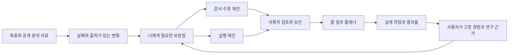

# AI 커리어와 연구 성장 기능 설계안

작성일 2026년 10월 31일. 수정일 2026년 10월 31일. 조사 마감일 2026년 10월 31일. 한국 시장을 우선으로 검토하고 해외 자료는 국가와 전망 기간을 구분했습니다. 이 문서는 제안이며 아래 기능, 가격, API와 서버 구성은 아직 구현되지 않았습니다.

## 목차

- [핵심 제안](#핵심-제안)
- [상세 문서](#상세-문서)
- [처음 만들 제품](#처음-만들-제품)
- [현재 앱에서 먼저 해결할 일](#현재-앱에서-먼저-해결할-일)
- [유료화와 출시 판단](#유료화와-출시-판단)
- [AI 서버 구성 판단](#ai-서버-구성-판단)
- [확정이 필요한 사항](#확정이-필요한-사항)

## 핵심 제안

**분야의 변화를 찾아주는 기능을 개인의 경험과 연구 자료, 문서 작성, 이번 주 실행으로 연결하는 성장 가이드로 만듭니다.** 사용자가 읽을 보고서를 늘리는 것보다, 확인한 근거를 바탕으로 선택한 행동이 실제 성과와 다음 문서로 남도록 설계합니다.

이 흐름은 현재 앱의 계획과 실제 기록 비교, 경력, 업무 위키와 WBS를 함께 사용할 이유를 만듭니다. 취업에 성공한 뒤에도 새 직무 적응, 분기 성과 정리, 연구와 독립 프로젝트로 이어질 수 있습니다. 지속 사용과 유료 전환은 앞으로 검증할 가설입니다.

단순한 AI 자기소개서 생성은 이미 경쟁 기능입니다. 고용부의 잡케어 운영 자료에도 진로 및 구직 지원 수요가 나타나며, Huntr는 이력서와 지원 관리, Elicit는 연구 분석과 정기 근거·산출물 갱신을 제공합니다. 따라서 이 앱만 가능한 기능이라고 홍보하기보다 **사용자가 승인한 실행과 실제 결과가 문서에 다시 반영되는 경험**이 더 유용한지 검증해야 합니다. [잡케어 근거](sources.md#s08), [경쟁 제품 근거](sources.md#s17), [연구 제품 근거](sources.md#s18).

## 상세 문서

| 문서 | 다루는 질문 |
| --- | --- |
| [시장과 사용자](01-시장과-사용자.md) | 어떤 변화가 관측됐고, 어떤 직업 및 이용자에게 기회가 있는가. |
| [제품과 유료화 설계](02-제품과-유료화-설계.md) | 앱에서 어떤 순서로 쓰며, 무엇에 돈을 낼 이유가 있는가. |
| [기술 설계와 구현 계획](03-기술-설계와-구현-계획.md) | 현재 Vue와 Spring 구조에 어떤 데이터, API와 AI 작업을 추가하는가. |
| [근거 자료](sources.md) | 자료의 발행일, 대상 국가, 전망 기간과 적용 한계는 무엇인가. |

## 처음 만들 제품

초기에는 경험이나 프로젝트 기록이 있고 4주 안에 결과물을 만들려는 개인을 대상으로 합니다. 소프트웨어·데이터 분야의 이직 준비자와 재직자를 먼저 모집하는 안을 권합니다. 현재 업무·경력·계획 기능과의 연결을 검증하기 쉽다는 제품 가설이며 해당 분야의 취업이 쉽다는 뜻은 아닙니다.

연구자는 공학·컴퓨터과학 분야의 별도 소규모 실험으로 시작합니다. 연구 동향과 채용 수요는 서로 다른 근거와 평가 기준을 사용합니다. 하나의 유망도 점수로 합치지 않습니다.

첫 유료 후보는 아래 다섯 가지를 하나로 묶은 기능입니다.

1. 관심 직무 또는 연구 목표 한 개를 만들고 사용할 자료를 선택합니다.
2. 출처와 분석 범위를 표시한 핵심 변화 세 가지를 확인합니다.
3. 내 경험이나 원고에서 활용할 근거와 추가로 확인할 내용을 구분합니다.
4. 문서 수정 제안과 다음 행동을 검토하고 필요한 항목만 적용합니다.
5. 실행 결과와 결과물을 기록하고 다음 주에 문서를 갱신합니다.

취준생은 지원 준비, 재직자는 직무 전환과 성과 정리, 연구자는 문헌과 실험 계획, 프리랜서는 제안서와 납품 사례를 같은 실행 구조에서 관리합니다. 각 사용자에게 필요한 서식과 자료만 다르게 제공합니다.

## 현재 앱에서 먼저 해결할 일

현재 소스의 AI 리포트는 고정 문구이고 경력 화면과 구독 화면은 시연 상태가 포함되어 있습니다. 서버의 AI·결제 실행도 제공자 미연결 503 경계입니다. 화면의 준비 상태만으로 실제 분석이나 결제를 활성화하면 안 됩니다.

| 우선순위 | 선행 작업 |
| --- | --- |
| 가장 먼저 | 경력, 문서와 계획의 계정별 서버 저장 및 버전 충돌 처리 |
| 함께 진행 | 사용할 개인 자료 선택, 목적별 동의, 삭제와 철회 처리 |
| 첫 AI 기능 | 출처가 있는 분석 작업, 결과 검증과 사용자 승인 |
| 유료 개통 전 | 서버 사용권, 사용량 예약·정산, 실제 결제 webhook 검증 |
| 이후 확장 | 연구 자료 관리, 코치 공유, 기관 계약과 자체 모델 운영 |

세부 소스와 기존 계약의 제약은 [기술 설계](03-기술-설계와-구현-계획.md)에 정리했습니다. 현재 구독 화면의 59,900원/년은 로컬 시연 값이며 이 설계의 가격 근거가 아닙니다.

## 유료화와 출시 판단

기본 플래너, 내 기록·문서 이력의 조회·복원과 내보내기는 무료로 유지합니다. 유료 가치는 개인 자료 비교, 심층 분석, 새로운 AI 수정안 생성과 반복 실행 지원에 둡니다. 출처 확인과 오류 정정은 무료 결과에서도 제공합니다.

초기에는 무료와 유료 한 종류를 운영하고, 취준생의 짧은 준비 기간에 맞는 기간 이용권을 별도 실험합니다. 월 9,900원과 14,900원 등은 **지불 의사와 원가를 시험할 가격 가설**이며 확정 요금이나 시장 평균이 아닙니다. 연구 분야의 자료 비용이 확인되기 전에는 무제한 분석을 약속하지 않습니다.

실제 결제를 제안하기 전에 사용자가 결과에서 실행할 행동을 선택하는지 확인합니다. 매출 외에도 근거 정확도, 승인 후 실행, 결과물의 문서 재사용, 작업당 원가와 실패 작업의 차감 복원을 함께 봅니다. 취업 성공이나 논문 게재를 초기 서비스의 인과적 성과로 홍보하지 않습니다.

## AI 서버 구성 판단

**인증·동의·결제·결과 저장은 기존 Spring Boot에 두고, 분석은 별도 워커로 실행하는 안을 권합니다.** 최초에는 외부 모델 API를 사용해 제품 가치를 검증할 수 있습니다. 별도 AI 서버가 곧 자체 대형 모델이나 GPU 서버를 뜻하지는 않습니다.

Python 문서 처리와 검색이 필요하면 AI 워커를 별도 컨테이너로 배포합니다. 자체 모델은 데이터 반출 제한, 품질, 운영 인력과 실제 사용량을 비교한 뒤 선택합니다. 작업은 영속화하고 재시도, 취소, 비용 상한과 근거 검증을 구현합니다.

## 확정이 필요한 사항

이 항목들은 분석을 멈추게 하는 사전 승인 목록이 아니라, 구현 착수 시 결정할 제품 범위입니다.

- 첫 실험 분야와 모집 채널, 실제 평가를 도울 도메인 검토자.
- 고용24 등의 이용 승인과 재사용 범위, 연구 자료별 이용권.
- 모델 제공자의 데이터 보관 및 학습 정책, 국내외 처리 위치와 비용.
- 초기 결제 방식, 기간 이용권 여부와 무료 제공량.
- 기능의 효용과 원가를 확인할 소규모 실험의 중단 및 확대 기준.

권장 실행 순서는 **작은 사용자 실험 → 서버 저장 연결 → 근거 있는 분석 → 승인한 계획 및 문서 반영 → 유료 베타 → 연구·기관용 확장**입니다.
