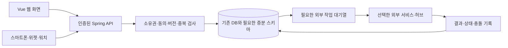

# 구매자 의견별 상세 구현 제안

작성일·수정일 2026-11-14. **아래 내용은 구현 제안이며 제품 코드·DB·API·연동 기능을 이번 작업에서 변경하지 않았다.** 기존 기능이 있는 경우 연결·확장 범위를 명시한다. 예상 필드·상태·작업 모델은 현행 API 지원 사실과 구분한다.

[전체 목록과 의견 원문](README.md) · [공식 참고 자료](sources.md) · [문서 작업 기록](context-notes.md)

## 1. 구현 방향

먼저 기록 저장과 신뢰할 수 있는 상태 표시를 완성하고, 같은 기록을 여러 화면·기기에서 이어 사용하도록 한다. 외부 서비스와 IoT는 그 기록 흐름에 연결한다. 36개 기능을 한 번에 출시하지 않으며 각 항목의 최소 범위부터 검증한다.

기존 Vue·Spring·MySQL 구조를 유지하는 안을 기본으로 한다. 파일 몇 개를 추가하기 위해 별도의 범용 플랫폼·마이크로서비스·새 상태관리 라이브러리를 먼저 도입하지 않는다. 외부 호출을 비동기로 처리할 때만 영속 작업과 재시도 워커를 확장한다.



이 그림은 제안 구조다. 네이티브 확장·외부 작업 워커·제공자 어댑터가 현재 모두 존재한다는 뜻이 아니다.

## 2. 현행 계약과 확장이 필요한 경계

| 영역 | 현재 확인한 기반 | 추가로 설계할 부분 |
| --- | --- | --- |
| 집중 세션 | RecordsController의 /api/focus/sessions 목록·생성·수정·삭제 | 활성 세션·일시정지·멱등 명령·기기간 동시성. 기존 CRUD만으로 완료되지 않음 |
| FOCUS 입력 | mode의 pomodoro/stopwatch/free, 필수 duration 1~1440, startedAt/endedAt 검사 | 목표와 실측의 단위·의미 분리, 정지 구간·짧은 기록 정책. FeatureType·FeatureInput·통계를 함께 변경 |
| 플래너 | /api/planner/items와 플래너 환경설정·조회 계약 | 기존 작업·일정 참조를 확인한 뒤 필요한 연결만 확장 |
| 설정 | /api/settings/{section} 및 허용된 섹션의 value·version | 신규 후보 필드는 현재 섹션과 검증 정책을 먼저 대조. 임의의 섹션 경로는 추가 전 사용하지 않음 |
| 외부 상태 | /api/integrations/capabilities, /api/sync/status | 실제 자격·권한·작업 결과로 상태를 갱신하고 미연결의 available=false를 유지 |
| AI·음성·결제·동기화 | IntegrationController의 인증·입력 검사와 503 경계 | 제공자 결정·비밀 관리·서명 검증·실행·실패 복구·실제 샌드박스 검증 |
| 내보내기 | /api/user/data/export의 profile·FeatureType 자료 | 전체 계정 자료 목록·관계·첨부·버전·복원·범위 고지 |
| 공유·AI 동의 | 공유 설정·AI 범위 선택 기반 | 서버 응답 최소화·수신자 미리보기·실행 직전 동의 재검사 |
| 모바일 | Capacitor와 Android·iOS 프로젝트 | 위젯·공유 확장·건강·NFC·워치별 네이티브 작업과 배포·실기기 검증 |

현행 계약은 [API 안내](../../api/README.md), [외부 제공자 경계](../../api/frontend-backend-2026-10-10/integrations.md), [FeatureType](../../../backend/src/main/java/kr/timebar/diary/feature/FeatureType.java), [FeatureInput](../../../backend/src/main/java/kr/timebar/diary/feature/FeatureInput.java)을 기준으로 한다. 새 필드는 DTO/허용 필드·검증·마이그레이션·생성 API 문서·관련 테스트를 함께 갱신한다.

## 3. 공통 데이터·실행 제안

### 기록과 시간

- 저장 원본은 계정 소유의 기록과 세션이다. 화면의 타이머 증가 횟수는 원본 시간이 아니다.
- 시점은 UTC로 저장하고 IANA 시간대·종일 날짜·사용자가 정한 하루 경계를 구분한다. 하루가 항상 24시간이라고 가정하지 않는다.
- 일시정지와 중간 종료를 도입하면 목표 duration, 실제 집중 초, 시작~종료 구간의 의미를 구분한다. 기존 통계를 함께 변경하지 않으면 휴식 시간이 집중으로 집계될 수 있다.
- 같은 수행을 플래너 실제 기록과 집중 세션에 연결할 때 집계의 기준 ID를 정한다. 연결된 화면 수만큼 시간을 합산하지 않는다.

### 데이터 후보와 적용 시점

| 후보 | 최소 보관 내용 | 적용 항목 |
| --- | --- | --- |
| 세션 상태 확장 | 소유자·상태·시작·일시정지 구간·종료·목표·실측·version | CF-005·006·027 |
| 기록 관계 | 기존 원본 종류/ID와 연결 대상. 현재 존재하는 관계는 재사용 | CF-009·015·020 |
| 클라이언트 변경 대기열 | 계정·opId·원본 version·변경·재시도 상태 | CF-026 |
| 외부 연결·매핑 | 제공자·계정·권한·외부/내부 ID·revision·cursor·연결 상태 | CF-016~022·028·030 |
| 외부 작업·전달 이력 | eventId·원인 ID·상태·시도·다음 재시도·결과 | 외부 호출이 필요한 연동·알림·자동화 |
| 백업 manifest·복원 작업 | schemaVersion·범위·파일 검증값·작업 ID·항목 결과 | CF-008 |
| 자료 사용 동의 | 목적·허용 범위·동의 버전·철회 시각 | CF-014·028·035 |
| 표시 기기 등록 | 기기·최소 읽기 권한·표시 범위·만료/철회 | CF-033 |

표의 모든 후보를 한꺼번에 생성하지 않는다. 기능 착수 시 기존 테이블·FeatureType으로 표현 가능한지 확인하고 검색·동시성·관계 제약이 필요한 데이터만 별도 스키마로 설계한다.

### 저장 실패·충돌·외부 작업

- 저장 요청은 인증된 계정 기준으로 검사하고 클라이언트가 보낸 소유자를 신뢰하지 않는다.
- 갱신의 version 충돌은 409와 사용자 비교 흐름으로 이어진다. 기존 Planner API 등 모든 경로가 같은 version 계약을 이미 가진다고 가정하지 말고 적용 대상별로 확인한다.
- 생성·종료·완료·복원·외부 명령은 멱등 키와 결과 재사용을 설계한다. 네트워크 전달의 절대 단 한 번 실행을 약속하기보다 재전송을 안전하게 처리한다.
- 외부 네트워크 호출 중 DB 트랜잭션을 유지하지 않는다. 필요한 경우 변경과 발송 대기 기록을 함께 저장하고 워커에서 호출한다.
- 재시도 가능한 통신 오류·호출 제한과 재인증·권한 상실·잘못된 입력을 구분한다. 무제한 재시도를 하지 않는다.
- 제안 상태 예시는 대기·실행 중·성공·재시도 대기·사용자 확인 필요·실패·취소다. 화면의 연결 설정 토글과 작업 성공 상태를 동일시하지 않는다.

### 개인정보와 플랫폼

- 외부 연결 토큰은 서버 또는 플랫폼 보안 저장소에서 관리한다. 기존 브라우저 AI 설정에 실서비스 비밀키를 추가하는 방식으로 구현하지 않는다.
- 모델·OCR·메일·메시지에서 얻은 텍스트는 입력 데이터로 처리한다. 임의 실행·권한 변경·외부 발송 명령으로 실행하지 않는다.
- 계정 전환, 공유 철회, 대기 작업의 동의 철회, 캐시, 내보내기와 첨부에도 소유권 정책을 적용한다.
- 네이티브 위젯·건강 데이터·워치·NFC는 반응형 웹과 별도다. OS 갱신 예산·백그라운드 제약·권한 거부·딥링크·로그아웃을 검증한다. [WidgetKit 제약](sources.md#s03), [Capacitor 확장](sources.md#s06).
- IoT는 선택한 장치와 액션만 실행한다. 사용자 수동 변경을 보존하고 일괄 중지·실행 이력·재시도 상한을 제공한다.

### UI 계약

핵심 기록 3탭 이내, 미완료 벌점화 금지, 키보드 접근, 320px·200% 확대·모션 감소를 구현 검수에 포함한다. 구체 색·폰트·모션을 이번 문서에서 변경하지 않는다. [디자인 문서 혼재와 hash 불일치](sources.md)의 정합성을 실제 UI 구현 전에 확인한다.

## 4. 단계별 추진 제안

| 단계 | 항목 | 다음 단계로 넘어갈 조건 |
| --- | --- | --- |
| 0. 기록 신뢰 | [CF-005](bug/CF-005.md), [CF-007](bug/CF-007.md), [CF-008](bug/CF-008.md), [CF-035](improvement/CF-035.md) | 기록 복구·정확한 상태·백업 범위·서버 공유 정책을 검증 |
| 1. 매일 사용하는 흐름 | [CF-004](improvement/CF-004.md), [CF-006](bug/CF-006.md), [CF-009](improvement/CF-009.md), [CF-010](feature-addition/CF-010.md), [CF-012](improvement/CF-012.md), [CF-026](feature-addition/CF-026.md), [CF-029](improvement/CF-029.md) | 자정·짧은 집중·기록 연결·오프라인 충돌·알림 액션을 검증 |
| 2. 사용성과 핵심 가치 | [CF-001](improvement/CF-001.md), [CF-002](improvement/CF-002.md), [CF-003](improvement/CF-003.md), [CF-011](feature-addition/CF-011.md), [CF-013](improvement/CF-013.md), [CF-014](improvement/CF-014.md), [CF-015](improvement/CF-015.md), [CF-016](integration/CF-016.md), [CF-036](improvement/CF-036.md) | 실제 자료의 분석·승인 실행·선택 제공자 캘린더·요금제 경계를 검증 |
| 3. 업무·모바일 확장 | [CF-017](integration/CF-017.md), [CF-018](integration/CF-018.md), [CF-019](integration/CF-019.md), [CF-020](integration/CF-020.md), [CF-021](integration/CF-021.md), [CF-022](integration/CF-022.md), [CF-023](feature-addition/CF-023.md), [CF-024](feature-addition/CF-024.md), [CF-025](feature-addition/CF-025.md), [CF-027](feature-addition/CF-027.md), [CF-028](integration/CF-028.md) | 제공자별 작은 범위와 대상 OS·실기기에서 검증 |
| 4. 생활 기기 확장 | [CF-030](integration/CF-030.md), [CF-031](integration/CF-031.md), [CF-032](integration/CF-032.md), [CF-033](feature-addition/CF-033.md), [CF-034](integration/CF-034.md) | 장치 한 종류부터 취소·오프라인·수동 변경 보존을 검증 |

단계는 일정 추정이 아니다. 병렬 개발이 필요하면 각 항목의 선행 조건을 기준으로 나눈다. 도구·계정·비용이 확정되지 않은 외부 기능은 조사부터 진행하고 사용자에게 제공할 수 있는 범위를 먼저 정한다.

## 5. 항목별 구현 제안

각 항목의 현재 근거·원문·상태·완료 체크박스는 연결된 CF 파일에서 관리한다. 아래에는 구현 순서와 구조를 기록한다. 코드 수정 대상은 검토 후보이며 해당 파일을 모두 수정하라는 지시가 아니다.

<a id="cf-001"></a>
### CF-001. 목적별 시작 구성과 즐겨찾기

[의견·근거·완료 기준](improvement/CF-001.md) · 우선순위 제안 P2 · 선행 없음.

**최소 구현 범위.** 역할별 메뉴·위젯 프리셋 세 개와 즐겨찾기 메뉴를 제공한다. 기존 사용자의 수동 설정을 유지한다.

1. 기존 navGroups와 WIDGET_CATALOG의 안정적인 키를 참조하고 동일 메뉴 정의를 복제하지 않는다. 숨김은 접근 권한과 분리한다.
2. 기존 general·dashboard 설정 섹션을 활용해 visibleMenuIds·favoriteMenuIds·presetId 후보 필드를 저장한다. 서버 검증과 version 충돌 처리를 추가한다.
3. 프리셋 변경 전 차이를 보여주고 되돌리기 및 전체 메뉴 보기를 제공한다.

**검증할 사용자 상황.** 기존 설정이 있는 계정에 프리셋을 적용하지 않았을 때 구성이 유지된다. 키보드로 즐겨찾기 추가·이동·해제할 수 있고 320px에서도 전체 메뉴에 접근할 수 있다.

<a id="cf-002"></a>
### CF-002. 이해하기 쉬운 모드 이름과 요일별 전환

[의견·근거·완료 기준](improvement/CF-002.md) · 우선순위 제안 P2 · 선행 없음.

**최소 구현 범위.** 내부 J/P/B 값은 유지하고 표시 이름을 바꾼다. 선택적으로 평일·주말 기본 모드를 지정한다.

1. 기존 저장값과 API의 J/P/B 허용값을 바꾸지 않고 MODE_META 표시만 매핑한다.
2. mode-profiles 설정에 요일별 기본값과 수동 재정의 만료일을 제안한다. 계정 시간대로 해당 날짜의 모드를 계산한다.
3. 작성 중인 초안과 과거 글의 모드 스냅샷은 자동 전환으로 변경하지 않는다.

**검증할 사용자 상황.** 이전 J/P/B 설정을 가진 계정의 작성 필드가 유지된다. 금요일에서 토요일로 넘어가도 열린 초안은 유지되고 새 작성에만 규칙이 반영된다.

<a id="cf-003"></a>
### CF-003. 한국어 용어와 업무 기능 설명

[의견·근거·완료 기준](improvement/CF-003.md) · 우선순위 제안 P2 · 선행 없음.

**최소 구현 범위.** 계획·실제 기록으로 표시를 통일하고 작업 분해·투입 시간의 짧은 설명을 제공한다.

1. 필터 내부 값과 데이터 필드는 유지하면서 화면 라벨만 변경한다. 전체 번역 프레임워크 도입은 이 항목의 범위가 아니다.
2. 도움말은 키보드와 터치로 열 수 있게 하고 약어의 원래 의미를 함께 제공한다.
3. 데이터 내보내기 키와 기존 북마크를 UI 번역 때문에 변경하지 않는다.

**검증할 사용자 상황.** 계획·실제 기록 필터가 기존과 같은 데이터를 표시한다. 도움말을 키보드로 열고 닫으며 화면 낭독기로 설명을 확인할 수 있다.

<a id="cf-004"></a>
### CF-004. 24시간 타임라인과 하루 경계 설정

[의견·근거·완료 기준](improvement/CF-004.md) · 우선순위 제안 P1 · 선행 없음.

**최소 구현 범위.** 00~24시 표시를 제공한 다음 하루 경계 시각을 설정할 수 있게 한다. 저장 시각을 화면 날짜에 맞춰 덮어쓰지 않는다.

1. 가시 구간 시작·종료와 dayBoundaryMinutes 후보 설정을 기존 플래너 환경설정 계약과 대조해 추가한다.
2. 실제 기록은 UTC 시점과 IANA 시간대를 보존하고 일간 집계에서만 경계에 따라 자른다. 종일 일정은 날짜 개념으로 유지한다.
3. 자정을 넘는 기록은 화면에 분할 표시하되 원본 ID를 유지하고 통계에서 중복 합산하지 않는다.

**검증할 사용자 상황.** 23:30~01:30 기록이 다음 날짜와 걸쳐 보여도 총 두 시간으로 집계된다. 하루 경계 04시와 서머타임 전환일의 23·25시간 하루를 검증한다.

<a id="cf-005"></a>
### CF-005. 실제 기록 저장과 화면 이동 후 복구

[의견·근거·완료 기준](bug/CF-005.md) · 우선순위 제안 P0 · 선행 없음.

**최소 구현 범위.** 기록 시작·종료를 영속 세션으로 연결하고 종료 후 저장된 활동의 상세 링크를 보여준다. 단일 기기의 이동·새로고침 복구부터 제공한다.

1. 기존 /api/focus/sessions와 플래너 실제 항목의 책임을 먼저 정한다. 집중 세션과 실제 기록을 연결하되 같은 시간을 두 번 집계하지 않는다.
2. UI setInterval 횟수를 시간 원본으로 삼지 않는다. startedAt·상태·일시정지 구간·version을 서버에서 관리하는 계약 확장을 제안한다.
3. 세션 생성·종료에 멱등 키를 도입하고 저장 응답 전에는 완료로 표시하지 않는다. 실패한 종료 요청은 초안을 유지해 다시 전송한다.

**검증할 사용자 상황.** 기록 중 화면 이동·새로고침 후 같은 세션을 복구하고 종료 시 한 건만 생성된다. 종료 응답 유실 후 재시도해도 중복 기록이 생기지 않고 저장 실패가 화면에 남는다.

<a id="cf-006"></a>
### CF-006. 자유 타이머와 중간 종료 기록

[의견·근거·완료 기준](bug/CF-006.md) · 우선순위 제안 P1 · 선행 [CF-005](bug/CF-005.md).

**최소 구현 범위.** 포모도로·사용자 지정 카운트다운·스톱워치를 구분하고 중간 종료 시 실제 경과 시간을 보존한다.

1. CF-005의 세션 저장을 공유하고 목표 시간과 실제 집중 시간을 분리한다.
2. 현재 duration 필수 범위는 1~1440이며 의미를 명확히 해야 한다. 스톱워치에 임의의 목표 시간을 채우지 말고 mode별 조건과 초 단위 실측 필드의 계약을 검토한다.
3. 일시정지 시간을 제외한 합산으로 통계를 갱신한다. 기존 InsightService의 endedAt-startedAt 계산도 함께 조정해야 한다.

**검증할 사용자 상황.** 13분 수행 후 종료하면 목표 50분이 아닌 실제 13분이 집계된다. 일시정지·재개·새로고침·0초 취소 시 정책대로 저장되고 음수 시간이 생성되지 않는다.

<a id="cf-007"></a>
### CF-007. 시연 상태와 실제 실행 상태 구분

[의견·근거·완료 기준](bug/CF-007.md) · 우선순위 제안 P0 · 선행 없음.

**최소 구현 범위.** 실제 서버·기기 확인을 받지 않은 성공 표시를 없애고 시연·미연결·연결 중·실패를 구분한다.

1. /api/integrations/capabilities와 /api/sync/status를 조회해 화면의 제공 가능 상태를 결정한다. 설정 의도와 실행 성공을 별도 값으로 표현한다.
2. 시연 데이터에는 일관된 표시를 붙이고 실제 계정 기록과 섞지 않는다. 백업 성공 시각은 검증된 작업 결과에서만 읽는다.
3. OS 방해 금지는 지원 플랫폼·권한·실제 적용 결과를 확인한 때에만 켜짐으로 표시한다. 지원하지 않으면 안내만 제공한다.

**검증할 사용자 상황.** available=false 응답에서 연결됨 또는 동기화 완료가 표시되지 않는다. 백업 실패·OS 권한 거부·네트워크 끊김이 성공 문구로 바뀌지 않는다.

<a id="cf-008"></a>
### CF-008. 실제 백업·내보내기·복원

[의견·근거·완료 기준](bug/CF-008.md) · 우선순위 제안 P0 · 선행 없음.

**최소 구현 범위.** 범위가 명시된 수동 내보내기와 미리보기 기반 병합 복원을 먼저 제공한다. 자동 백업은 실제 예약 실행과 복원 검증 후 제공한다.

1. 현재 export를 그대로 전체 백업으로 광고하지 않는다. 기록 종류별 포함 표와 schemaVersion·exportedAt·시간대·첨부 목록·검증값을 갖춘 manifest를 제안한다.
2. 백업에서 토큰·비밀키를 제외하고 현재 계정 소유권으로 복원한다. 기존 ID와 버전 충돌·첨부 누락을 사전 검사해 병합 계획을 보여준다.
3. 복원 작업 ID와 항목별 결과를 저장해 중단 후 재개와 재시도 중복을 막는다. 자동 예약은 마지막 검증 성공 시각과 실패 로그를 남긴다.

**검증할 사용자 상황.** 서로 다른 기록과 첨부를 내보내 새 테스트 계정에 복원한 뒤 수·관계·내용을 대조한다. 손상 파일·미지원 버전·중복 ID·중단 후 재시도가 기존 자료를 조용히 덮어쓰지 않는다.

<a id="cf-009"></a>
### CF-009. 할 일·일정·실제 기록의 연결

[의견·근거·완료 기준](improvement/CF-009.md) · 우선순위 제안 P1 · 선행 [CF-005](bug/CF-005.md).

**최소 구현 범위.** 할 일 한 건에서 계획 배치·집중 시작·실제 기록·회고를 오갈 수 있도록 원본 참조를 제공한다.

1. 기존 taskId·schedule 관계를 먼저 대조하고 필요한 sourceType·sourceId 또는 명시적 관계만 추가한다. 신규 만능 Activity 계층은 먼저 만들지 않는다.
2. 공유할 필드의 소유 도메인을 정한다. 할 일 제목 수정과 계획 시간 수정이 서로 다른 데이터를 덮어쓰지 않도록 한다.
3. 관련 기록 삭제는 연결 해제와 실제 기록 삭제를 구분한다. 조회·통계에서는 동일 세션의 중복 시간 반영을 막는다.

**검증할 사용자 상황.** 할 일에서 만든 계획과 실제 기록을 각 화면에서 추적하고 한 번만 집계한다. 일정 삭제 후 실제 수행 기록은 유지되며 타인 기록을 임의 연결할 수 없다.

<a id="cf-010"></a>
### CF-010. 자연어 빠른 입력과 사후 분류

[의견·근거·완료 기준](feature-addition/CF-010.md) · 우선순위 제안 P1 · 선행 없음.

**최소 구현 범위.** 한국어 날짜·시각의 자주 쓰는 표현을 해석해 미리보기 칩을 보여주고 불명확하면 메모 초안으로 남긴다.

1. 먼저 규칙 기반 파서를 작은 범위로 구현하고 AI는 선택적 보조로 둔다. 입력 당시 기준 날짜와 계정 시간대를 함께 전달한다.
2. 기존 작성 검증을 통과한 뒤 저장한다. 오후 표기 없는 3시나 종료 시간이 없는 입력을 근거 없이 확정하지 않는다.
3. 원문과 추출값을 초안에서 유지해 종류 변경·수정·실행 취소를 지원한다.

**검증할 사용자 상황.** 내일 오후 3시·다음 주 월요일·월말·자정 표현을 고정 기준 날짜로 검증한다. 모호한 입력을 자동 확정하지 않고 빠른 기록의 핵심 흐름이 3탭 이내다.

<a id="cf-011"></a>
### CF-011. 계획 지연 시 재배치 제안

[의견·근거·완료 기준](feature-addition/CF-011.md) · 우선순위 제안 P2 · 선행 [CF-004](improvement/CF-004.md), [CF-009](improvement/CF-009.md).

**최소 구현 범위.** 하루 범위에서 고정 약속을 제외한 할 일의 이동안을 만들고 사용자가 골라 적용한다.

1. 시간 길이·마감·고정 여부·휴식 구간을 입력으로 하는 결정적 배치부터 시작한다. 불가능한 항목은 미배치로 남긴다.
2. 제안 생성 당시 각 항목의 버전을 저장하고 적용 시 재검사한다. 충돌하면 새 제안을 만들며 부분 반영 여부를 명시한다.
3. 사용자가 승인한 항목만 이동한다. 직후 되돌리기도 버전을 검사해 이후 수동 변경을 덮어쓰지 않는다.

**검증할 사용자 상황.** 30분 지연에도 고정 회의와 마감은 보존되고 겹침이 없는 안을 제안한다. 제안 생성 후 다른 기기에서 바꾼 일정은 충돌로 표시하고 무단 이동하지 않는다.

<a id="cf-012"></a>
### CF-012. 루틴 예외일과 휴식 처리

[의견·근거·완료 기준](improvement/CF-012.md) · 우선순위 제안 P2 · 선행 없음.

**최소 구현 범위.** 날짜별 건너뛰기·기간 일시 중단을 지원하고 연속 기록 계산 정책을 설명한다. 교대근무 주기와 공휴일 자동 처리는 후속 범위다.

1. 원본 반복 규칙과 routineId+date 예외를 분리한다. 기존 boolean 완료에 completed·skipped·notScheduled 등의 표현을 넣을 때 마이그레이션을 설계한다.
2. 휴식일은 달성률 분모와 연속 기록 계산에서 명시한 정책대로 제외하고 과거 통계 변경 여부를 안내한다.
3. 공휴일은 국가·지역·데이터 기준 연도를 정한 뒤 연결한다. 일정 전체 삭제로 예외를 표현하지 않는다.

**검증할 사용자 상황.** 지정한 휴가 기간에는 알림이 없고 이전·이후 루틴은 유지된다. 완료·건너뛰기·미예정일을 달성률과 연속 기록에서 일관되게 계산한다.

<a id="cf-013"></a>
### CF-013. 비계획 활동 인정과 점수 숨김

[의견·근거·완료 기준](improvement/CF-013.md) · 우선순위 제안 P2 · 선행 [CF-005](bug/CF-005.md), [CF-009](improvement/CF-009.md).

**최소 구현 범위.** 실제 기록을 계획 유무와 무관하게 남기고 점수·랭킹 표시를 선택한다.

1. 계획 실행률과 실제 활동 총량을 별도 지표로 제공한다. 계획이 없는 기록을 실패나 0점으로 변환하지 않는다.
2. 비계획 활동 여부는 계획 참조가 없는 상태 또는 사용자가 선택한 분류로 표현하고 자동으로 낮은 우선순위를 부여하지 않는다.
3. 기존 위젯 숨김과 개인 설정을 재사용한다. 랭킹 참여 해제는 화면 숨김과 서버 공개 집계 제외를 구분한다.

**검증할 사용자 상황.** 계획 없이 가족 돌봄을 기록해도 활동 시간과 회고에 나타난다. 랭킹 참여 해제 후 다른 계정의 랭킹 응답에도 해당 사용자가 노출되지 않는다.

<a id="cf-014"></a>
### CF-014. 근거를 확인할 수 있는 통계와 AI

[의견·근거·완료 기준](improvement/CF-014.md) · 우선순위 제안 P1 · 선행 [CF-005](bug/CF-005.md), [CF-007](bug/CF-007.md), [CF-009](improvement/CF-009.md), [CF-035](improvement/CF-035.md).

**최소 구현 범위.** 서버 기록 기반 통계와 원본 이동을 먼저 제공하고, 근거가 있는 한 줄 분석·승인형 행동 제안을 추가한다.

1. 지표마다 집계 기간·시간대·기록 수·누락 범위를 응답한다. 분석은 근거 recordId와 버전을 참조하고 원본 접근 권한을 다시 검사한다.
2. 기존 AI 설계의 동의·작업 이력·사용량 한도를 재사용한다. 모델 결과는 정해진 구조로 검증하고 부족한 표본이나 근거 없는 문장은 표시하지 않는다.
3. 일정 변경은 별도 제안 객체로 저장하고 CF-011과 같은 버전 확인 후 승인 실행을 사용한다. 모델 출력 자체를 실행 명령으로 취급하지 않는다.

**검증할 사용자 상황.** 수치에서 원본으로 이동했을 때 같은 기간·시간대의 합계가 일치한다. 기록 부족·제공자 장애·동의 철회 시 그럴듯한 고정 분석이나 일정 변경이 발생하지 않는다.

<a id="cf-015"></a>
### CF-015. 업무 시간에서 보고서·인수인계 초안 생성

[의견·근거·완료 기준](improvement/CF-015.md) · 우선순위 제안 P2 · 선행 [CF-005](bug/CF-005.md), [CF-009](improvement/CF-009.md), [CF-035](improvement/CF-035.md).

**최소 구현 범위.** 프로젝트와 기간을 고르면 실제 시간·완료 항목·남은 일을 모은 편집 가능한 초안을 만든다.

1. 선택된 업무 기록과 세션만 집계하고 원본 링크를 유지한다. 규칙 기반 보고서부터 제공해 AI 없을 때도 동작하게 한다.
2. REPORT에 저장할 구조와 원본 참조는 기존 FeatureType 허용 필드에 맞추거나 명시적으로 확장한다. 자동 게시·자동 발송은 기본 범위에서 제외한다.
3. 공유용 사본은 이름·고객명·개인 메모를 제외할 수 있게 하고 PDF/Word 내보내기 전 미리보기를 보여준다.

**검증할 사용자 상황.** 개인 다이어리가 포함된 계정에서도 선택한 업무 기록만 보고서에 들어간다. 초안 수정 후 원본 시간은 바뀌지 않고 공유 파일의 숫자와 화면이 일치한다.

<a id="cf-016"></a>
### CF-016. 외부 캘린더의 실제 동기화

[의견·근거·완료 기준](integration/CF-016.md) · 우선순위 제안 P1 · 선행 [CF-007](bug/CF-007.md), [CF-009](improvement/CF-009.md).

**최소 구현 범위.** Google의 선택한 캘린더 가져오기부터 검증하고 양방향·Outlook 순서로 확장한다. Apple·네이버는 연결 방식의 타당성 조사 후 범위를 결정한다.

1. 서버에 계정별 암호화 토큰과 연결 상태, 외부 calendarId/eventId·내부 ID·revision·sync cursor 매핑을 제안한다. OAuth state·지원 시 PKCE·권한 철회를 처리한다.
2. 초기 전체 조회 후 증분 동기화를 적용한다. Google syncToken과 Outlook calendarView delta는 각 공식 계약대로 별도 처리한다. 삭제·반복 예외·시간대·종일 일정을 보존한다.
3. 양쪽에서 바뀐 항목은 마지막 동기화 기준과 비교해 충돌로 남긴다. 410·토큰 만료·429·페이지 중단을 복구하고 내보낸 변경이 다시 신규 항목으로 유입되지 않게 한다.
4. Apple 기기 캘린더 접근과 iCloud 서버 동기화를 동일하게 취급하지 않는다. 네이버의 지원 경로·약관·제공 범위를 확인하기 전 양방향을 약속하지 않는다.

**검증할 사용자 상황.** 같은 변경을 두 번 받아도 한 건만 반영하고 삭제·반복 일정의 단일 회차 수정이 보존된다. 외부 수정 충돌과 sync cursor 무효화 후 복구해도 로컬의 미전송 변경이 사라지지 않는다.

공식 제약 참고. [Google 증분 동기화](sources.md#s01), [Microsoft Graph delta](sources.md#s02).

<a id="cf-017"></a>
### CF-017. Notion·Todoist·Microsoft To Do 작업 연결

[의견·근거·완료 기준](integration/CF-017.md) · 우선순위 제안 P2 · 선행 [CF-009](improvement/CF-009.md).

**최소 구현 범위.** 우선 제공자 한 곳과 목록 하나를 선택해 읽기 전용 가져오기를 제공한다. 검증 후 완료 상태 반영을 추가한다.

1. 제공자 조사에서 안정적인 항목 ID·목록 선택 권한·필드 형식·페이지·호출 한도를 확인한다.
2. 제목·상태·마감·우선순위의 사용자 매핑을 저장한다. Notion의 사용자 정의 속성을 고정 스키마로 가정하지 않는다.
3. 외부 매핑·출처 링크·마지막 반영 버전을 저장한다. 양방향 전환 시 삭제 정책과 완료 취소의 우선순위를 명시한다.

**검증할 사용자 상황.** 재가져오기해도 중복 항목이 없고 지원하지 않는 필드는 미리보기에 표시된다. 외부 목록 권한 철회 후 자동 동기화가 중지되고 기존 로컬 항목 처리 방식을 안내한다.

<a id="cf-018"></a>
### CF-018. Slack·Teams 메시지를 할 일 후보로 전환

[의견·근거·완료 기준](integration/CF-018.md) · 우선순위 제안 P2 · 선행 [CF-009](improvement/CF-009.md), [CF-010](feature-addition/CF-010.md), [CF-035](improvement/CF-035.md).

**최소 구현 범위.** 사용자가 선택한 메시지 한 건을 초안으로 전달하고 내용·담당자·마감 확인 후 저장한다.

1. 선택 액션 또는 지원되는 공유 경로 하나부터 구현한다. 제공자별 앱 설치 권한과 관리자 승인 조건을 착수 조사에 포함한다.
2. workspace/channel/message 식별자와 permalink를 출처로 보존한다. 외부 사용자와 내부 계정의 담당자 연결은 명시적 매핑을 요구한다.
3. 개인 채널 원문을 공동 작업 영역에 복사할 때 미리보기에서 공개 범위를 확인한다. 메시지 삭제·권한 상실 시 원본이 계속 열릴 것이라 보장하지 않는다.

**검증할 사용자 상황.** 사용자가 선택하지 않은 주변 메시지가 저장되거나 모델로 전송되지 않는다. 같은 메시지를 다시 가져오면 기존 후보를 안내하고 담당자가 임의로 자동 지정되지 않는다.

<a id="cf-019"></a>
### CF-019. Gmail·Outlook 메일에서 일정 추출

[의견·근거·완료 기준](integration/CF-019.md) · 우선순위 제안 P2 · 선행 [CF-010](feature-addition/CF-010.md), [CF-035](improvement/CF-035.md).

**최소 구현 범위.** 선택한 메일 또는 사용자가 붙여 넣은 본문에서 일정 후보를 만들고 검토 후 저장한다.

1. 초기에는 메일함 상시 수집보다 붙여넣기·선택 공유를 제공한다. 공식 연동 시 읽을 데이터와 권한 범위를 별도 검토한다.
2. 날짜·시간대·장소·주최자·원문 링크를 추출하되 불명확한 값은 사용자에게 남긴다. 외부 본문의 명령문은 일정 데이터로만 처리한다.
3. 예약번호 또는 출처 메시지 ID로 중복 후보를 찾고 취소·변경 메일은 기존 일정 변경안으로 표시한다.

**검증할 사용자 상황.** 시간대가 있는 항공·회의 메일에서 날짜가 바뀌는 경우에도 원문과 후보를 비교할 수 있다. 취소 메일이나 같은 메일 재전송이 별도 약속으로 조용히 등록되지 않는다.

<a id="cf-020"></a>
### CF-020. GitHub·GitLab·Jira 이슈와 시간 연결

[의견·근거·완료 기준](integration/CF-020.md) · 우선순위 제안 P2 · 선행 [CF-005](bug/CF-005.md), [CF-009](improvement/CF-009.md), [CF-035](improvement/CF-035.md).

**최소 구현 범위.** 외부 이슈 URL을 업무에 연결하고 해당 업무에서 시작한 시간을 프로젝트별로 합산한다. API 검색은 제공자 한 곳부터 추가한다.

1. provider·workspace/project·issueId·URL을 참조로 저장하고 내용 복제는 최소화한다. 코드 저장소 전체 읽기 권한을 기본으로 요청하지 않는다.
2. 외부 프로젝트를 내부 프로젝트에 명시적으로 매핑한다. 이슈 종료와 내부 작업 완료의 자동 동기화는 별도 선택으로 둔다.
3. 타이머는 CF-005의 세션을 재사용하고 커밋 수·온라인 시간으로 개인 평가 점수를 만들지 않는다.

**검증할 사용자 상황.** 같은 이슈에 연결된 여러 집중 세션이 프로젝트 보고서에 중복 없이 집계된다. 비공개 이슈 권한 철회 시 내용을 노출하지 않고 기존 개인 시간은 보존된다.

<a id="cf-021"></a>
### CF-021. 지도 기반 이동 시간과 출발 알림

[의견·근거·완료 기준](integration/CF-021.md) · 우선순위 제안 P2 · 선행 [CF-004](improvement/CF-004.md), [CF-029](improvement/CF-029.md).

**최소 구현 범위.** 사용자가 입력한 출발지와 목적지로 지도 앱을 열고 수동 이동 여유 시간을 일정 앞에 배치한다. API 경로 조회는 지원 범위 확인 후 추가한다.

1. 교통수단·예상 소요·여유 시간·조회 시각·출처를 별도 이동 구간으로 보관해 원래 약속 시작 시각을 유지한다.
2. 제공자 선택 전 지역·대중교통·도보 등의 지원과 데이터 재사용 조건을 확인한다. 실패 시 수동 시간과 길찾기 링크로 대체한다.
3. 실시간 위치 추적은 기본 범위가 아니다. 출발 알림은 계정 시간대와 최신 일정 버전을 참조하고 CF-029 알림 정책을 따른다.

**검증할 사용자 상황.** 예상 이동 시간이 갱신돼도 약속 시작 시각이 바뀌지 않는다. 경로 조회 실패·일정 취소·위치 권한 거부 때 잘못된 출발 알림이 반복되지 않는다.

<a id="cf-022"></a>
### CF-022. 웹훅과 사용자 정의 자동화 연동

[의견·근거·완료 기준](integration/CF-022.md) · 우선순위 제안 P2 · 선행 [CF-007](bug/CF-007.md), [CF-009](improvement/CF-009.md), [CF-035](improvement/CF-035.md).

**최소 구현 범위.** 할 일 완료 이벤트의 서명된 외부 웹훅과 선택한 수신 액션 한 종류를 제공한다. 각 서비스의 공식 앱 등록은 별도 후속 단계다.

1. 이벤트 ID·스키마 버전·발생 시각·허용 필드만 포함한다. 데이터 변경과 발송 대기 기록을 같은 트랜잭션으로 저장하고 별도 워커가 전달한다.
2. 수신은 서명·타임스탬프·재전송 검사를 수행하고 발신은 제한된 재시도·실행 로그·수동 재실행을 제공한다.
3. 임의 URL 입력에는 내부망·메타데이터 주소로의 요청을 차단하고 리다이렉트도 검사한다. 연쇄 자동화는 원인 이벤트 ID와 최대 실행 깊이로 순환을 막는다.

**검증할 사용자 상황.** 응답 유실로 재전송돼도 수신 측 작업이 한 번만 적용되는 계약을 검증한다. 위조·만료 요청과 내부 주소 대상 발송이 거부되며 영구 실패는 중지된다.

<a id="cf-023"></a>
### CF-023. 스마트폰 홈·잠금화면 위젯

[의견·근거·완료 기준](feature-addition/CF-023.md) · 우선순위 제안 P2 · 선행 [CF-005](bug/CF-005.md), [CF-009](improvement/CF-009.md), [CF-035](improvement/CF-035.md).

**최소 구현 범위.** 지원 플랫폼 한 곳에서 다음 일정·상위 할 일·빠른 기록 진입 위젯을 제공하고, 직접 완료 액션은 OS 지원 검증 후 확장한다.

1. 웹 위젯을 그대로 배치하지 않고 iOS WidgetKit 또는 Android 위젯 확장을 구현한다. 앱과 위젯이 공유할 최소 스냅샷과 안전한 액션 경로를 만든다.
2. OS 갱신 예산을 전제로 마지막 갱신 시각·오래된 데이터 표시를 제공한다. 매초 서버 조회나 웹 타이머 상시 실행을 가정하지 않는다.
3. 잠금화면에서는 제목 숨김을 기본 선택지로 두고 만료 세션은 앱 로그인으로 연결한다. 지원하지 않는 직접 액션은 딥링크로 대체한다.

**검증할 사용자 상황.** 앱 종료·기기 잠금·로그아웃 후에도 허용 범위만 표시된다. 동일 완료 액션 반복과 오프라인 동작이 중복 저장이나 거짓 성공을 만들지 않는다.

공식 제약 참고. [WidgetKit 갱신](sources.md#s03), [Capacitor 확장](sources.md#s06).

<a id="cf-024"></a>
### CF-024. 음성으로 활동 기록

[의견·근거·완료 기준](feature-addition/CF-024.md) · 우선순위 제안 P2 · 선행 [CF-007](bug/CF-007.md), [CF-010](feature-addition/CF-010.md), [CF-035](improvement/CF-035.md).

**최소 구현 범위.** 눌러서 녹음하고 종료하면 전사문·시간·활동 종류의 초안을 보여준다. 확인 전 자동 저장하지 않는다.

1. 마이크 권한·녹음 중 표시·최대 길이·취소를 제공하고 OS STT와 서버 STT 중 실제 지원 가능한 경로를 선택한다.
2. 서버 사용 시 파일 형식·크기·길이를 검사하고 처리 후 원본 보관 정책을 적용한다. 전사 결과는 CF-010의 해석 및 작성 검증으로 전달한다.
3. 방금 40분은 기록 기준 시점에 따른 후보로 계산하되 시작·종료를 수정할 수 있게 한다. 민감 기록의 외부 처리 여부를 명시한다.

**검증할 사용자 상황.** 권한 거부·무음·인식 실패에서 텍스트 입력으로 전환할 수 있다. 40분이 4분으로 인식된 경우 사용자가 수정하고 저장해야 기록이 생성된다.

공식 제약 참고. [Capacitor 확장](sources.md#s06).

<a id="cf-025"></a>
### CF-025. 공유 메뉴와 이미지에서 기록 초안 만들기

[의견·근거·완료 기준](feature-addition/CF-025.md) · 우선순위 제안 P2 · 선행 [CF-010](feature-addition/CF-010.md), [CF-035](improvement/CF-035.md).

**최소 구현 범위.** 공유된 텍스트·URL을 임시 메모함에 넣는 흐름부터 제공한다. 사진 OCR과 여러 일정 추출은 다음 단계다.

1. Android 공유 intent와 iOS 공유 확장을 플랫폼별로 검토한다. 웹에서는 지원 환경의 공유 수신 또는 붙여넣기로 기능을 제공한다.
2. 공유받은 MIME·크기·URL 형식을 검증하고 출처 링크와 사용자 선택 범위만 저장한다. 원격 URL 자동 읽기는 별도 권한과 요청 제한을 둔다.
3. OCR은 날짜·시간·행 단위 후보를 미리보기로 보여주고 선택한 항목만 기존 일정 검증을 통과시킨다.

**검증할 사용자 상황.** 앱이 닫힌 상태의 공유 입력을 재실행 후 잃지 않고 복구한다. 시간표의 잘못 인식된 시간·겹치는 일정·중복 사진을 확인 없이 일괄 저장하지 않는다.

공식 제약 참고. [Capacitor 확장](sources.md#s06).

<a id="cf-026"></a>
### CF-026. 오프라인 기록과 충돌 없는 재전송

[의견·근거·완료 기준](feature-addition/CF-026.md) · 우선순위 제안 P1 · 선행 [CF-005](bug/CF-005.md), [CF-009](improvement/CF-009.md).

**최소 구현 범위.** 메모·할 일의 생성과 수정부터 오프라인 대기열을 적용한다. 삭제·첨부·모든 도메인 동기화는 단계적으로 확장한다.

1. IndexedDB 등 기기 저장소에 계정별 outbox를 두고 opId·원본 version·변경 내용·재시도 상태를 기록한다. 기존 시연 데이터는 사용자가 선택한 가져오기만 수행한다.
2. 서버에 멱등 처리와 변경 조회 기준을 추가한다. 엔티티별 순서를 유지하고 409는 원본·서버·내 초안을 비교하는 충돌 화면으로 보낸다.
3. 로그아웃·계정 전환 시 대기 데이터 처리 정책을 안내하고 다른 계정으로 전송되지 않게 격리한다. OS 백그라운드 실행이 없어도 재접속·앱 재개 때 재전송한다.

**검증할 사용자 상황.** 응답 유실·중복 전송·순서 뒤바뀜 후 서버에 의도한 변경만 남는다. 두 기기 동시 수정과 계정 전환에서도 초안을 잃거나 다른 계정에 업로드하지 않는다.

<a id="cf-027"></a>
### CF-027. PC·휴대전화·워치 타이머 이어 쓰기

[의견·근거·완료 기준](feature-addition/CF-027.md) · 우선순위 제안 P2 · 선행 [CF-005](bug/CF-005.md), [CF-006](bug/CF-006.md).

**최소 구현 범위.** PC와 휴대전화의 한 계정 세션 이어 쓰기를 먼저 완성하고 워치 시작·일시정지·종료를 추가한다.

1. CF-005 세션을 서버 원본으로 사용한다. 한 계정의 활성 세션 정책과 상태 전이·예상 version을 검사해 동시 시작을 원자적으로 제어한다.
2. 변경은 인증된 조회 또는 별도 세션 이벤트 경로로 배포한다. 기존 채팅 SSE를 무조건 재사용하지 않고 권한·연결 수명을 별도 검토한다.
3. 워치는 작은 명령과 스냅샷만 주고받는다. 오프라인 명령은 현재 상태와 충돌할 수 있음을 표시하고 이미 끝난 세션을 다시 시작시키지 않는다.

**검증할 사용자 상황.** 두 기기에서 동시에 시작해도 활성 세션 한 건만 만들어진다. PC 종료 후 늦게 도착한 워치 일시정지 요청이 종료 상태를 되돌리지 않는다.

공식 제약 참고. [Capacitor 확장](sources.md#s06).

<a id="cf-028"></a>
### CF-028. 수면·운동 기록을 회고와 연결

[의견·근거·완료 기준](integration/CF-028.md) · 우선순위 제안 P2 · 선행 [CF-004](improvement/CF-004.md), [CF-035](improvement/CF-035.md).

**최소 구현 범위.** 사용자가 허용한 수면 시간·운동 시간의 일간 요약을 조회해 회고 옆에 보여준다. 의료 판단이나 자동 일정 변경은 포함하지 않는다.

1. iOS HealthKit·Android Health Connect 등 플랫폼 데이터 경로를 조사한다. Samsung Health에서 실제 공유되는 항목과 직접 SDK 필요 여부는 별도 확인한다.
2. 데이터 종류별 최소 읽기 권한을 요청하고 최초 범위·갱신 범위를 제한한다. 원본 제공자 ID·수정 시각으로 중복·삭제를 처리한다.
3. 백그라운드 읽기를 항상 가능하다고 가정하지 않는다. 서버 업로드·AI 분석은 기기 읽기 동의와 분리하고 철회 후 보관 데이터 삭제 선택을 제공한다.

**검증할 사용자 상황.** 수면만 허용한 계정에서 운동이나 심박수 자료를 읽지 않는다. 여러 기기의 중복 운동·자정 넘는 수면·권한 철회 후 재개를 검증한다.

공식 제약 참고. [Health Connect 읽기](sources.md#s04), [HealthKit 동의](sources.md#s05), [Capacitor 확장](sources.md#s06).

<a id="cf-029"></a>
### CF-029. 알림에서 바로 처리하고 중복 줄이기

[의견·근거·완료 기준](improvement/CF-029.md) · 우선순위 제안 P1 · 선행 [CF-009](improvement/CF-009.md), [CF-012](improvement/CF-012.md).

**최소 구현 범위.** 할 일 완료·10분 뒤 알림과 루틴 건너뛰기 액션을 지원하고 기본 수신 기기를 선택한다.

1. 알림에 원본 종류·ID·발생 회차·예상 version·허용 액션을 묶는다. 완료는 할 일 상태, 건너뛰기는 CF-012 예외 기록으로 처리한다.
2. 논리 알림 ID와 기기별 전달 ID를 구분해 재시도 중복을 줄인다. OS 수준에서 절대 한 번 울림을 보장한다고 약속하지 않는다.
3. 액션 시 인증·만료·이미 완료된 상태를 확인한다. 조용한 시간·선호 기기·기기간 확인에 따라 후속 전달을 취소한다.

**검증할 사용자 상황.** 두 기기에서 같은 완료 버튼을 눌러도 한 번만 처리되고 남은 알림이 갱신된다. 취소된 일정의 늦은 알림과 만료된 액션이 자료를 변경하지 않는다.

<a id="cf-030"></a>
### CF-030. 집중 상태에 따른 책상 조명

[의견·근거·완료 기준](integration/CF-030.md) · 우선순위 제안 P3 · 선행 [CF-005](bug/CF-005.md), [CF-007](bug/CF-007.md), [CF-022](integration/CF-022.md).

**최소 구현 범위.** 허브 한 종류와 사용자가 고른 조명 한 개에서 집중 시작·휴식·종료 동작을 제공한다.

1. CF-005의 확정된 세션 상태를 트리거로 사용한다. 연결 등록·기기 선택·미리 실행·전체 중지와 조명 이전 상태 저장을 제공한다.
2. 서비스 호출 성공과 장치 상태 반영을 구분한다. 실패해도 집중 기록은 유지하며 조명 실패를 독립적으로 알린다.
3. 사용자가 집중 중 직접 바꾼 조명을 종료 시 무조건 원상복구하지 않는다. 마지막 자동 적용 상태와 현재 상태를 비교한다.
4. Home Assistant의 사설망 주소를 클라우드에서 직접 호출할 수 있다고 가정하지 않는다. 승인된 연결 구조를 조사하고 SmartThings OAuth 권한·운영 조건도 확인한다.

**검증할 사용자 상황.** 집중 시작 이벤트 중복 수신과 네트워크 끊김에서 조명이 반복 깜빡이지 않는다. 사용자의 수동 밝기 변경 이후 종료 시 그 변경을 덮어쓰지 않는다.

공식 제약 참고. [SmartThings 권한](sources.md#s07), [Home Assistant 장치 동작](sources.md#s08).

<a id="cf-031"></a>
### CF-031. 물리 버튼·NFC로 기록 시작

[의견·근거·완료 기준](integration/CF-031.md) · 우선순위 제안 P3 · 선행 [CF-005](bug/CF-005.md), [CF-022](integration/CF-022.md).

**최소 구현 범위.** 등록한 NFC 태그를 읽어 지정 활동의 시작 초안을 열고, 지원 허브의 버튼 이벤트 한 종류를 추가한다.

1. 태그에는 불투명한 actionId만 두고 인증 토큰이나 서버 비밀을 기록하지 않는다. 실제 실행은 로그인된 계정에서 등록 관계를 검증한다.
2. 버튼은 허브를 통한 인증 이벤트로 받고 디바운스·이벤트 ID 중복 방지·현재 세션 확인을 수행한다.
3. 토글 명령보다 시작·종료 의도를 명확히 한다. 잠금 상태·권한 거부·다른 세션 실행 중에는 화면 확인이나 진동으로 결과를 알린다.

**검증할 사용자 상황.** 같은 태그 연속 스캔·버튼 튕김으로 세션이 여러 개 생성되지 않는다. 복사된 태그를 다른 계정으로 읽어도 원래 사용자의 기록을 변경하지 못한다.

공식 제약 참고. [Capacitor 확장](sources.md#s06), [Home Assistant 장치 동작](sources.md#s08).

<a id="cf-032"></a>
### CF-032. 실내 센서 기반 환기·휴식 제안

[의견·근거·완료 기준](integration/CF-032.md) · 우선순위 제안 P3 · 선행 [CF-022](integration/CF-022.md), [CF-029](improvement/CF-029.md).

**최소 구현 범위.** 허브 한 종류에서 센서 한 개의 최근 값을 읽고 사용자가 지정한 조건이 지속되면 휴식 제안을 한 번 보낸다.

1. deviceId·측정값·단위·측정 시각·수신 시각을 보관하고 데이터 유효 기간을 정한다. 오래되거나 알 수 없는 단위는 판단에 쓰지 않는다.
2. 임계값·지속 시간·재알림 간격을 사용자 규칙으로 둔다. 경계 부근 반복 알림을 줄이는 재진입 조건을 둔다.
3. 집중 점수·근무 성실도·의료 판단에 사용하지 않고 센서 기록 보관 기간을 제한한다. 장치 제어는 이 항목에서 자동 실행하지 않는다.

**검증할 사용자 상황.** 센서 단절과 오래된 측정값에서는 정상 환경이라고 표시하지 않는다. 임계값 근처 진동·중복 이벤트에서도 지정 횟수를 넘겨 알리지 않는다.

공식 제약 참고. [Home Assistant 장치 동작](sources.md#s08).

<a id="cf-033"></a>
### CF-033. 전자잉크 전용 일정 화면

[의견·근거·완료 기준](feature-addition/CF-033.md) · 우선순위 제안 P3 · 선행 [CF-009](improvement/CF-009.md), [CF-035](improvement/CF-035.md).

**최소 구현 범위.** 선택된 공유 일정과 다음 행동을 담은 작은 흑백 표시용 응답을 제공하고 시험 기기 한 대에서 표시한다.

1. 기기별 읽기 전용 권한·표시 범위·만료/철회를 관리한다. 사용자 전체 계정 토큰을 디스플레이에 저장하지 않는다.
2. 기기 해상도에 맞는 최소 JSON 또는 렌더링 결과를 제공한다. 남은 시간의 초 단위 갱신은 가정하지 않고 변경·분 단위 갱신을 기기 특성에 맞춘다.
3. 전자잉크는 연결 해제 후에도 마지막 화면이 남을 수 있다. 민감 제목 비표시를 기본으로 하고 마지막 갱신 시각과 오프라인 한계를 안내한다.

**검증할 사용자 상황.** 회사 비공개 일정과 개인 일기가 표시용 응답에 포함되지 않는다. 기기 권한 철회 후 추가 조회가 거부되며 연결된 기기는 비움 화면을 받는다. 오프라인 기기의 잔상 한계도 검수한다.

<a id="cf-034"></a>
### CF-034. 기상·취침 생활 자동화

[의견·근거·완료 기준](integration/CF-034.md) · 우선순위 제안 P3 · 선행 [CF-012](improvement/CF-012.md), [CF-022](integration/CF-022.md), [CF-030](integration/CF-030.md).

**최소 구현 범위.** 사용자가 누르는 취침 루틴 한 개를 조명 변경과 회고 열기 두 동작에 연결한다. 시간 예약은 이후 추가한다.

1. 트리거·대상·조건·실행 순서를 사전 미리보기로 보여주고 활성화한 규칙만 실행한다. 자동화마다 실행 ID를 남긴다.
2. CF-030 조명 동작과 회고 초안을 재사용하되 한 단계 실패를 다른 단계의 성공으로 표시하지 않는다.
3. 전체 중지는 대기 작업을 취소하고 진행 중인 작업 결과를 확인한다. 이전 상태 복구도 사용자의 수동 변경을 보존하며 재귀 트리거를 차단한다.

**검증할 사용자 상황.** 같은 루틴을 연속 실행하거나 예약 이벤트가 중복돼도 회고·조명 명령이 중복 생성되지 않는다. 조명 실패 시 회고를 잃지 않고 전체 중지 후 새 외부 명령이 발송되지 않는다.

공식 제약 참고. [SmartThings 권한](sources.md#s07), [Home Assistant 장치 동작](sources.md#s08).

<a id="cf-035"></a>
### CF-035. 상대방 기준 공유 미리보기와 AI 데이터 선택

[의견·근거·완료 기준](improvement/CF-035.md) · 우선순위 제안 P1 · 선행 없음.

**최소 구현 범위.** 선택한 수신자가 볼 실제 데이터의 미리보기를 제공하고 바쁜 시간만·제목 포함·상세 포함을 구분한다.

1. 미리보기와 실제 공유 응답이 동일한 서버 권한 함수를 사용하도록 한다. 클라이언트의 CSS 가림만으로 민감 필드를 보호하지 않는다.
2. 항목·그룹·수신자 범위, 차단, 만료, 링크 철회를 확인하고 첨부·검색·통계 파생 데이터에도 같은 정책을 적용한다.
3. AI 처리 동의는 사람에게 공유하는 권한과 분리한다. 선택한 자료·목적·동의 버전을 작업에 묶고 실행 직전 철회·삭제를 재검사한다.

**검증할 사용자 상황.** 바쁜 시간만 허용한 수신자의 API 응답에 제목·본문·첨부 식별자가 포함되지 않는다. 공유 철회와 AI 동의 철회 후 캐시·대기 작업·다운로드 경로에서도 정책이 적용된다.

<a id="cf-036"></a>
### CF-036. 실제 제공 기능 기준 요금제와 기록 접근

[의견·근거·완료 기준](improvement/CF-036.md) · 우선순위 제안 P1 · 선행 [CF-007](bug/CF-007.md), [CF-008](bug/CF-008.md), [CF-035](improvement/CF-035.md).

**최소 구현 범위.** 사용 가능한 기능·제한·차감 기준을 서버 상태로 표시하고 해지 후 조회·내보내기 정책을 명확하게 제공한다. 실제 결제 개통은 별도 검증 단계다.

1. 확정 요금·이용권·실제 capabilities·사용량 원장을 연결한다. 화면에 보이는 가격이나 클라이언트 플래그로 권한을 부여하지 않는다.
2. AI 요청의 사용량 예약·성공 정산·실패 복원을 멱등 처리한다. 준비 중인 기능은 유료 혜택의 제공 완료 항목에서 제외한다.
3. 결제 제공자 검증 webhook으로 상태를 갱신하고 해지 시점·유예·데이터 보관·조회·내보내기의 실제 정책을 일치시킨다. 가격 숫자는 이 문서에서 확정하지 않는다.

**검증할 사용자 상황.** 중복 webhook·실패한 AI 작업·해지 후 기간 경계에서 권한과 사용량이 일치한다. 구독 종료 후 기존 기록 조회와 허용된 내보내기가 동작하며 미제공 기능은 구매 가능으로 표시되지 않는다.

## 6. 구현 착수 시 검증 계획

이번 문서 작업에서 아래 제품 검증을 실행했다는 의미가 아니다. 실제 변경 위험에 맞는 최소 검증부터 실행한다.

| 변경 영역 | 필수 검증 |
| --- | --- |
| 타이머·기록 | 화면 이동·새로고침·백그라운드 복귀·일시정지·중간 종료·중복 종료·서버 재시도 |
| 플래너·루틴 | 자정·하루 경계·서머타임·종일·반복 예외·휴식일 분모·통계 중복 |
| 계정·공유 | 다른 계정 접근 거부·수신자별 필드 제한·철회 후 캐시·첨부·내보내기 |
| 백업 | 포함 범위 대조·새 계정 복원·관계 보존·손상 파일·중단·중복 실행 |
| 외부 제공자 | 실제 시험 계정의 최초 연결·재인증·권한 철회·호출 제한·중복 이벤트·충돌 |
| 스마트폰·워치 | 대상 OS 실기기의 잠금·종료·배터리 제약·오프라인·권한 거부·로그아웃 |
| IoT | 명령 응답과 장치 상태 대조·연결 단절·수동 변경·중복 이벤트·전체 중지 |
| 구독 | 시험 결제·검증된 webhook·중복 처리·해지·만료·사용량 차감 복원 |

관련 기존 검사 경로의 예시는 다음과 같다. 변경 영역의 새 회귀 테스트를 함께 작성하고 기존 정적 계약 검사만으로 완료 판정하지 않는다.

```powershell
# 프로젝트 루트에서 작성·반복·검색 관련 기존 검사.
node --test frontend/tests/writing-flows.test.mjs frontend/tests/search-recurrence.test.mjs

# API 계약을 바꾼 경우 생성 결과와 실제 소스를 대조.
node frontend/scripts/api-inventory.mjs --check
node frontend/scripts/frontend-api-contract.mjs --check

# 프런트엔드 코드를 바꾼 경우 빌드.
npm.cmd --prefix frontend run build

# 백엔드 변경 시 관련 테스트부터 선택.
# 실제 준비 환경은 프로젝트 테스트 안내를 따른다.
Push-Location backend
.\gradlew.bat test --tests "*FeaturePersistenceTest" --tests "*PlannerPersistenceTest"
Pop-Location
```

[기존 테스트 계획](../../quality/test-plan.md)을 참고한다. 특정 검사를 실행할 수 없으면 명령·실제 오류·미검증 범위를 항목 이력에 남긴다. 외부 계정·실기기 검증이 필요한 기능은 해당 근거 없이 전체 완료로 표시하지 않는다.

## 7. 마이그레이션·출시·되돌림

- 먼저 현재 API·데이터와 사용자 변경을 확인하고 필요한 증분 Flyway migration을 작성한다. 기존 migration을 덮어쓰지 않는다.
- 로컬 시연 자료는 실제 계정에 자동 합치지 않는다. 가져올 대상·중복·실패 결과를 보여준 뒤 사용자가 선택한 자료만 이전한다.
- 새 필드가 없는 기존 기록에 대한 읽기·통계·내보내기 호환성을 정의한다. 오래된 기록에 일시정지 구간이 없다고 허위 데이터를 채우지 않는다.
- 외부 연동은 연결 해제 시 새 작업을 중지하고 pending·완료·실패 결과를 정리한다. 이미 만든 기록의 유지·삭제는 별도 선택이다.
- 배포 중 기능을 중지하더라도 저장된 사용자 기록을 삭제하지 않는다. 전용 장치·대기 명령·구독 상태가 남는 경우의 중지 절차도 검증한다.
- 출시 기록에는 제공 플랫폼·서비스·지원 범위·알려진 제한과 해당 CF 번호를 남긴다.
