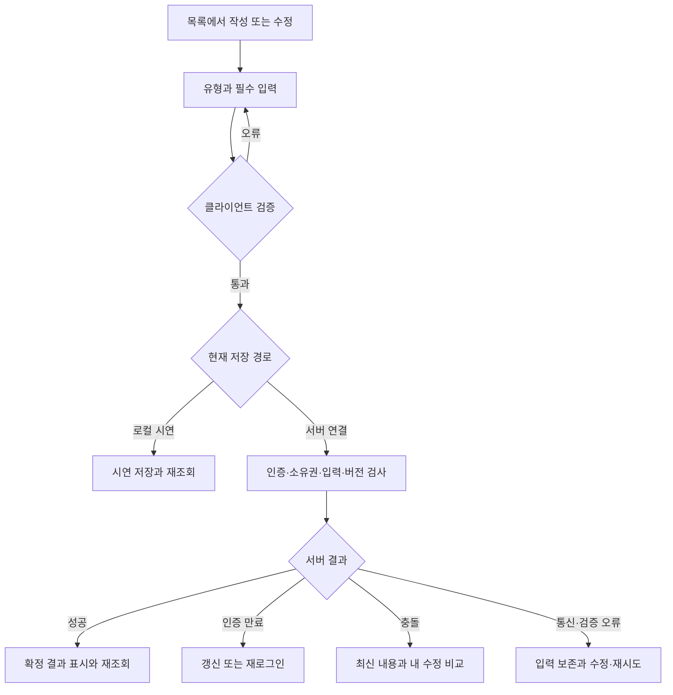

# 화면 명세·와이어프레임·사용자 흐름

작성일 2026-10-31. 수정일 2026-10-31. 현재 화면군의 명세와 개발·검수할 상태를 정의합니다. AI 성장 화면은 향후 제안입니다. 픽셀 단위 최종 디자인이나 모든 화면의 서버 연결 완료를 뜻하지 않습니다.

## 목차

- [화면 기준과 목록](#화면-기준과-목록)
- [공통 레이아웃과 상태](#공통-레이아웃과-상태)
- [화면별 명세](#화면별-명세)
- [와이어프레임](#와이어프레임)
- [작성·저장 흐름](#작성저장-흐름)
- [AI 성장 흐름](#ai-성장-흐름)
- [검수 기준](#검수-기준)

## 화면 기준과 목록

실제 URL·컴포넌트는 [소스에서 생성한 전체 화면 목록](screen-catalog.md)을 기준으로 합니다. 기획 카탈로그·뷰 파일 수·실제 라우트 수·서버 연결 수는 서로 다릅니다. 필드의 정확한 길이·enum·조건은 [API 명세](../api/README.md), 기능 정책은 [기능 명세](../handbook/source/05-기능-명세서.md)를 따릅니다.

현재 DESIGN.md 후반에 다른 프로젝트의 색·폰트 규칙이 들어 있어 앞부분 Timebar 계약과 충돌합니다. 이 문서는 색상 없는 구조를 명세하며 시각 스타일 변경 전 기준 확정이 필요합니다. [IMP-002](../releases/backlog.md#imp-002)에서 추적하고 DESIGN.md를 임의 수정하지 않습니다.

## 공통 레이아웃과 상태

데스크톱은 내비게이션·제목·검색/필터·본문·보조 상세로 구성합니다. 모바일은 내비게이션을 접고 핵심 내용과 작성 행동을 먼저 보여줍니다. 320px·200% 확대·키보드·명확한 포커스·제목 순서·동작 축소를 확인합니다.

작성은 제목·기록 종류·해당 유형 필수값·본문과 저장/취소를 분리합니다. 모달 본문만 스크롤하고 저장/취소를 찾을 수 있게 하며 닫기 때 미저장 입력을 보호합니다. 클릭 가능한 영역과 정적 표면을 구분합니다.

| 상태 | 표시·사용자 행동 | 구현 시 주의 |
| --- | --- | --- |
| 최초·빈 목록 | 아직 자료가 없다는 설명과 만들기 | 오류·자료 없음 구분 |
| 로딩·저장 중 | 처리 상태와 중복 클릭 방지 | 실제 실패를 성공 토스트로 대체 금지 |
| 입력 오류 | 해당 필드·이유·수정 방법 | 입력 보존·포커스 이동 |
| 인증·권한 | 로그인·접근 불가·다시 확인 | 타인 자료 상세 노출 금지 |
| 충돌 | 최신 내용과 내 수정 비교·재조회 | 무조건 덮어쓰기 금지 |
| 네트워크 오류 | 재시도·입력 보존 | 멱등한 요청만 자동 재실행 |
| 미연결 | 실제 제공자 준비 상태 | 시연 결과를 실제 AI·결제 성공으로 표시 금지 |
| 저장 완료 | 저장한 항목·버전·이동 경로 | 서버 재조회와 로컬 시연 결과 구분 |

## 화면별 명세

| ID·화면군 | 목적·주요 영역 | 입력·행동 | 출력·권한·오류·다음 이동 |
| --- | --- | --- | --- |
| SC-01 인증 | 가입·로그인·약관·세션 | 이메일·비밀번호, 가입 닉네임·동의 | 서버 검증·중복·만료 표시 → 홈. 소셜·재설정은 제공자 상태 확인 |
| SC-02 홈·캘린더 | 오늘·날짜·요약·빠른 작성 | 날짜 이동·유형 필터·항목 선택 | 계획·실제 기록·D-Day → 상세/플래너. 로컬 데이터 범위 명시 |
| SC-03 플래너·집중 | 일/주/월/년, 계획과 실제 축 | 보기·시간·종류·분류·할 일, 집중 시작/종료 | 시간·날짜 검증 → 기록·통계. /planner는 설정한 보기로 이동 |
| SC-04 일정·할 일·루틴 | 목록·필터·상세·반복·담당자 | 유형별 필수값, 체크리스트·반복 범위 | 소유권·한도·409·중복 → 목록 재조회 |
| SC-05 다이어리·메모·머니 | 개인 목록·본문·태그·날짜 | 제목·본문·날짜, 금액/유형 조건 | 비공개·유효값·버전 → 상세/검색. 저장 위치 확인 |
| SC-06 통계·검색·보관함 | 기간·분류·검색·출처 | 기간·검색어·태그·멘션 읽음 | 분모·출처·접근 가능한 결과 → 원문. 기록량을 능력 점수로 해석 금지 |
| SC-07 업무·WBS·위키 | 업무 유형·계층·공수·문서 이력 | 업무 필수값·부모·MD·진척·본문 | 부모 권한·순환·가중 계산·버전 → 작업/문서 |
| SC-08 경력·포트폴리오 | 경험·이력서·결과물·선택 공유 | 역할·기간·기술·실제 성과·공유 itemIds | 기본 비공개·명시 링크·만료 → 확정 문서. 현재 시연 상태 보완 필요 |
| SC-09 공유·커뮤니티 | 친구·차단·그룹·회원·게시판 | 요청/승인·초대·글·인증 | ACTIVE·owner·차단·기간 → 그룹/게시판. 전체 개인 자료 공개 금지 |
| SC-10 채팅 | 방 목록·메시지·검색·참여자 | 전송·읽음·멘션·태그·방 선택 | 서버/시연 구분·재전송·SSE 복귀 → 원문/방 |
| SC-11 설정·관리 | section·프로필·세션·운영 목록 | 설정·관리 조치·버전 | 비밀값 거부·ADMIN·정지 검사. 결제·AI·2FA 토글은 실제 실행과 구분 |
| SC-12 성장 가이드 | 목표·근거·변화·수정안·실행 | 목표·선택 자료·동의·승인 | 향후 제안. 출처·한도·취소·자료 부족 → 문서/계획 |

## 와이어프레임

### 인증과 홈

```text
인증 화면                           홈
┌────────────────────────┐        ┌────────┬──────────────────────────┐
│ 서비스 설명 · 로그인/가입 │        │ 메뉴   │ 오늘 날짜 · 빠른 작성       │
│ 이메일                  │        │        │ 계획 | 실제 기록            │
│ 비밀번호                │        │        │ 오늘 할 일 · 루틴           │
│ 가입 시 닉네임·약관 동의  │        │        │ 일정·기록 상세로 이동        │
│ 필드 오류 안내            │        │        │ 다음 검토·목표 제안은 후속   │
│ 로그인 또는 가입          │        └────────┴──────────────────────────┘
└────────────────────────┘
```

### 플래너와 작성 모달

```text
┌────────┬──────────────────────────────────────────┐
│ 메뉴   │ 날짜 이동 · 일간/주간/월간/연간 · 작성      │
│        │ 유형 · 상태 · 분류 · 검색                  │
│        ├─────────┬────────────┬───────────────────┤
│        │ 시간축  │ 계획        │ 실제 기록          │
│        │         │ 일정·할 일  │ 수행·결과           │
└────────┴─────────┴────────────┴───────────────────┘
          ┌──────────────────────────────────────┐
          │ 기록 종류 · 제목 · 해당 유형 필수값   │
          │ 날짜/시간/반복/상태 · 본문             │
          │ 입력 오류 또는 충돌 안내               │
          ├──────────────────────────────────────┤
          │ 취소                         저장     │
          └──────────────────────────────────────┘
```

### 업무·경력과 문서

```text
┌────────┬──────────────────┬─────────────────────────┐
│ 메뉴   │ 경험/위키/WBS 목록 │ 선택한 문서·역할·본문    │
│        │ 검색·분류·새 항목  │ 근거·이력·저장 상태      │
│        │ 계층 또는 프로젝트 │ 선택 항목만 공유          │
└────────┴──────────────────┴─────────────────────────┘
AI 수정안은 후속 기능으로 원문 | 수정안 | 근거를 비교한 뒤 적용합니다.
```

### 채팅과 설정·관리

```text
채팅                                  설정·관리
┌───────────┬─────────────────────┐   ┌────────┬────────────────────────┐
│ 방·검색   │ 방 이름·연결 상태    │   │ 구역   │ 사용자/정책/설정 목록    │
│ 미읽음    │ 메시지·읽음·멘션    │   │ 선택   │ 선택 대상·권한·수정     │
│ 참여자    │ 이전 기록 불러오기   │   │        │ 실제 상태·변경 이력     │
│           │ 입력 · 전송         │   │        │ 확인 후 저장/취소       │
└───────────┴─────────────────────┘   └────────┴────────────────────────┘
```

### 모바일과 향후 성장 가이드

```text
┌──────────────────────────┐     ┌──────────────────────────┐
│ 메뉴 · 제목 · 핵심 행동    │     │ 목표와 분석 범위          │
│ 날짜/필터 접기             │     │ 변화 최대 3개 · 출처      │
│ 읽을 내용 또는 시간축       │     │ 내 근거·확인할 내용       │
│ 상세는 한 번에 한 영역     │     │ 수정안·실행 제안           │
│ 입력 오류와 저장 상태      │     │ 수정/보류/승인             │
│ 저장/취소가 보이는 위치    │     │ 승인한 계획과 실제 결과    │
└──────────────────────────┘     └──────────────────────────┘
```

## 작성·저장 흐름



이 흐름은 구현·검수 기준입니다. 현재 모든 화면이 이미 오류 상태를 완성했다는 뜻이 아닙니다. 소유권·로그인 경로 보호는 실제 API 검사와 화면 이동을 함께 검증합니다.

## AI 성장 흐름


자료 부족·실패·한도·철회·자동 재분석 정책과 상세 사례는 [AI 제품 설계](ai-growth-2026-10-31/02-제품과-유료화-설계.md)에 둡니다.

## 검수 기준

화면군마다 빈 상태·로딩·입력 오류·인증·권한·충돌·연결 끊김·저장 완료를 확인합니다. 키보드로 주요 흐름을 끝내고 모바일 가로 넘침·모달·가상 키보드·파일 선택을 검수합니다. 실제 계정 분리는 서로 다른 브라우저 프로필을 사용하고 같은 출처의 미리보기 두 프레임을 계정 분리로 오인하지 않습니다.

요구사항은 REQ-F01~REQ-F23과 REQ-N04·REQ-N05, 실행 케이스는 [TC-01~TC-44](../quality/test-plan.md)에 연결합니다. 화면 변경은 라우터·입력 계약·테스트·작업 원장·목표 릴리스를 함께 갱신합니다.

